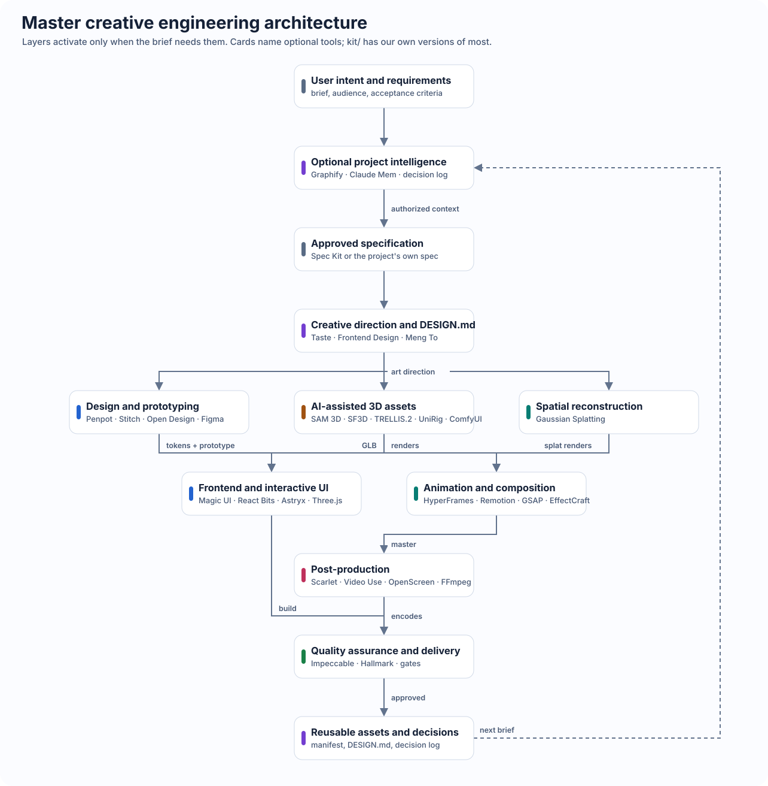
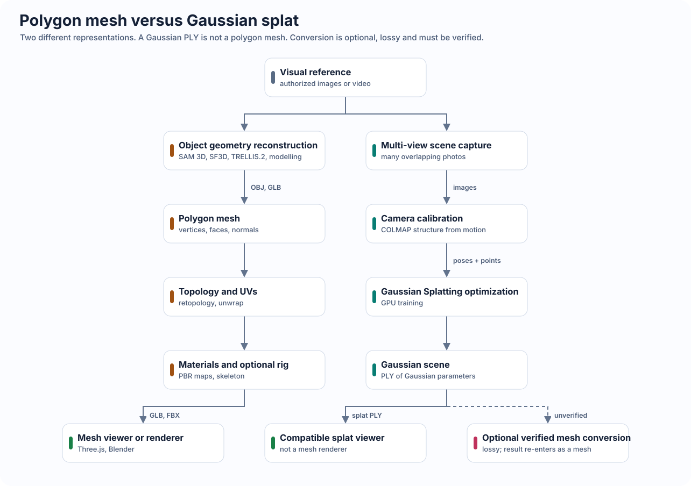
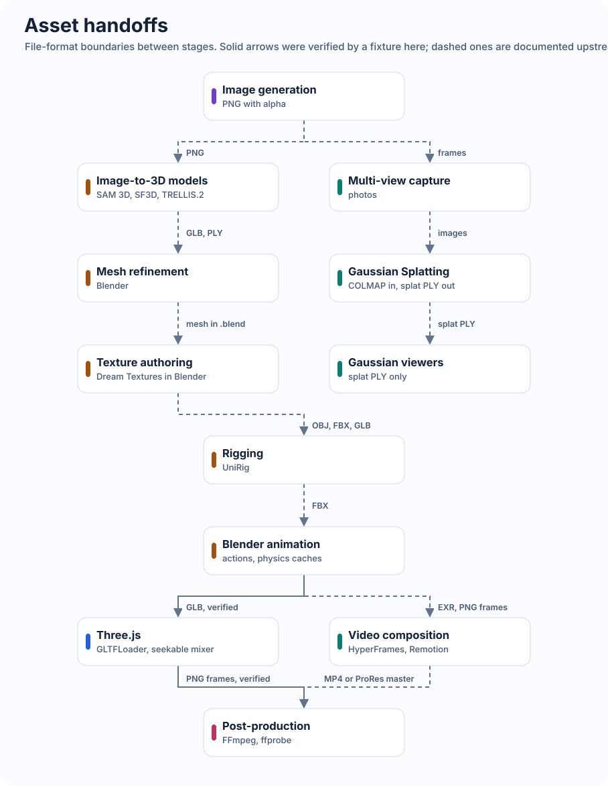
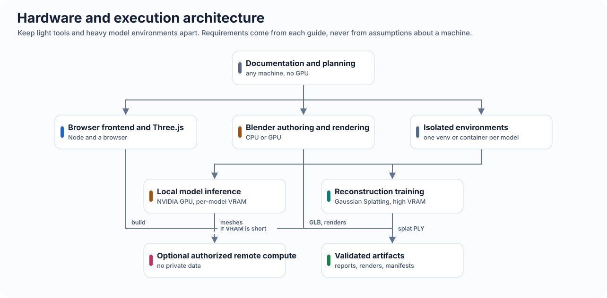

# Creative engineering architecture

The brief, an approved specification, creative direction, quality review and delivery constrain every workflow. Design, frontend, 3D, spatial capture, motion, cinematic, game and post-production layers switch on only when a deliverable needs them. A strategy layer governs long or delegated work. Versioned artifacts connect them, and approved decisions flow back for the next brief.

[Architecture source](docs/diagrams/creative-architecture.mmd)

## Authority

- **One design authority.** `DESIGN.md` owns typography, color, spacing, composition, illustration, materials, lighting and motion. Generated prototypes, components, textures and timelines are proposals until reviewed against it. See [DESIGN.md](DESIGN.md) for an example and the [template](templates/design-system.md).
- **One owner per artifact.** One generator per 3D asset, one rig owner, one timeline, one editor, one memory store, one game runtime, one physics solver per world, one owner per animated property, one server authority per game responsibility. [Tool selection](TOOL_SELECTION.md) lists the alternatives to choose between.
- **The current instruction wins.** Project knowledge and memory inform the agent; they never override the user, project policy or security rules.

## Representations

A polygon mesh, a Gaussian splat, an SVG, a frame sequence and a seekable scene are different things. Handoffs convert between them explicitly, and every conversion is recorded.

## Handoffs

Assign a producer and a consumer to every handoff. Specify the format, path, coordinate system, units, dimensions, color space, alpha, cadence, rights and an acceptance fixture as relevant. Preserve editable sources. Confirm that one producer sample loads in the consumer before committing to batch work. Version every stage separately and never overwrite an earlier stage with a lossy step.

[Handoff source](docs/diagrams/asset-handoffs.mmd) · [Mesh and splat source](docs/diagrams/mesh-vs-gaussian.mmd) · [Export contracts](docs/3d-pipeline/export-contracts.md) · [Asset manifest](templates/asset-manifest.json)

## Execution tiers

[Hardware source](docs/diagrams/hardware-execution.mmd) · [HARDWARE.md](HARDWARE.md)
