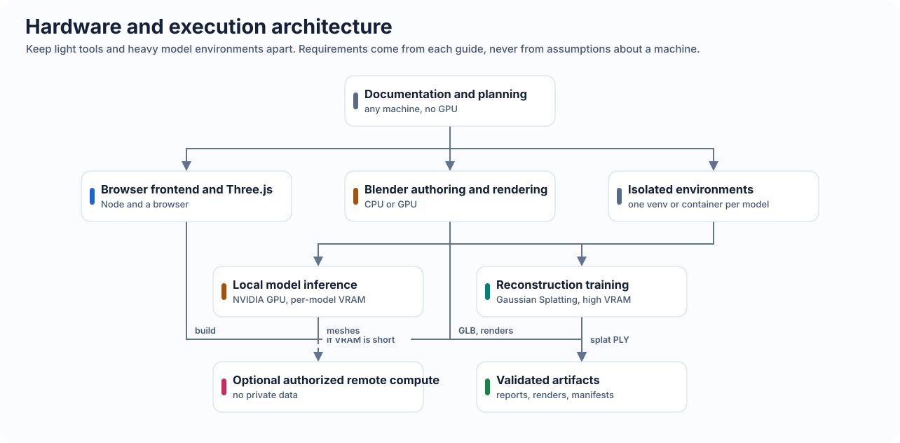

# Hardware and execution

Most of this catalogue runs on any laptop. A few models need a large NVIDIA GPU, and one training job needs more. Plan from the numbers below, which come from each tool's pinned documentation, and never from assumptions about a particular machine.

## Four tiers

| Tier | What runs there | Typical needs |
| --- | --- | --- |
| **Light** | Skills, curated lists, Spec Kit, Graphify, Claude Mem, design tools, Rough.js, Three.js, React Three Fiber, Motion, GSAP, Theatre.js, pixelfx, Phaser, Babylon.js, Matter.js, Rapier (WASM), howler.js, jsfxr, inkjs, Colyseus, Remotion, HyperFrames, FFmpeg | Node 22+ or Python 3.11+, a browser. No GPU. |
| **Desktop editors and engines** | Godot, Bevy builds, Pixelorama, Blockbench, LDtk, inklecate (.NET 6+), Nakama (with CockroachDB or Postgres) | A desktop OS; a GPU helps editors and 3D games. Upstream states no GPU or RAM figures for these, except Nakama's instance sizes. |
| **Blender** | Authoring, validation, Cycles or EEVEE renders, Blender MCP, Blender Skills, Dream Textures | Blender (5.2 for Blender Skills; Dream Textures 3.1+). GPU helps renders and Dream Textures. |
| **Model inference** | Stable Fast 3D, MeshAnything V2, UniRig, TRELLIS.2, SAM 3D Objects, ComfyUI-3D-Pack, Real-ESRGAN | NVIDIA CUDA GPU, from 6 GB to 32 GB VRAM. Mostly Linux. |
| **Reconstruction training** | Gaussian Splatting | 24 GB VRAM for paper-quality training. Viewing needs far less. |

## Model requirements

Figures are what the pinned documentation states. "Not documented" means the tool's docs give no number. None of these models was run for this catalogue, and no weights were downloaded.

| Model | OS | GPU and VRAM | Python / PyTorch / CUDA | Weights | Weights access |
| --- | --- | --- | --- | --- | --- |
| [Stable Fast 3D](docs/repositories/stable-fast-3d.md) | Linux; Windows and macOS (MPS) experimental | About 6 GB per image; CPU fallback documented | Python 3.8+, PyTorch matched to CUDA | About 4.0 GB | Gated, automatic approval |
| [MeshAnything V2](docs/repositories/meshanything-v2.md) | Linux (tested Ubuntu 22) | About 8 GB, 45 s per mesh on an A6000 | Python 3.10, torch 2.1.1, CUDA 11.8, flash-attn | About 4.0 GB | Public |
| [UniRig](docs/repositories/unirig.md) | Not stated (bash launch scripts) | At least 8 GB for inference; skin training at least 60 GB | Python 3.11, PyTorch 2.3.1+, spconv, bpy 4.2 | Skeleton 1.4 GB + skin 4.4 GB | Public |
| [TRELLIS.2](docs/repositories/trellis-2.md) | Linux | At least 24 GB; tested on A100 and H100 | Python 3.10 (setup.sh), torch 2.6.0, CUDA 12.4, flash-attn 2.7.3 | About 16.2 GB, plus DINOv3 and RMBG-2.0 | Public model; dependencies gated |
| [SAM 3D Objects](docs/repositories/sam-3d-objects.md) | Linux | At least 32 GB | Python 3.11.0, PyTorch 2.5.1, CUDA 12.1, pytorch3d, Kaolin | About 13.2 GB | Gated, manual approval |
| [Gaussian Splatting](docs/repositories/gaussian-splatting.md) | Windows, Linux | Training 24 GB for paper quality; compute capability 7.0+; viewer OpenGL 4.5, 4 GB | Python 3.7, PyTorch 1.12.1, CUDA 11.6 in environment.yml (README recommends CUDA 11.8) | No network weights; optional 14 GB pre-trained scenes | Public |
| [ComfyUI-3D-Pack](docs/repositories/comfyui-3d-pack.md) | Windows, Linux | Per model; not documented as a whole (Era3D 16 GB) | README: Python 3.12, CUDA 12.4, torch 2.5.1. build_config.yaml: torch 2.7.0, CUDA 12.8 | Per model | Per model |
| [Dream Textures](docs/repositories/dream-textures.md) | Windows, macOS, Linux | Over 4 GB recommended; CUDA or Apple Silicon tested | Bundled: torch 2.3.1, diffusers 0.27.2 | Stable Diffusion models downloaded by the user | Per model |
| [Real-ESRGAN](docs/repositories/real-esrgan.md) | Python or Vulkan binaries | Not documented; NVIDIA GPU recommended | Python 3.7+ | Release assets | Public |

## What follows from the numbers

- **One 24 GB card does not run everything.** SAM 3D Objects needs 32 GB, so 24 GB cards are ruled out. TRELLIS.2 and Gaussian Splatting training fit at 24 GB with no headroom.
- **Stable Fast 3D is the only image-to-3D model here with a documented CPU fallback** and a modest VRAM need. Start there unless the brief needs scene-aware layout (SAM 3D Objects) or higher detail (TRELLIS.2).
- **The CUDA versions disagree**: 11.6 or 11.8, 12.1, 12.4 and 12.8 across these tools, with PyTorch from 1.12.1 to 2.7.0. No single environment serves them all.
- **ComfyUI-3D-Pack can replace PyTorch.** Its installer pins torch 2.7.0 and force-reinstalls prebuilt wheels. Give it its own ComfyUI install.
- **Training and viewing are different jobs.** A Gaussian scene that needed 24 GB to train can be viewed on a 4 GB GPU, or in a web splat viewer.

## Environments

1. **One environment per model.** Use conda or mamba where upstream does (SAM 3D Objects, Gaussian Splatting, MeshAnything V2) and a venv or container otherwise. Never install a model into Blender's bundled Python or the system Python.
2. **Never replace a working driver** to satisfy one tool. Pick the tool's CUDA build that matches the installed driver, or use a container.
3. **Pin what upstream pins.** Record Python, PyTorch, CUDA and checkpoint hashes in the [toolchain plan](templates/toolchain-plan.md).
4. **Review installers before running them.** See [installation](INSTALLATION.md) and [security](SECURITY.md).
5. **Download weights only for a real job.** Documentation never needs multi-gigabyte checkpoints.

## Remote compute

Rented GPUs are an option when local VRAM is short. Send only data the brief allows to leave the machine: no private photographs, faces, scans, locations or client assets without written authorization. Keep tokens in the provider's secret store, and delete volumes when the job ends.

## What this catalogue ran

Light and Blender tiers only: Chrome 158 headless with SwiftShader WebGL, Node 24, FFmpeg 7.1, Python 3.14, Blender 5.2.2, uv. The game-development and expressive-motion fixtures run on software WebGL in under a minute each. No desktop editor or engine in the new tier was run. See [smoke tests](docs/examples/smoke-tests.md). Every model-inference and training row above is documented, not tested.
