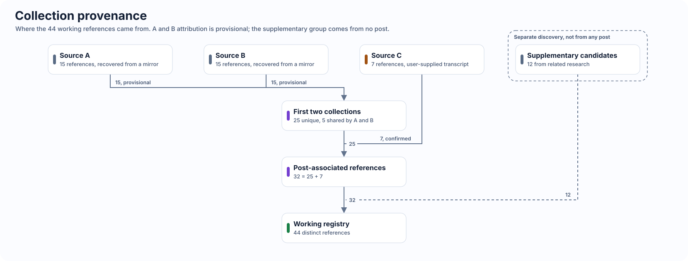

# Sources and provenance

Where all 75 references came from, how sure that attribution is, and how each URL was checked. Attribution and verification are tracked separately: a repository can be fully verified while its source attribution stays provisional.

## Counts

| Group | References | Attribution status |
| --- | --- | --- |
| Source A only | 10 | Provisional |
| Source B only | 10 | Provisional |
| Shared by A and B | 5 | Provisional |
| **First two collections** | **25** | 15 + 15 − 5 shared |
| Source C: 3D post | 7 | Confirmed from the user-supplied transcript |
| Source D: cinematic post | 9 new (18 listed) | User-supplied transcript; repeats not identified |
| Source E: game-development post | 16 | User-supplied transcript |
| Source F: expressive-animation post | 6 new (12 listed) | User-supplied transcript; 6 repeats recorded as associations |
| **Post-associated** | **63** | |
| Supplementary candidates | 12 | Not attributable to any post |
| **Working registry** | **75** | Numbered 01–75 as in the V7 manual |

The validator recomputes these counts from [the registry](registry/repositories.json) and fails if they change without this page.

## The posts

| Source | Post | How the list was obtained |
| --- | --- | --- |
| A | https://x.com/0xnicc0/status/2125567907522379841 | Recovered from a likely matching mirrored post. 15 references. |
| B | https://x.com/flxrnc/status/2125681086722097551 | Recovered from a likely matching mirrored post. 15 references. |
| C | https://x.com/thegreatest_sv/status/2125614738943934706 | A transcript supplied by the user, naming exactly seven repositories. |
| D | Not supplied | A transcript of a cinematic-production post supplied by the user: 18 names, 9 new. |
| E | Not supplied | A transcript of a game-development post supplied by the user: 16 names, all new. |
| F | Not supplied | A transcript of an expressive-animation post supplied by the user: 12 names, 6 new. |

The posts themselves were not readable from this environment. The A/B split below follows the order of the seed list in the `simlish` README and catalogue v1, where the first 15 entries form one set. Treat which set belongs to which post as provisional until someone checks the posts.

## Source A (15, provisional)

| Reference | Original URL | Verification |
| --- | --- | --- |
| [Taste Skill](docs/repositories/taste-skill.md) | https://github.com/Leonxlnx/taste-skill | verified |
| [Impeccable](docs/repositories/impeccable.md) | https://github.com/pbakaus/impeccable | verified |
| [Hallmark](docs/repositories/hallmark.md) | https://github.com/Nutlope/hallmark | verified |
| [Anthropic Frontend Design](docs/repositories/anthropic-frontend.md) | https://github.com/anthropics/skills/tree/main/skills/frontend-design | verified |
| [UI/UX Pro Max](docs/repositories/ui-ux-pro-max.md) | https://github.com/nextlevelbuilder/ui-ux-pro-max-skill | verified |
| [Stitch Skills](docs/repositories/stitch-skills.md) | https://github.com/google-labs-code/stitch-skills | verified |
| [Open Design](docs/repositories/open-design.md) | https://github.com/nexu-io/open-design | verified |
| [Penpot](docs/repositories/penpot.md) | https://github.com/penpot/penpot | verified |
| [Figma Context MCP](docs/repositories/figma-context.md) | https://github.com/GLips/Figma-Context-MCP | verified |
| [Astryx](docs/repositories/astryx.md) | https://github.com/meta/astryx | verified |
| [Magic MCP](docs/repositories/magic-mcp.md) | https://github.com/21st-dev/magic-mcp | verified |
| [Magic UI](docs/repositories/magic-ui.md) | https://github.com/magicuidesign/magicui | verified |
| [Three.js](docs/repositories/three-js.md) | https://github.com/mrdoob/three.js | verified |
| [Blender MCP](docs/repositories/blender-mcp.md) | https://github.com/ahujasid/mcp-for-blender | verified |
| [HyperFrames](docs/repositories/hyperframes.md) | https://github.com/heygen-com/hyperframes | verified |

## Source B (15, provisional)

| Reference | Original URL | Verification |
| --- | --- | --- |
| [Impeccable](docs/repositories/impeccable.md) | https://github.com/pbakaus/impeccable | verified |
| [Hallmark](docs/repositories/hallmark.md) | https://github.com/Nutlope/hallmark | verified |
| [Meng To Skills](docs/repositories/mengto-skills.md) | https://github.com/MengTo/Skills | verified |
| [Rough.js](docs/repositories/rough-js.md) | https://github.com/rough-stuff/rough | verified |
| [Sakuga VFX](docs/repositories/sakuga-vfx.md) | https://github.com/finktheartist/sakuga-vfx | verified |
| [Line Art Animation](docs/repositories/line-art-animation.md) | https://github.com/JDhruv14/line-art-animation | verified |
| [Motion Canvas](docs/repositories/motion-canvas.md) | https://github.com/motion-canvas/motion-canvas | verified |
| [Three.js](docs/repositories/three-js.md) | https://github.com/mrdoob/three.js | verified |
| [Blender MCP](docs/repositories/blender-mcp.md) | https://github.com/ahujasid/mcp-for-blender | verified |
| [HyperFrames](docs/repositories/hyperframes.md) | https://github.com/heygen-com/hyperframes | verified |
| [Remotion](docs/repositories/remotion.md) | https://github.com/remotion-dev/remotion | verified |
| [Scarlet](docs/repositories/scarlet.md) | https://github.com/Forward-Future/scarlet | verified |
| [Video Use](docs/repositories/video-use.md) | https://github.com/browser-use/video-use | verified |
| [Real-ESRGAN](docs/repositories/real-esrgan.md) | https://github.com/xinntao/Real-ESRGAN | verified |
| [FFmpeg](docs/repositories/ffmpeg.md) | https://github.com/FFmpeg/FFmpeg | verified |

## Source C (7, confirmed)

None of these duplicates a URL from sources A or B.

| Reference | Original URL | Verification |
| --- | --- | --- |
| [SAM 3D Objects](docs/repositories/sam-3d-objects.md) | https://github.com/facebookresearch/sam-3d-objects | verified |
| [Stable Fast 3D (SF3D)](docs/repositories/stable-fast-3d.md) | https://github.com/Stability-AI/stable-fast-3d | verified |
| [MeshAnything V2](docs/repositories/meshanything-v2.md) | https://github.com/buaacyw/MeshAnythingV2 | verified |
| [UniRig](docs/repositories/unirig.md) | https://github.com/VAST-AI-Research/UniRig | verified |
| [Dream Textures](docs/repositories/dream-textures.md) | https://github.com/carson-katri/dream-textures | verified |
| [ComfyUI-3D-Pack (Comfy3D)](docs/repositories/comfyui-3d-pack.md) | https://github.com/MrForExample/ComfyUI-3D-Pack | verified |
| [Gaussian Splatting](docs/repositories/gaussian-splatting.md) | https://github.com/graphdeco-inria/gaussian-splatting | verified |

## Source D: cinematic post (9 new of 18 listed)

A transcript supplied by the user on 2026-11-26 listed 18 tools; nine were new to the catalogue. The V7 manual identifies the post only as the fourth collection, without a URL, and does not say which nine entries were repeats, so no repeat association is recorded for D. These nine were first catalogued as "added by the user"; V7 reattributes them to this post.

| # | Reference | Original URL | Verification |
| --- | --- | --- | --- |
| 33 | [Huashu Motion](docs/repositories/huashu-motion.md) | https://github.com/alchaincyf/huashu-motion | verified |
| 34 | [anything2explainer](docs/repositories/anything2explainer.md) | https://github.com/Vincentwei1021/anything2explainer | verified |
| 35 | [OpenScreen](docs/repositories/openscreen.md) | https://github.com/getopenscreen/openscreen | verified |
| 36 | [OneTake](docs/repositories/onetake.md) | https://github.com/feitangyuan/onetake | verified |
| 37 | [Lemo Opuscar](docs/repositories/lemo-opuscar.md) | https://github.com/lemomo-ai/lemo-opuscar | verified |
| 38 | [EffectCraft](docs/repositories/effectcraft.md) | https://github.com/storytold/effectcraft | verified |
| 39 | [GSAP](docs/repositories/gsap.md) | https://github.com/greensock/GSAP | verified |
| 40 | [ComfyUI](docs/repositories/comfyui.md) | https://github.com/Comfy-Org/ComfyUI | verified |
| 41 | [Remotion skills](docs/repositories/remotion-skills.md) | https://github.com/remotion-dev/skills | verified |

## Source E: game-development post (16)

A transcript supplied by the user on 2026-11-27, without a post URL. All 16 are new; none duplicates an earlier URL. Every repository was resolved through the GitHub API and pinned on 2026-11-27.

| # | Reference | Original URL | Verification |
| --- | --- | --- | --- |
| 42 | [Godot Engine](docs/repositories/godot.md) | https://github.com/godotengine/godot | verified |
| 43 | [Godot MCP](docs/repositories/godot-mcp.md) | https://github.com/Coding-Solo/godot-mcp | verified |
| 44 | [Phaser](docs/repositories/phaser.md) | https://github.com/phaserjs/phaser | verified |
| 45 | [Bevy](docs/repositories/bevy.md) | https://github.com/bevyengine/bevy | verified |
| 46 | [Babylon.js](docs/repositories/babylonjs.md) | https://github.com/BabylonJS/Babylon.js | verified |
| 47 | [Rapier](docs/repositories/rapier.md) | https://github.com/dimforge/rapier | verified |
| 48 | [Jolt Physics](docs/repositories/jolt-physics.md) | https://github.com/jrouwe/JoltPhysics | verified |
| 49 | [Matter.js](docs/repositories/matter-js.md) | https://github.com/liabru/matter-js | verified |
| 50 | [Pixelorama](docs/repositories/pixelorama.md) | https://github.com/Orama-Interactive/Pixelorama | verified |
| 51 | [Blockbench](docs/repositories/blockbench.md) | https://github.com/JannisX11/blockbench | verified |
| 52 | [LDtk (Level Designer Toolkit)](docs/repositories/ldtk.md) | https://github.com/deepnight/ldtk | verified |
| 53 | [howler.js](docs/repositories/howler.md) | https://github.com/goldfire/howler.js | verified |
| 54 | [jsfxr](docs/repositories/jsfxr.md) | https://github.com/chr15m/jsfxr | verified |
| 55 | [ink (inkle)](docs/repositories/ink.md) | https://github.com/inkle/ink | verified |
| 56 | [Colyseus](docs/repositories/colyseus.md) | https://github.com/colyseus/colyseus | verified |
| 57 | [Nakama](docs/repositories/nakama.md) | https://github.com/heroiclabs/nakama | verified |

## Source F: expressive-animation post (6 new of 12 listed)

A transcript supplied by the user on 2026-11-27, without a post URL. It lists 12 tools. Six are new:

| # | Reference | Original URL | Verification |
| --- | --- | --- | --- |
| 70 | [pixelfx](docs/repositories/pixelfx.md) | https://github.com/patch-gg/pixelfx | verified |
| 71 | [motionmaxxing](docs/repositories/motionmaxxing.md) | https://github.com/Tejashmakwana/motionmaxxing | verified |
| 72 | [reanimate](docs/repositories/reanimate.md) | https://github.com/NiazMorshed2007/reanimate | verified |
| 73 | [Motion (formerly Framer Motion)](docs/repositories/motion.md) | https://github.com/motiondivision/motion | verified |
| 74 | [Theatre.js](docs/repositories/theatre.md) | https://github.com/theatre-js/theatre | verified |
| 75 | [React Three Fiber (@react-three/fiber)](docs/repositories/react-three-fiber.md) | https://github.com/pmndrs/react-three-fiber | verified |

The other six repeat existing references, which keep their original source group and gain F in `source_associations`: [Hallmark](docs/repositories/hallmark.md), [Blender MCP](docs/repositories/blender-mcp.md), [Line Art Animation](docs/repositories/line-art-animation.md), [Sakuga VFX](docs/repositories/sakuga-vfx.md), [Rough.js](docs/repositories/rough-js.md), [GSAP](docs/repositories/gsap.md).

## Strategy article (source pending, no references)

https://x.com/0xcodio/status/2109275834984915150 prompted the [strategy layer](docs/strategy/README.md). Its body could not be retrieved, directly or through mirrors, so its identity and contents are unconfirmed. Nothing in the catalogue is attributed to it, and it adds no repository. Social-media summaries found during that research are not treated as evidence. The strategy practices are this catalogue's own proposal, tested only through [kit/workledger](kit/workledger/README.md).

## Supplementary candidates (12, not from any post)

Identified during related research. Kept as a separate collection: they are evaluated on their merits and never presented as part of the posts.

| Reference | Original URL | Verification |
| --- | --- | --- |
| [Graphify](docs/repositories/graphify.md) | https://github.com/Graphify-Labs/graphify | verified |
| [Spec Kit](docs/repositories/spec-kit.md) | https://github.com/github/spec-kit | verified |
| [Claude Mem](docs/repositories/claude-mem.md) | https://github.com/thedotmack/claude-mem | verified |
| [Awesome DESIGN.md](docs/repositories/awesome-design-md.md) | https://github.com/VoltAgent/awesome-design-md | verified |
| [Designlang (design-extract)](docs/repositories/designlang.md) | https://github.com/Manavarya09/designlang | redirected |
| [Anatomy](docs/repositories/anatomy.md) | https://github.com/wheresryan22/anatomy | verified |
| [Video Shotcraft](docs/repositories/video-shotcraft.md) | https://github.com/Vincentwei1021/video-shotcraft | verified |
| [Dream Loop](docs/repositories/dream-loop.md) | https://github.com/achimala/dream-loop | verified |
| [Blender Skills](docs/repositories/blender-skills.md) | https://github.com/EL4CTEO/blender-skills | verified |
| [TRELLIS.2](docs/repositories/trellis-2.md) | https://github.com/microsoft/TRELLIS.2 | verified |
| [React Bits](docs/repositories/react-bits.md) | https://github.com/DavidHDev/react-bits | verified |
| [Awesome Claude Skills](docs/repositories/awesome-claude-skills.md) | https://github.com/ComposioHQ/awesome-claude-skills | verified |

## Verification method

On 2026-11-26 for the first 53 references, and on 2026-11-27 for the 22 from sources E and F:

1. Resolved the original URL through the GitHub API, recording the canonical owner and repository and the default branch.
2. Recorded the head commit of the default branch as the inspected commit. Every documentation link in a guide is pinned to that commit, except a source read at a named release tag (Godot's 4.4-stable changelog), which the validator allows explicitly.
3. Read the README, license and the manifests, requirements or setup files needed for runtime and hardware facts, at that commit. Hugging Face API metadata was used for model sizes, gating and model licenses.
4. Recorded archive state and last push as maintenance signals.
5. Ran a smoke test where it needed no gated or multi-gigabyte download. See [smoke tests](docs/examples/smoke-tests.md).

`python scripts/check-repositories.py` repeats steps 1 and 4 and reports drift.

## Corrections

| Original URL | Finding | Recorded as | Evidence |
| --- | --- | --- | --- |
| https://github.com/Manavarya09/designlang | 404 on 2026-11-26. The owner account exists. | https://github.com/Manavarya09/design-extract (status `redirected`) | The npm package `designlang` 13.4.1 lists `git+https://github.com/Manavarya09/design-extract.git` as its repository. No other project was substituted. |
| https://github.com/ahujasid/mcp-for-blender | Resolves. Catalogue v1 noted the Python package is now published as `mcp-for-blender`. | Unchanged | Pinned README |
| https://github.com/21st-dev/magic-mcp | Resolves. Upstream points new setups to the 21st MCP. | Unchanged | Pinned README |

| https://github.com/NiazMorshed2007/reanimate | The V7 draft says its GitHub page could not be fetched and confirms the path from the project site. | Unchanged, `verified` | The GitHub API resolves it; the pinned commit has `skills/reanimate/SKILL.md` and an MIT license. |
| Godot's Jolt claims in the V7 draft | 4.4 introduced Jolt; 4.6 makes it the default. | Confirmed, with a nuance | 4.4-stable CHANGELOG adds Jolt; the pinned ProjectSettings.xml says new projects from 4.6 use Jolt, but the setting's DEFAULT still maps to GodotPhysics3D for older projects or ones made outside the editor. The pinned commit is 4.8 rc. |

All other URLs resolved to themselves. 74 references are `verified` and 1 is `redirected`; none is unavailable. Where the [V7 draft](AI_CREATIVE_STACK_V7_DRAFT.md) and the registry differ, the registry is correct.
