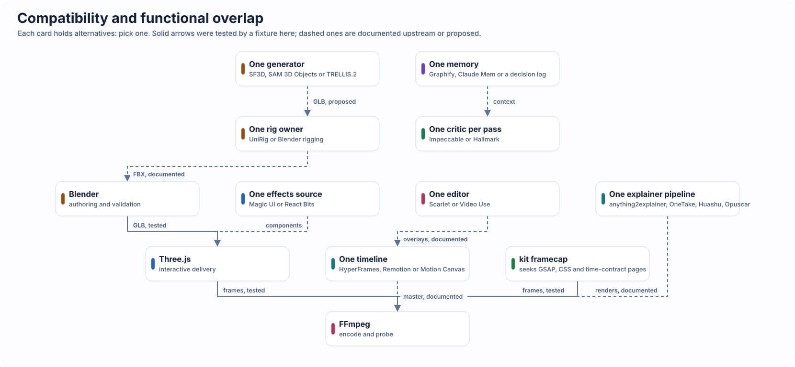
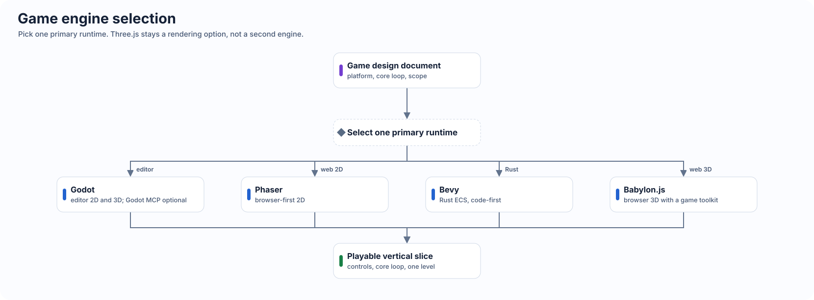
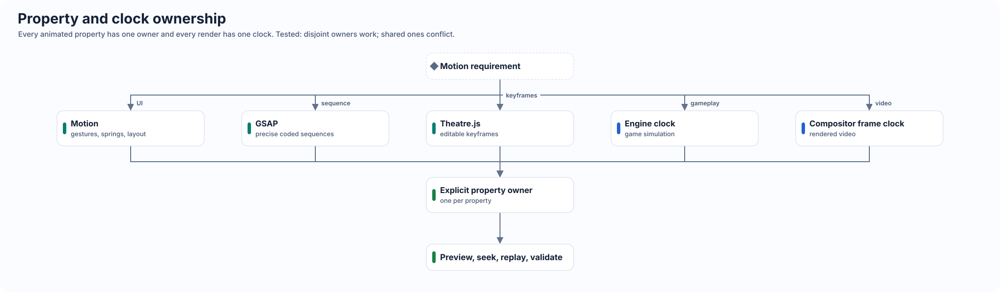

# Tool selection

Start with the host project. Choose a new capability only when it closes a documented gap in the brief or the acceptance checks. The strongest outcome is the smallest coherent toolchain, not the largest. Use the [repository guides](REPOSITORIES.md) for pinned evidence, and [registry/compatibility.json](registry/compatibility.json) for the machine-readable version of the comparisons below.

## Classifications

| Classification | Meaning |
| --- | --- |
| Complementary | Different jobs that combine well. |
| Recommended alternative | Pick one; the brief decides which. |
| Optional | Adds value only for specific briefs. |
| Redundant | Same job; both together add cost without benefit. |
| Potentially conflicting | Both try to own the same asset, timeline, hook or rule set. |
| Unverified | No evidence either way yet. |

Every tool also has a role. **Guidance** shapes decisions (skills, lists). **Execution** produces artifacts (libraries, models, apps). **Orchestration** runs other tools in order (ComfyUI, compositors). **Storage** keeps project knowledge (memory, graphs, logs). Two tools in different roles rarely conflict; two in the same role on the same artifact usually do.

## Direction, design and frontend

| Need | Pick | Classification and reason |
| --- | --- | --- |
| Project already meets the brief | Existing stack | Recommended. Keeps the established components and build path. |
| Establish a visual direction | Taste Skill, Anthropic Frontend Design or UI/UX Pro Max; a single Meng To skill for one effect | Recommended alternatives. Redundant as co-authors. One authority writes `DESIGN.md`. |
| Visual review | Existing direction + Impeccable or Hallmark | Recommended alternatives per pass. Impeccable's detector can still run in CI while Hallmark owns a review. |
| Learn from references | Designlang to extract tokens from your own or permitted sites; Awesome DESIGN.md as examples | Complementary. Both describe real brands. Take principles, never a brand's look, trademarks or proprietary fonts. |
| Prototype | Penpot (self-hostable), Stitch (hosted), Open Design (local-first agent workspace) | Recommended alternatives. One prototype owner. |
| Implement from Figma | Figma Context MCP with authorized Figma API access | Optional. Only when Figma is the authority. |
| Components and effects | Existing components; Magic UI or React Bits for effects; 21st MCP for hosted generation; Astryx for a React 19+ system | Magic UI and React Bits are redundant. React Bits is MIT plus Commons Clause: ship it inside a product, never resell the components. Competing component authorities conflict. |
| Augment a scene | Rough.js sketch paths, Line Art Animation figures, Sakuga VFX controls, Anatomy machine explainers | Optional. Different scopes. Several effects on one control conflict on timing and accessibility. |

## Intelligence and planning

| Need | Pick | Classification and reason |
| --- | --- | --- |
| Remember decisions | A plain decision log in the repository | Recommended default. No hooks, no telemetry, no external calls. |
| Project knowledge graph | Graphify | Optional. Code is parsed locally; documents, PDFs and images go to the configured model provider. Queries are logged locally by default. |
| Session memory | Claude Mem | Optional, with care. Analytics are on by default; raw tool input and output are kept indefinitely by default; its README addresses agents directly. |
| Graphify and Claude Mem together | One of them | Potentially conflicting. Both install hooks that can block file reads. |
| Specification-driven work | Spec Kit | Optional. Tested here: `specify init` with the Claude integration. |
| Discover more skills | Awesome Claude Skills | Discovery only. No license file; review every linked skill on its own. |

## 3D assets and spatial capture

| Need | Pick | Classification and reason |
| --- | --- | --- |
| Image to 3D | Stable Fast 3D (about 6 GB), SAM 3D Objects (32 GB, mask, real photos) or TRELLIS.2 (24 GB, PBR GLB) | Recommended alternatives. Run one per asset. Benchmark only on the same authorized images. See [image to 3D](docs/3d-pipeline/image-to-3d.md). |
| Low-poly artist mesh | MeshAnything V2 | Optional. At most 1,600 faces, untextured, non-commercial code license. |
| Deformation topology | Blender retopology | Recommended over MeshAnything V2 for characters. |
| Rig and skin | UniRig to predict, Blender to correct | Complementary. Rig only assets with skeletal motion. |
| Texture generation | Dream Textures inside Blender | Complementary with Blender's material nodes, which assemble the full PBR set. GPL-3.0. |
| Agent access to Blender | Blender MCP; Blender Skills as guidance on top | Complementary. Blender Skills can run headless or through Blender MCP. |
| Generate-and-judge loop | Dream Loop | Potentially conflicting with a Blender-first pipeline: it routes image-to-3D to fal.ai (paid) and tells agents not to model in Blender. |
| Node-based batch runs | ComfyUI with ComfyUI-3D-Pack, or kit/assetpipe | ComfyUI is the host; the pack adds 3D nodes (SF3D, TRELLIS v1, Hunyuan3D, TripoSG, InstantMesh, 3DGS). Give the pack its own install, because its installer can replace PyTorch. kit/assetpipe runs the kit's own chain with manifests. |
| Real places from photos | Gaussian Splatting | A different representation, not an alternative mesh. Research-only license. |
| Interactive delivery | Three.js with a validated GLB | Recommended. Tested here with a Blender-built skinned GLB. |
| 3D craft recipes | One Meng To 3D skill | Optional. Load the single skill that matches the scene. |
| One scene, live and as film | Three.js to the [time contract](docs/contracts/time-contract.md) | Recommended for explainers and learning. Tested by the [seekable scene fixture](fixtures/seekable-scene/README.md). |

## Game development

| Need | Pick | Classification and reason |
| --- | --- | --- |
| Game runtime | Godot (editor-driven 2D and 3D, native exports), Phaser (browser-first 2D), Bevy (Rust ECS), Babylon.js (browser 3D with a game toolkit) | Recommended alternatives. One runtime per game. Phaser and Babylon.js are tested here; Godot and Bevy are documented only. |
| Browser 3D without a game toolkit | Three.js, or React Three Fiber in a React project | Recommended alternative to Babylon.js. React Three Fiber renders Three.js; it is not a second engine. |
| Agent access to Godot | Godot MCP | Optional. Runs projects with full script execution and reads console output; it cannot see the running scene tree. |
| Physics | The engine's own solver: Godot Physics or Jolt (built in since 4.4, the default for new projects since 4.6), Phaser Arcade or its bundled Matter.js, bevy_rapier, Babylon.js Havok | One solver per world. Rapier, Jolt and Matter.js are alternatives, never co-owners. Matter.js and Rapier repeat bitwise on one machine (tested); none is promised to match across platforms. |
| Sprites and tiles | Pixelorama; pixelfx for effects | Complementary. Pixelorama's JSON is its own project format; pixelfx writes Aseprite-style atlases (tested). |
| Blocky low-poly models | Blockbench; Blender for anything else | Complementary. Export glTF or GLB and validate in the engine. GPL-3.0 editor; exported models are yours. |
| Levels | LDtk | Optional. Its JSON is documented with a schema, but the pinned repo names no Godot or Phaser loader: review a community loader or write an adapter. |
| Sound effects | jsfxr, then engine audio or Howler.js | Complementary. jsfxr WAVs tested; Howler.js documented (audio unlocks on the first user gesture). |
| Branching story | Ink with one runtime (inkjs on the web) | Optional. Compile, branch coverage and save/load tested. No Godot integration in the pinned files. |
| Online play | Colyseus (authoritative rooms in Node.js) or Nakama (accounts, storage, matchmaking, leaderboards, chat) | Recommended alternatives per responsibility. A Colyseus room is tested on loopback; Nakama is documented and sends telemetry by default. |

## Expressive motion

| Need | Pick | Classification and reason |
| --- | --- | --- |
| UI motion in React | Motion | Recommended. Gestures, springs, layout animation; seekable (tested). Reduced motion is opt-in. |
| Coded timelines | GSAP | Recommended. Seekable through framecap (tested). |
| Keyframes edited by a person | Theatre.js | Optional. Core seeks exactly (tested); the public repo has been frozen since August 2024 and the studio is AGPL-3.0. |
| Two libraries on one element | Disjoint properties only | Potentially conflicting. When GSAP and Motion both animate `x`, the last writer wins silently and GSAP's state goes stale (tested). |
| Theatre.js with React Three Fiber | Drive R3F from Theatre's core sequence | Potentially conflicting. `@theatre/r3f` needs R3F 8 (React 18); current R3F is 9 (React 19). |
| A kinetic type piece or motion critique | motionmaxxing | Optional. Builds on GSAP and vendors Three.js; keep whichever compositor already owns the timeline. Voice and music services need approval. |
| Rebuild motion from a reference | reanimate | Optional. Authorized references and original assets only; compare within a tolerance. Needs Bun on macOS or Linux. |
| Pixel-art hits and spells | pixelfx | Recommended alternative to Sakuga VFX, which suits web interaction bursts instead. |

## Motion and video

| Need | Pick | Classification and reason |
| --- | --- | --- |
| Shot planning | Your shot list; Video Shotcraft when the film is made from real web pages | Optional. Video Shotcraft outputs MP4 plus an editable Remotion project. |
| Topic or product in, finished film out | One of anything2explainer (Remotion explainers), OneTake (one-take motion films), Huashu Motion (launch films with locally composed music) or Lemo Opuscar (99 film styles) | Recommended alternatives. Each owns its own timeline. OneTake and Opuscar seek a page by time, like the time contract. |
| Animation engine inside pages | GSAP | Complementary with HyperFrames, and with kit/framecap, which seeks GSAP timelines (tested). |
| Motion graphics and compositing app | EffectCraft | Optional; alpha software. Exports ProRes 4444 with alpha without FFmpeg. |
| Screen-recorded demos | OpenScreen | Optional. Records screen, camera and audio with auto-zoom; agents drive it through a CLI or MCP. |
| Remotion skills for agents | Remotion's skills repository | Complementary with Remotion. |
| Compose | HyperFrames, Remotion or Motion Canvas | Redundant for a single timeline. HyperFrames documents a Remotion port skill. |
| Design workspace + HTML video | Open Design + HyperFrames | Complementary, documented natively upstream. |
| Edit footage | Scarlet or Video Use | Potentially conflicting as co-editors. Both make HTML-based motion graphics: Video Use through HyperFrames or Remotion, Scarlet to transparent ProRes 4444. |
| Upscale | Real-ESRGAN | Optional, after an A/B test at delivery size. Never on text, UI captures or faces that must stay accurate. |
| Deliver | FFmpeg and ffprobe | Recommended. Tested here. Avoid duplicate lossy encodes. |

## Judgment

| Need | Pick | Classification and reason |
| --- | --- | --- |
| Judge pages | Impeccable or Hallmark against `DESIGN.md` | Recommended alternatives per pass. |
| Judge 3D or motion | The [quality gates](QUALITY_GATES.md), `scripts/blender/validate_asset.py`, Blender MCP `look`, a Meng To scorecard | Partial. These judge the picture and the geometry. |
| Judge understanding | The Learning gate with a real learner | No tool in the catalogue does this. |
| Judge a game | A playtest against the vertical-slice criteria, plus the Games gate | No tool in the catalogue does this. |

## Strategy and governance

| Need | Pick | Classification and reason |
| --- | --- | --- |
| A short, direct task | Do it | Recommended. Governance costs more than it saves on small work. |
| Several packages, agents or hours | The [strategy layer](docs/strategy/README.md) with kit/workledger | Optional. Tested against direct execution on the same 7 work packages: half the attempts, a scope deviation caught, a blocked dependent skipped. |
| A consequential choice | `workledger decide` with at least two alternatives | Recommended. Refuses a decision with one option. |

Cloud and credential dependencies: Stitch, 21st MCP, motionmaxxing's optional ElevenLabs voice and music, Nakama's default telemetry and any hosted game server, the Figma API, Video Use transcription (ElevenLabs), Dream Loop (fal.ai), HyperFrames Studio Pro and cloud rendering, and the gated weights of SAM 3D Objects, Stable Fast 3D and TRELLIS.2's dependencies (Hugging Face). Everything else has a documented local path.
