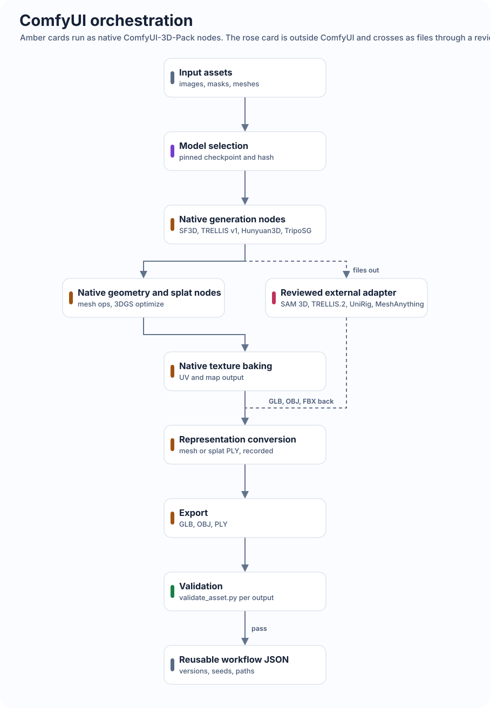

# ComfyUI orchestration for 3D

[ComfyUI-3D-Pack](../repositories/comfyui-3d-pack.md) (Comfy3D) puts many image-to-3D, multi-view and Gaussian Splatting models into one ComfyUI node graph. It is useful when a team already runs ComfyUI and wants repeatable graphs. It is also the riskiest install in the 3D lane. Documented here from the pinned commit `9e8096e`; **not run**.

## What runs natively and what needs an adapter

| Runs as native nodes (documented) | Needs an external adapter |
| --- | --- |
| Stable Fast 3D | SAM 3D Objects |
| TRELLIS v1 (image-large), **not** TRELLIS.2 | TRELLIS.2 |
| Hunyuan3D 2.1, 2.0 and 1.0 | UniRig |
| TripoSG, PartCrafter, InstantMesh, TripoSR, CRM, LGM, TriplaneGaussian, Era3D, Unique3D, Zero123++, Wonder3D, CharacterGen, Stable3DGen, MV-Adapter | MeshAnything V2 |
| 3D Gaussian Splatting, Instant-NGP and FlexiCubes optimisers; 3DGS-to-mesh | Blender stages (retopology, rigging, validation) |
| Orbit camera poses, mesh and 3DGS orbit renderers, nvdiffrast multi-view texture baking, axis switching between models' coordinate systems | |

`registry/compatibility.json` records ComfyUI-3D-Pack as *optional* orchestration (documented): the models on the right run standalone with file handoffs.

**An adapter**, in this catalogue's sense, is a *proposed* boundary: the external model runs in its own environment, reads files the graph wrote to a known folder, and writes files back. Keep it a file handoff. Do not install another model's dependencies into the ComfyUI Python. If you wrap it as a custom node that shells out, review that node like any other code.

## Security review of the installer

`install.py` is the main failure point and the main risk. The registry's review of the pinned commit found:

| Finding | Risk | Mitigation (proposed) |
| --- | --- | --- |
| Downloads prebuilt binary wheels from a third-party GitHub repository (`DenisKochetov/Comfy3D_Pre_Builds`, not the author's repository named in the README) at its default branch, with no hash check | Unreviewed binaries, and the branch can change after your review | Download the wheels yourself, record SHA-256 hashes, review the source repository at a pinned commit, install from local files |
| Installs those wheels with `pip --no-deps --force-reinstall` | Silently replaces packages other nodes depend on | Use a dedicated environment (below) |
| Pins torch 2.7.0 and xformers into the ComfyUI Python | Replaces the torch version other custom nodes expect | Dedicated environment |
| Downloads Python C++ source files from that same repository into the Python install's root folder | Writes outside the node folder | Dedicated environment; inspect before running |
| Auto-installs PyGithub, triton or triton-windows, and `diso` from an unpinned git URL with `--no-build-isolation` | Moving target, build-time code execution | Pin to commits; build once, keep the wheel |
| `requirements.txt` pulls unpinned git dependencies; some nodes JIT-compile CUDA extensions at runtime | Unreproducible environment | Freeze the environment after install (`pip freeze`) and record it |
| `webserver/server.py` adds a `/viewfile` route that returns any local file with a `.png`, `.jpg`, `.obj`, `.glb`, `.ply`, `.mtl` or `.splat` extension to allow-listed IPs | Behind a local reverse proxy it exposes arbitrary file reads of those types | Never put ComfyUI behind a proxy or on a shared network; keep the allow-list to 127.0.0.1 |
| Hugging Face token stored in plain text in `Configs/system.conf` | Token leaks through backups or commits | Use a read-only token, keep the file out of version control, rotate after use |
| Unique3D needs pickle `.ckpt`/`.pth` weights | Code execution on load | Load only from official sources; prefer safetensors models |

The README's pre-build versions (Python 3.12, CUDA 12.4, torch 2.5.1) also contradict `build_config.yaml` (torch 2.7.0, CUDA 12.8 default). Decide which one you are building and write it down. No macOS or CPU path is documented. Follow [SECURITY.md](../../SECURITY.md) and [INSTALLATION.md](../../INSTALLATION.md) before installing.

## Isolated environments

- **One ComfyUI install for 3D-Pack only.** A separate folder, its own Python, its own `custom_nodes`. Do not add 3D-Pack to the ComfyUI you use for image work.
- **Better: a container or VM** with GPU passthrough, no host home directory mounted, and only an `input/` and `output/` folder shared.
- **One environment per adapter model.** SAM 3D Objects, TRELLIS.2, UniRig and MeshAnything V2 each pin different Python, CUDA and torch versions (see their guides). They cannot share one environment safely.
- **Blender stays outside.** Validation and refinement run in a normal Blender install, reading the files the graph exports.
- **Snapshot after a working install.** Freeze packages, record the commit of every custom node, and keep the snapshot so you can rebuild the same environment.

## Working order (proposed)

1. **Review, then install.** Read `install.py` and `requirements.txt` at the pinned commit, apply the mitigations above, and build the isolated environment. Freeze it.
2. **Prove the install with an example.** Run one bundled example workflow with its example inputs first. The registry notes those inputs must be copied into `ComfyUI/input`. A failure here is an environment problem, not a model problem.
3. **Pin the weights.** Hash every checkpoint the graph loads and record the source repository. Gated weights such as Stable Fast 3D need the Hugging Face token described above.
4. **One representative input.** Run your own graph on a single input. Validate the output in Blender and load it in the real consumer to check axis, scale and materials before anything else.
5. **Then batch.** Only after step 4 passes, run the full set with fixed seeds, and validate every output, not a sample.
6. **Save the graph with its record.** Workflow JSON plus the table below, stored next to the outputs.

## What to record per workflow

Save the workflow JSON next to its outputs, and record the following in the [execution report](../../templates/execution-report.md). The JSON holds the graph and widget values; it does not hold weights, node code or the environment.

| Record | Example of what to write |
| --- | --- |
| ComfyUI version | Release tag or commit |
| Custom node versions | Every node pack's repository and commit, including ComfyUI-3D-Pack `9e8096e…` |
| Checkpoints and hashes | File name, source repository, SHA-256 for each weight file the graph loads |
| Dependencies | `pip freeze` output, CUDA, driver, torch, compiler for JIT nodes |
| Inputs | Each input file with its hash and rights note; mask source |
| Parameters | Every non-default widget value (the JSON carries them; list the ones that matter) |
| Seeds | Per sampling node; whether the seed was fixed or randomised after each run |
| Output paths | Where each file was written, with its stage name from [export contracts](export-contracts.md) |
| Coordinate transforms | Every axis-switch node and its setting, plus any scale normalization, so Blender and Three.js can undo or match it |
| Execution order | Which graph ran first when several graphs or adapters feed each other |
| Hardware | GPU model and VRAM, peak memory, run time |
| Expected artifacts | The file list a correct run produces; a run that writes fewer files failed even if it reported success |

Run [`validate_asset.py`](asset-validation.md) on every mesh output before it leaves the graph's output folder. Splat PLY outputs follow the [Gaussian Splatting checks](gaussian-splatting.md#validation-list) instead.

[Editable diagram](../diagrams/comfyui-orchestration.mmd)
