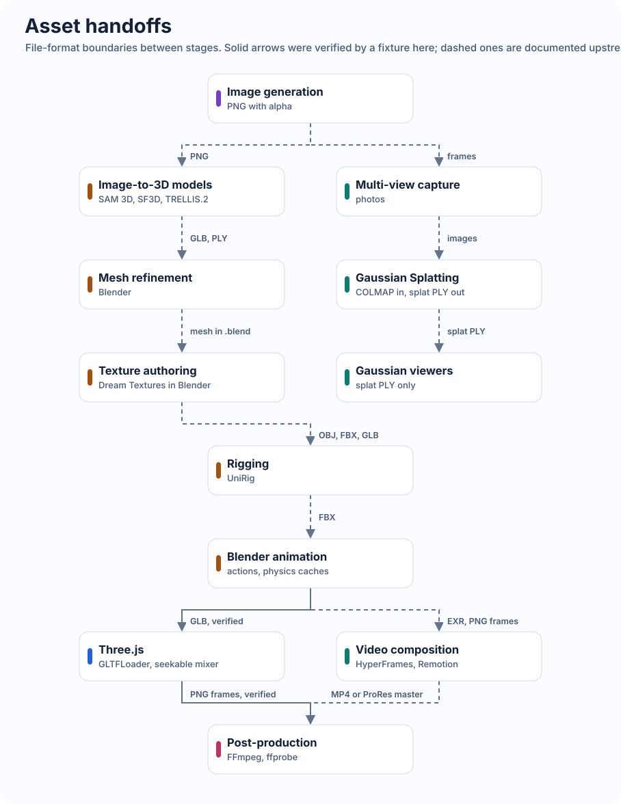

# Export contracts

Every boundary between two 3D tools is a file. An export contract says which file, in which coordinate system, at which scale, with which names, made from which version of the asset. Write it before the first export, and check it after every import. Most 3D handoff bugs are contract bugs: wrong axis, wrong scale, a renamed clip, or a consumer reading an older version than the producer thinks.

Two handoffs are **tested** in this catalogue: Blender animation to Three.js as GLB ([fixtures/blender-glb](../../fixtures/blender-glb/check.mjs)), and Three.js frames to FFmpeg ([fixtures/seekable-scene](../../fixtures/seekable-scene/README.md)). The rest are documented upstream or proposed.

## Choosing a format

| Format | Use it for | Carries | Loses or lacks | Evidence |
| --- | --- | --- | --- | --- |
| Blender source (`.blend`) | The editable master of every stage | Everything: modifiers, constraints, drivers, node materials, actions, NLA, cache references | Needs Blender; files saved by a newer Blender may not open in an older one (general practice) | tested |
| OBJ (+ MTL) | Static geometry exchange; MeshAnything V2 output | Positions, UVs, normals, basic MTL materials | Skeleton, skin, animation, PBR maps beyond basic MTL, declared units or up axis | documented |
| FBX | Rigged and animated exchange with DCC tools and engines; UniRig output | Mesh, skeleton, skin, animation, basic materials | Blender node materials; reliable PBR maps; **clip names** (the fixture's `bend` came back as `toy_rig\|toy_rig\|bend`); axis and unit settings vary by exporter | tested |
| GLB / glTF 2.0 | Web and real-time delivery; most generators' output | Triangles, PBR metallic-roughness, skin (4 influences per set), morph targets, node animation; meters and Y up by specification | Quads and ngons (triangulated), constraints, drivers, simulations, displacement, UDIMs; vertices split at UV seams and hard edges | tested |
| PNG / EXR sequences | Rendered frames for compositing and encoding | PNG: 8 or 16-bit display images. EXR: linear float, multiple passes | The scene; the frame rate (record it separately) | PNG tested |
| PBR texture maps | Material inputs | Pixel values per map | The color space is not reliably stored in the file: record it per map. JPEG compression damages normal maps (general practice) | documented |
| Gaussian PLY | Captured or generated splat scenes | Gaussian positions, scales, rotations, opacity and view-dependent color | Faces, UVs, rig, physics. **Not a mesh**; see [Gaussian Splatting](gaussian-splatting.md) | documented |
| Rendered video (MP4, ProRes master) | Final picture and sound | The approved frames | Everything editable; delivery codecs are lossy | tested (FFmpeg) |
| Workflow JSON (ComfyUI) | Reproducing a node graph | Graph and widget values | Weights, custom node code, environment; record those as in [ComfyUI orchestration](comfyui-orchestration.md#what-to-record-per-workflow) | documented |

## Coordinate system and up axis

| Tool | Handedness | Up | Front (general practice) |
| --- | --- | --- | --- |
| Blender | Right-handed | +Z | Front view looks along +Y, so a model's front faces −Y |
| glTF 2.0 and Three.js | Right-handed | +Y | An asset's front faces +Z |

Blender's glTF exporter converts on the way out when **+Y Up** is enabled (the default; the fixture sets `export_yup=True`). A Blender point (x, y, z) becomes (x, z, −y) in glTF. The importer converts back. The fixture shows both sides: the 0.3 m limb modelled along Blender +Z reports `bbox_m.size` 0.09, 0.09, 0.3 after re-import into Blender, and three r187 reports 0.09 × 0.3 × 0.09 m with Y up.

- FBX exporters take explicit forward and up axis settings, and other tools use other conventions. Record the exporter settings in the contract and check orientation in the consumer, not in Blender.
- Generators may use their own frames. MeshAnything V2 normalizes input to a unit box and works best with +Y up; ComfyUI-3D-Pack has axis-switching nodes; SAM 3D Objects returns object pose and layout. Record every transform so it can be undone.
- Apply rotation and scale in Blender before export. The validator's `unit_scale` Reflex check catches unapplied scale; rotation is checked by eye.

## Units

Model in **meters** with Blender's unit scale at 1.0 (the fixture sets the metric system and `scale_length = 1.0`). glTF defines its units as meters. Confirm real size in the consumer: the fixture's Three.js check requires the height to be 0.3 m within 3 mm. For FBX, check the exporter's scale options and the consumer's import scale, because tools disagree on default units (general practice).

## Naming

- Files: `<asset>_<stage>_v<NNN>.<ext>`, lowercase, underscores, no spaces. Example: `toy_limb_rigged_v003.glb`.
- Objects, materials, bones and images: stable, descriptive names; no Blender `.001` suffixes in a delivery.
- Textures: `<asset>_<map>_v<NNN>.png` with the map named (`basecolor`, `orm`, `normal`, `emission`), and the color space recorded in the manifest.
- Splats: say so in the name (`garden_splat_v002.ply`), because a mesh PLY and a Gaussian PLY share an extension.

## Clip names

**Lesson from the fixture:** an FBX round trip renamed the action `bend` to `toy_rig|toy_rig|bend`, while the GLB kept `bend`. List every clip's name and duration in the contract, check them after every import (`animations` in the validator report, `stats.animations` in the Three.js check), and map renamed clips explicitly in code. More in [animation and physics](animation-and-physics.md#clip-names-are-part-of-the-contract).

## Versioned stages

| Stage | Typical producer | Typical format | Lossy step that creates it |
| --- | --- | --- | --- |
| `original` | Generator or capture: SF3D, TRELLIS.2, SAM 3D Objects, scan, Gaussian training | GLB, OBJ, PLY as delivered | none: keep byte for byte |
| `refined` | Blender: orientation, scale, cleanup of non-manifold and loose parts | `.blend` + GLB | Deleting geometry |
| `retopologised` | MeshAnything V2 or Blender | `.blend`, OBJ | New topology; UVs, weights and shape keys lost |
| `uv-ready` | Blender unwrap | `.blend` | Replaces any earlier UVs |
| `textured` | Bakes, Dream Textures, Blender nodes, TRELLIS.2 texturing | `.blend` + maps | Baking and texture resolution |
| `rigged` | UniRig, Blender | `.blend`, FBX | Weight limits and normalization |
| `animated` | Blender actions, baked caches | `.blend` + caches | Baking constraints and simulations |
| `delivery-optimised` | Decimation, texture compression, GLB export | GLB | Triangulation, decimation, compression |

Rules:

1. **Never overwrite an earlier stage with a lossy step.** Decimation, retopology, triangulation, texture compression, representation conversion and FBX round trips each write a new file with a new version number.
2. **Every downstream step names the version it consumes**, in the `consumes` field of the [asset manifest](../../templates/asset-manifest.json) and in its execution notes. The template's worked example is the fixture itself: `v4-rigged` consumes `v1-original`, with the GLB's SHA-256 and all three reports attached. A consumer that cannot name its input is not reproducible.
3. **Skipped stages are recorded as skipped**, with the reason (a static prop has no `rigged` stage).
4. **Branches share a parent.** A web GLB and an engine FBX both name the same `animated` version.
5. **Evidence attaches to a version.** Validator reports and consumer checks name the exact file and its hash; see [asset validation](asset-validation.md#evidence-to-keep).

## Contract checklist per handoff

Producer, consumer, file and version consumed, format and exporter settings, up axis and forward axis, units and measured size, triangle and texture budgets, materials and color spaces, skeleton and influence limit, clip names and durations, validation commands and results, rights for every input. The [example asset contract](../examples/asset-contract.md) shows the shape for a Blender to Three.js product model, and the [interactive 3D workflow](../workflows/interactive-3d.md) shows where it sits.

[Editable diagram](../diagrams/asset-handoffs.mmd)
