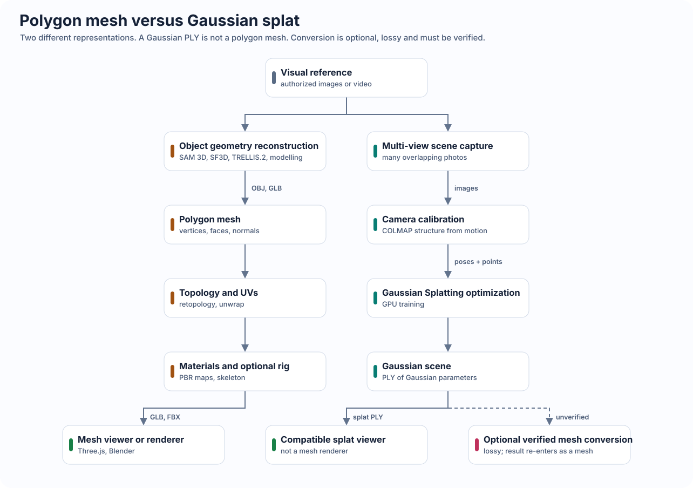

# Gaussian Splatting

Gaussian Splatting optimises millions of small, colored, semi-transparent 3D Gaussians so that rendered views match a set of posed photos. The result renders real places and objects with convincing view-dependent shine at interactive frame rates. It is **not a polygon mesh**: it has no faces, no UVs, no topology and no skin. Plan it as a separate representation with its own viewer, its own checks and its own license.

[Gaussian Splatting](../repositories/gaussian-splatting.md) (Inria and MPII) is documented here, **not run**. No pre-trained scenes were downloaded.

## Choose it when

- The deliverable is a view of a real scene or object: a fly-through, a turntable, a backdrop.
- You can photograph the subject from many positions, and nothing in it moves.
- The asset does not need to deform, collide, be re-lit or be edited as geometry.

Choose a mesh instead when the asset must be rigged, animated by deformation, used for physics, UV-textured, 3D printed or edited by an artist. `registry/compatibility.json` lists Gaussian Splatting and the polygon mesh pipeline as a *recommended alternative* (documented): different representations for different deliverables.

## Capture rules

General photogrammetry practice, unless marked as from the upstream README:

1. **Static subject.** No people walking, no wind in leaves, no moving shadows. Anything that moves becomes ghosting or floaters.
2. **Lock the camera.** Fixed exposure, white balance and focus for the whole capture. If that is impossible, record it: the trainer documents an exposure-compensation option.
3. **Overlap.** Each point of the subject should appear in many photos from different angles. Walk full orbits at two or three heights, then add close passes for detail.
4. **Sharp frames.** Avoid motion blur. When extracting from video, keep only the sharpest frames.
5. **Even, unchanging light.** Overcast daylight or fixed studio lights. Avoid the sun moving across a long capture.
6. **Avoid trouble surfaces** or expect artifacts: mirrors, glass, chrome, water, and large blank walls with no texture for matching.
7. **Consistent scale of view.** The README notes the method struggles with multi-scale captures that mix close-ups and far shots. For large scenes it suggests lower position and scaling learning rates.
8. **Resolution.** Inputs wider than 1.6K pixels are downscaled automatically (README). Shooting larger gains nothing for training.
9. **Rights and privacy.** Photographed people, plates and private interiors are baked into the output PLY. Get consent or remove them before training.

## Camera poses with COLMAP

Training needs camera poses and a sparse point cloud. The repository's `convert.py` runs COLMAP on raw photos placed in `<location>/input` (ImageMagick is used for resizing). The trainer reads a COLMAP dataset with `images/` and `sparse/0/` (`cameras.bin`, `images.bin`, `points3D.bin`) using a SIMPLE_PINHOLE or PINHOLE camera model, or a synthetic NeRF (Blender) dataset.

Check COLMAP's result before training: the share of images registered, the reprojection error, and whether the sparse points outline the subject. Pose errors cannot be trained away; they show as doubled edges and blur.

## Training hardware versus viewing hardware

| | Training | Viewing |
| --- | --- | --- |
| GPU | NVIDIA CUDA, Compute Capability 7.0+ | OpenGL 4.5 GPU and drivers; 4 GB VRAM recommended; CUDA CC 7.0+ for the real-time viewer |
| Memory | 24 GB VRAM for paper-quality 30,000 iterations; 7,000-iteration runs need much less | Grows with the number of Gaussians |
| Software | Conda env (pinned Python 3.7.13, PyTorch 1.12.1, cudatoolkit 11.6; the README warns of issues with CUDA 11.6 and used 11.8); CUDA extensions built from source | SIBR viewers built with CMake, or the prebuilt Windows zip |
| Platforms | Windows and Ubuntu | Same; macOS unsupported |

To fit a smaller GPU, the FAQ suggests a higher `--densify_grad_threshold`, a lower `--densify_until_iter`, `--data_device cpu` and `--test_iterations -1`. Default training saves Gaussians at 7,000 and 30,000 iterations to `point_cloud/iteration_<N>/point_cloud.ply`. The training GUI listens on 127.0.0.1:6009; do not change `--ip` to expose it.

## Validation list

Record each item with the scene, training iteration and viewer used.

| Check | How to check |
| --- | --- |
| Coverage | Orbit the scene in the viewer. Look for holes, smeared regions and blurry areas where the capture was thin |
| Pose quality | COLMAP registration rate and reprojection error; doubled edges or ghosting in the result |
| Exposure | Brightness jumps or color shifts between views; blotchy patches where exposure varied |
| Moving objects | Ghost figures, smeared cars, translucent leaves |
| Floaters | Clouds of stray Gaussians in empty space, most visible from views between the captured ones |
| Completeness | Every surface the deliverable needs is present; record what is missing (often the top and underside) |
| View-dependent quality | Move between and away from captured views; reflections and highlights should stay stable, not flicker |
| Held-out views | The trainer reports PSNR, SSIM and LPIPS on test images; keep those numbers |
| Size | Gaussian count and PLY file size against the delivery budget |
| Performance | Frame time on the target viewer and hardware, not just the training machine |

## License

The Gaussian-Splatting License allows **research and evaluation use only, non-commercially**, without the right to sublicense. Commercial use needs prior consent from Inria. Do not ship this code or its trainer in a commercial product as is. Other implementations and viewers carry their own licenses; check each one before use.

## "Not a mesh" rules

- Do not run `validate_asset.py` on a splat PLY. Its mesh checks do not apply.
- Do not load a splat PLY with a mesh loader and call it done. A generic PLY loader shows only the Gaussian centres as points (general practice). Use a splat viewer or splat-rendering library.
- Do not rig, UV-unwrap, texture or use it as a physics collider.
- Name it so nobody confuses it with a mesh PLY (`garden_splat_v002.ply`), and record the representation in the [asset manifest](../../templates/asset-manifest.json).
- [SAM 3D Objects](../repositories/sam-3d-objects.md) also writes a Gaussian PLY, from **one** image. Its hidden sides are inferred, not captured. Do not present it as a multi-view capture.

## Optional conversion to a mesh

Converting splats to a mesh is possible but lossy. [ComfyUI-3D-Pack](../repositories/comfyui-3d-pack.md) documents 3DGS-to-mesh nodes (they need a C++ compiler at runtime). The conversion is **unverified** here. Expect to lose:

- View-dependent color (the spherical-harmonic shine), which becomes flat base color.
- Thin structures and fine edges, which become blobs or vanish.
- Clean surfaces, since floaters and noise become stray geometry.
- Any material separation; the color arrives baked with the capture's lighting.

The converted mesh re-enters the mesh pipeline at the start: [asset validation](asset-validation.md), [retopology](retopology.md), then [UVs and materials](uv-and-materials.md). Keep the splat as its own stage; never overwrite it with the conversion.

[Editable diagram](../diagrams/mesh-vs-gaussian.mmd)
