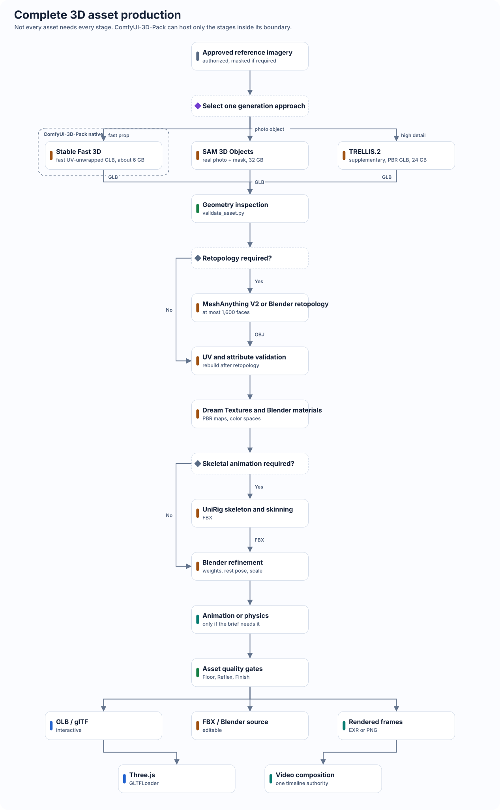

# Image to 3D: choosing a generator

An image-to-3D model predicts a whole object from one picture. It sees one side of the object. The back, the underside and the inside of a handle are **inferred** from training data, not reconstructed from evidence. Treat every output as a draft mesh that must pass the same inspection as any hand-built asset.

None of the three generators below was run in this catalogue and no weights were downloaded. Every figure on this page is documented upstream and recorded in `registry/repositories.json`. Blender itself was tested for export and validation in [fixtures/blender-glb](../../fixtures/blender-glb/make_asset.py), not for modelling quality.

## The candidates

| | [Stable Fast 3D](../repositories/stable-fast-3d.md) | [TRELLIS.2](../repositories/trellis-2.md) | [SAM 3D Objects](../repositories/sam-3d-objects.md) | Manual modelling in Blender |
| --- | --- | --- | --- | --- |
| Input | One RGB or RGBA image; rembg removes the background when there is no alpha | One image; RMBG-2.0 removes the background. Can also texture an existing mesh from a reference image | RGB image plus one binary mask per object, merged into the alpha channel. Optional pointmap | Reference photos, drawings, measured dimensions |
| Output | GLB with UV-unwrapped texture atlas, normals and predicted material parameters | GLB with PBR base color, roughness, metallic and opacity (in texture alpha, exported OPAQUE); MP4 turntable; O-Voxel data | Gaussian PLY; textured GLB when the mesh decoder runs (the demo bakes vertex colors, texture baking off); pose and layout for several objects | Whatever the brief asks for |
| GPU memory | About 6 GB per image at defaults; CPU fallback documented | At least 24 GB; verified on A100 and H100 | At least 32 GB | Workstation |
| Platforms | Linux; Windows and macOS MPS experimental | Linux only (tested) | Linux 64-bit | Any |
| Documented speed | No seconds figure in the pinned README | About 3 s, 17 s and 60 s at 512³, 1024³ and 1536³ on an H100 | None stated | Hours to days |
| License | Stability AI Community License: free under US$1M annual revenue, commercial users register, outputs may not train other foundation models | MIT code and weights; default pipeline pulls gated DINOv3 and RMBG-2.0 under their own licenses; nvdiffrast and nvdiffrec have their own | SAM License: royalty-free, ship the license, credit SAM, bans ITAR, military, nuclear and weapons uses; Meta may change it | Yours |
| Weights | Gated (form, auto-approval), safetensors, about 4.0 GB | Public 4B model, about 16.2 GB, safetensors | Gated (manual approval), about 13.2 GB, pickle `.ckpt`/`.pt` | None |
| Strongest at | Fast single objects, delit albedo, optional triangle or quad remesh | Detail, open surfaces, internal structure, full PBR | Occluded objects in real cluttered photos, multi-object layout | Exact dimensions, known hidden surfaces, deformation topology |
| Fails at | High detail and scenes; remeshing can add artifacts on thin surfaces | Small GPUs; heavy CUDA build; keeps non-manifold parts that need cleanup | No mask, under 32 GB, single clean product shots where a lighter model is enough | Turnaround time |
| Evidence | documented | documented | documented | Blender export tested; modelling not tested |

The three generators are a *recommended alternative* set in `registry/compatibility.json` (documented): pick one per asset. [Dream Loop](../repositories/dream-loop.md) offers a hosted route through fal.ai (paid) and says not to model in Blender in its Plus workflow, so it conflicts with a Blender-led pipeline. Choose one loop owner.

## Decision rules

1. **The asset has exact dimensions, a manufactured fit, text, a logo, or a side the photo does not show that the client will look at.** Model it by hand. Use generator output as a reference volume only.
2. **A fast prop on a modest GPU.** Stable Fast 3D. Set `--texture-resolution` and `--remesh_option` deliberately and record them.
3. **Detail and PBR maps on a 24 GB+ Linux machine.** TRELLIS.2. Plan to rewire opacity and clean non-manifold parts.
4. **An object inside a real photo, partly occluded, or several objects with their layout.** SAM 3D Objects, with a segmenter for the masks and 32 GB+ of VRAM.
5. **A character that will deform.** None of these produce deformation topology. Budget [retopology](retopology.md) before [rigging](rigging-and-skinning.md).
6. **Commercial work.** Check revenue against the SF3D threshold, the SAM License use bans, and the DINOv3 and RMBG-2.0 terms before choosing TRELLIS.2's default pipeline. Record the decision in the [toolchain plan](../../templates/toolchain-plan.md).

## Hidden surfaces are inferred, not reconstructed

- A single image carries no evidence about the far side. The model fills it with a statistically plausible guess. It can look convincing and still be wrong.
- Do not describe a generated back or underside as a reconstruction. Label it "inferred" in the [asset manifest](../../templates/asset-manifest.json) and in client reviews.
- Score visible and hidden regions separately in any benchmark (below).
- When the hidden side matters, get evidence for it: model it from more reference views, or capture the object from all sides and use [Gaussian Splatting](gaussian-splatting.md) or photogrammetry. Several photos make the far side measured instead of guessed.

## A fair benchmark protocol

Run this before committing a project to one generator. It compares like with like on images you are allowed to use.

1. **Reference set.** Choose 8 to 12 authorized images and record their rights. Cover the cases that break generators: a hard-surface object with known dimensions, an organic form, thin parts (handles, straps, antennae), reflective or transparent material, printed text or a logo, and an occluded object in a cluttered photo. For geometry accuracy, include objects you hold ground truth for: an owned CAD file or scan that you photograph, or an owned mesh you render from a recorded camera.
2. **Identical inputs.** Same crop, same resolution and the same alpha mask for every model. SAM 3D Objects needs the mask; SF3D skips rembg when alpha is present; TRELLIS.2 runs RMBG-2.0 by default. Record whether each model's own background removal ran.
3. **Identical hardware.** SAM 3D Objects needs 32 GB, so a 24 GB card cannot run all three. Use one Linux machine with at least 32 GB of VRAM, or record the GPU per row and do not compare times across machines.
4. **Pinned versions.** Record the repository commit (the registry lists the inspected ones), weight file hashes, CUDA, PyTorch and driver versions.
5. **Seeds and repeats.** Fix seeds where a model accepts one (SAM 3D Objects documents a seed). Run three seeds per image and report the spread, not the best.
6. **Settings.** Start from defaults and write them down: SF3D texture resolution 1024 and remesh `none`; the TRELLIS.2 resolution and GLB `decimation_target`. For density comparisons, also make a copy of each output decimated in Blender to one shared triangle budget.
7. **Timing and memory.** Exclude model loading and one warm-up run. Time from image in to GLB written. Record peak GPU memory with `torch.cuda.max_memory_allocated()` inside the process or by sampling `nvidia-smi`, and say which.
8. **Blind review.** Rename outputs so reviewers do not know which model made them. Review under the three lighting setups in [UV and materials](uv-and-materials.md#check-under-several-lights).

| Criterion | How to measure | Notes |
| --- | --- | --- |
| Geometry accuracy | Chamfer distance and F-score at a stated threshold against ground truth, after aligning scale and pose (ICP) | Report visible side and hidden side separately |
| Silhouette consistency | Render the mesh from the input camera; mask IoU against the input alpha. Repeat for held-out photos from other angles if you have them | Input-view IoU only proves the visible outline |
| Texture and material quality | PSNR or LPIPS at the input view; blind novel-view review; check for baked-in shadows and highlights; list which PBR maps exist | Delit albedo is a documented SF3D goal; verify it |
| Mesh density | Triangles, vertices, connected components, texture size, file size | From the [validator report](asset-validation.md) |
| Inference time | Warm seconds per image | Same GPU only |
| GPU memory | Peak GB | State the method |
| Export usability | `validate_asset.py` Floor and Reflex results; loads in Blender and Three.js at the right scale and up axis | See [export contracts](export-contracts.md) |
| Cleanup needed | Artist minutes and the list of operations needed to pass Floor and the brief's budget | The number that decides cost |

### Results table template

**Status: not run here.** No generator was executed for this catalogue. Fill one row per model and image, and attach the [mesh quality report](../../templates/mesh-quality-report.md) for each output.

| Image | Model and commit | GPU | Seed | Chamfer (vis / hidden) | F-score | Input-view IoU | Held-out IoU | Texture review (1-5) | Tris | Time (s) | Peak VRAM (GB) | Floor pass | Cleanup (min) |
| --- | --- | --- | --- | --- | --- | --- | --- | --- | --- | --- | --- | --- | --- |
| *not run* | Stable Fast 3D | | | | | | | | | | | | |
| *not run* | TRELLIS.2 | | | | | | | | | | | | |
| *not run* | SAM 3D Objects | | | | | | | | | | | | |

## Next stages

Every output goes to [asset validation](asset-validation.md) first, then [retopology](retopology.md) if the brief needs a budget or deformation, then [UVs and materials](uv-and-materials.md). Keep the raw generator output as the `original` stage described in [export contracts](export-contracts.md).

[Editable diagram](../diagrams/3d-asset-production.mmd)
