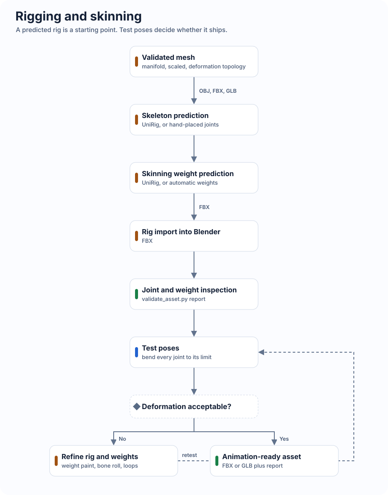

# Rigging and skinning

A rig is a skeleton plus skin weights that tell each vertex how much each bone moves it. It is the most expensive stage to get right and the easiest to get subtly wrong: weights can sum correctly and still crease, collapse or tear in a pose. A predicted rig is a starting point. **Test poses decide whether it ships.**



## When to rig

| Asset | Rig? | Why (general practice) |
| --- | --- | --- |
| Static prop | No | Nothing deforms. A skin adds file size and CPU or GPU cost for no gain. |
| Rigid moving parts: doors, wheels, lids, turrets, robot plates | No skin. Animate object transforms in a parent hierarchy | Rigid transforms are exact and cheap. Skinning a rigid part invites bending where none should happen. |
| Mechanical character with rigid segments | Bones with each part weighted 1.0 to one bone, or object parenting | Keeps parts rigid while sharing one skeleton for animation tools |
| Character, creature, tail, cable, cloth-like soft part | Yes | The surface must bend |
| Asset whose motion comes from a simulation | Bake the simulation instead; see [animation and physics](animation-and-physics.md) | |

Rig only after the mesh is final. [Retopology](retopology.md) after rigging throws the weights away.

## UniRig as a starting point

[UniRig](../repositories/unirig.md) predicts a skeleton and per-vertex skin weights for humans, animals and objects. Documented, **not run here**.

| Item | Documented behavior |
| --- | --- |
| Input | `.obj`, `.fbx`, `.glb`, `.vrm`; the launch scripts also accept `.dae` and `.gltf` |
| Steps | `generate_skeleton.sh` (use `--seed` for variations), `generate_skin.sh`, then `merge.sh` to put the result on the original model |
| Output | Skeleton FBX, skinned FBX, then a merged `.glb`/`.gltf`, `.fbx`, `.vrm` or `.dae` written through Blender's Python module (bpy 4.2) |
| Preprocessing | Skeleton prediction simplifies the input to 50,000 faces by default |
| Hardware | CUDA GPU with at least 8 GB VRAM |
| License | MIT code and weights, but the vendored Michelangelo encoder is GPL-3.0; redistributing a product that includes it brings GPL obligations |
| Known traps | Merging the skeleton-only FBX gives no skinning: merge the skin FBX. Skinning drops sharply when the skeleton misses bones such as tails or wings, so edit the skeleton before skinning. Physics bone attributes are not released. Checkpoints are pickle files. |
| Successor | The README points to SkinTokens, which it says improves skinning accuracy |

`registry/compatibility.json` pairs UniRig with Blender rigging as *complementary* (documented): UniRig predicts, Blender corrects. Treat its output as a draft to inspect with the list below, never as a finished rig.

## Inspection list

Record each item in the [rig validation report](../../templates/rig-validation-report.md).

| Check | What to look for | Automated by `validate_asset.py` |
| --- | --- | --- |
| Hierarchy | One root; parent chain matches the anatomy; no stray or duplicate bones | Yes: `roots`, `hierarchy` |
| Joint placement | Joints at pivot points: inside the elbow, knee and knuckle, not on the surface | No |
| Bone orientation | Consistent roll; mirrored left and right bones have mirrored local axes; bones point down the chain | No |
| Rest pose | Matches the target convention (T-pose or A-pose); armature and mesh transforms applied; scale 1 | Partly: mesh `scale` |
| Weight normalization | Every vertex's deform weights sum to 1; no vertex without weight | Yes: `non_normalised_vertices`, `unweighted_vertices` (Floor) |
| Influence limit | At most 4 bones per vertex | Yes: `vertices_over_4_influences` (Reflex) |
| Deformation | Smooth bends, no creases, candy-wrapper twists or volume loss at joints | No: use test poses |
| Penetration | No surface passes through another in test poses: armpits, fingers, clothing over body | No |
| Animation compatibility | Bone names and rest pose fit the animation source or retargeting map | No |
| Export compatibility | Skin, bone count and clip names survive a GLB or FBX round trip | Partly: re-run the validator on the export |

## Lessons from the fixture

The [blender-glb fixture](../../fixtures/blender-glb/make_asset.py) rigs a 0.3 m limb with three bones and automatic weights, then exports GLB and FBX. Two lessons from that real run apply to every rig:

**Automatic weights crease.** On the 3-bone chain, automatic weights produced a visible crease at the middle joint in test poses, while every weight sum was correct and the validator passed. Weight sums prove bookkeeping, not deformation. Pose every joint and look.

**Limit and normalize before export.** glTF skins carry four joint influences per vertex set. More influences need extra sets, which some consumers ignore, so weights are silently lost (general practice). The fixture limits first, then normalizes, in that order, so the four remaining weights sum to 1:

```python
bpy.ops.object.vertex_group_limit_total(group_select_mode="BONE_DEFORM", limit=4)
bpy.ops.object.vertex_group_normalize_all(group_select_mode="BONE_DEFORM", lock_active=False)
```

The fixture also exports FBX with `add_leaf_bones=False`, so no extra end bones appear in the consumer.

## Test poses

1. Pose every deforming joint to its expected limit in both directions, plus a twist for limbs.
2. Render each pose from at least two angles, shaded and in wireframe. Keep the images with the rig report.
3. Check creases, collapse, penetration and stretching against the inspection list.
4. Fix in Blender: weight paint, smooth weights, adjust bone roll, or add edge loops at the joint (which sends you back to UVs; see [retopology](retopology.md#retopology-breaks-uvs-and-vertex-correspondence)).
5. Retest after every fix. Then export and pose the exported file in its consumer as well. The fixture's [check.mjs](../../fixtures/blender-glb/check.mjs) seeks the GLB to two poses in Three.js and confirms the tip bone moves and the pose repeats exactly.

## Validate

```
blender --background --factory-startup --python-exit-code 1 --python scripts/blender/validate_asset.py -- path/to/asset_rigged_v003.glb reports/asset_rigged_v003.json
```

Exit code 0 means every Floor check passed, including `rig_weights_normalised`. The fixture's rig passed on both GLB and FBX: 3 bones, one root, 0 unweighted, 0 non-normalized and 0 over-4 vertices. See [asset validation](asset-validation.md) for each field and [export contracts](export-contracts.md) for the formats and clip names.

[Editable diagram](../diagrams/rigging-and-skinning.mmd)
