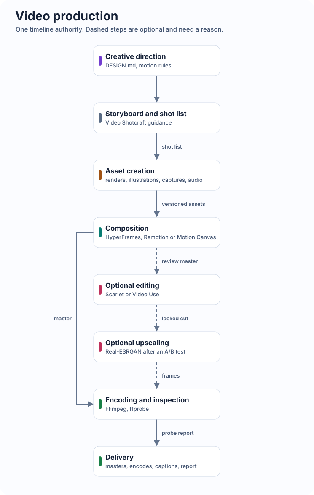
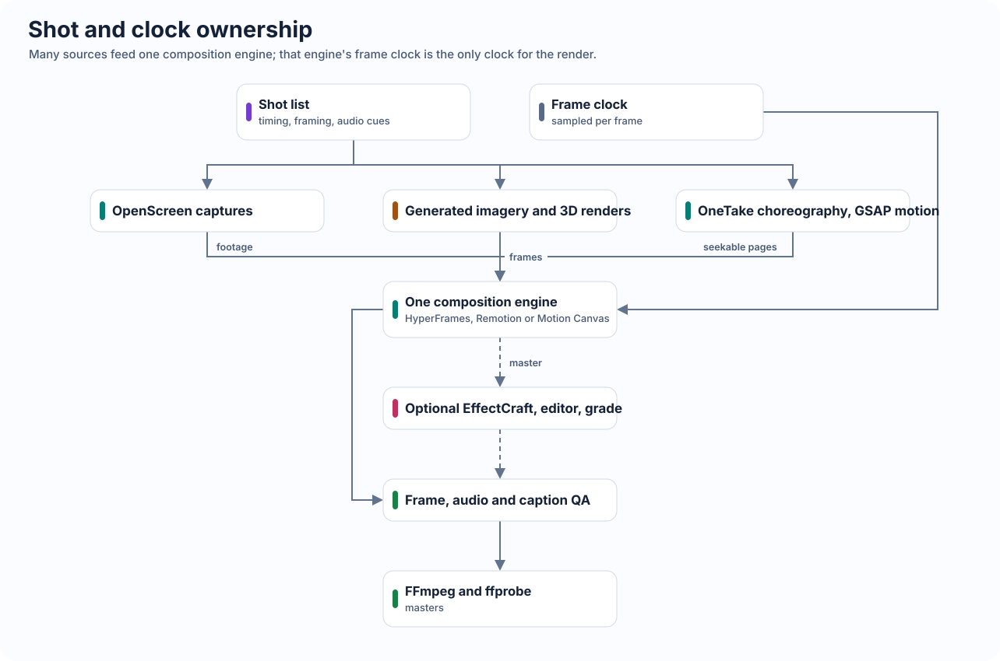

# Cinematic pipeline

This section covers short produced films: launch trailers, explainers, product walkthroughs, one-take sequences and styled shorts. Many tools can make a film. The pipeline stays simple when each scene has one composition engine, one timeline and one frame clock, and every other tool hands it files or seekable pages.

[Editable diagram](../diagrams/cinematic-video.mmd)

Evidence on this page: the tools' behavior is **documented** from their pinned guides unless marked. The catalogue's own **tested** pieces are the [time contract](../contracts/time-contract.md) fixture, [framecap](../../kit/framecap/README.md) (frame-exact HTML to MP4, including GSAP pages) and the GSAP and Motion seek checks in [fixtures/expressive-motion](../../fixtures/expressive-motion/README.md). The step-by-step workflow is [cinematic promotional video](../workflows/cinematic-video.md).

## Choose a method

Pick the method from the deliverable. Each one below brings its own direction rules, and most bring their own renderer.

| Deliverable | Method | What it brings | Watch for |
| --- | --- | --- | --- |
| Launch trailer or data explainer drawn in code | [Huashu Motion](../repositories/huashu-motion.md) | A single HTML page with GSAP, Canvas, three.js and SVG; a written score played with sampled instruments; a frame-click editor | Tested upstream on macOS only. Bundles GSAP under its Standard no-charge license. It cannot hear, so a person does the final listen. |
| Narrated lesson, 2 to 8 minutes | [anything2explainer](../repositories/anything2explainer.md) | Sourced narration and a black-canvas house style drawn in Remotion by parallel agents, with four human checkpoints | PolyForm Noncommercial license. Once narration is voiced, frame numbers are hard-coded, so a word change re-times the film. |
| Walkthrough of a real product | [OpenScreen](../repositories/openscreen.md) | Screen recording with auto-zoom, cursor smoothing, transcript cuts and a headless CLI | The project format and CLI may change (upstream warning). Records a real screen, so check what is on it. |
| One continuous camera move | [OneTake](../repositories/onetake.md) | Beat boundaries designed to carry, about 38 moves as pure functions of time, an automatic continuity oracle, real motion blur | PolyForm Noncommercial license. Its own instruction is to use HyperFrames or Remotion if the user names one. |
| A named visual look | [Lemo Opuscar](../repositories/lemo-opuscar.md) | 99 named styles, each a style prompt plus a demo film, rendered from `window.render(t)` pages | Mixed license: code MIT, docs and prompts CC BY-NC 4.0 with a permission for your own films. Needs ffmpeg 7 or newer. |
| Layered compositing in the After Effects style | [EffectCraft](../repositories/effectcraft.md) | Keyframes, effects, 3D cameras and lights, a render queue, CLI and MCP | Upstream calls it alpha, not yet for production client work. No After Effects plug-ins. |
| Shot recipes for a product promo | [Video Shotcraft](../repositories/video-shotcraft.md) (supplementary) | 124 recipe cards with Remotion demos, beat sync and sound design | Its output is a Remotion project. With another engine, use the recipes as guidance only. SKILL.md is in Chinese. |

Licensing decides as often as craft does. Check the license column of each guide against the client and the distribution before you start.

## One composition engine per scene

[Editable diagram](../diagrams/cinema-ownership.mmd)

Choose one engine for the scene's timeline:

| Engine | Choose it when |
| --- | --- |
| [HyperFrames](../repositories/hyperframes.md) | HTML, CSS and seekable animations are the natural authoring form |
| [Remotion](../repositories/remotion.md) | React components and parameterized video matter. Some companies need a paid Remotion license. |
| [Motion Canvas](../repositories/motion-canvas.md) | Procedural vector motion synced to voice-over is central |

A method's own renderer can be the engine for a scene: Huashu Motion, OneTake and Lemo Opuscar each render their own pages. What matters is that one renderer owns each scene. Either the method renders the whole scene, or its output enters HyperFrames, Remotion or Motion Canvas as footage or a seekable page. Never both drive the same scene.

Rules for the engine:

- **One timeline and one frame clock per scene.** The engine computes `t = frame / fps` and every source samples that `t`. No source runs on its own wall clock during render.
- **Remotion Skills guide Remotion; they are not a second renderer.** [Remotion skills](../repositories/remotion-skills.md) give an agent Remotion's own practices for creating, previewing and rendering. They change how the agent writes the Remotion project, not who renders it. The pinned repo states no license, so do not redistribute or modify the skill files.
- **Sample GSAP against the compositor timebase.** Pause GSAP's own clock and set its time from the engine's frame. GSAP's guide documents removing `gsap.updateRoot` from the ticker and stepping it yourself. framecap pauses `gsap.globalTimeline` and sets its time per frame (tested: within 0.054 px in every frame). HyperFrames lists GSAP as an animation runtime (documented). In Remotion, seeking a paused GSAP timeline to `useCurrentFrame() / fps` is the same idea (proposed, not run here).
- **ComfyUI supplies assets, never live state.** [ComfyUI](../repositories/comfyui.md) generates stills, plates and clips as versioned files with recorded workflow JSON, seeds and model versions. The engine reads the files.
- **Games and simulations hand over replays or captures.** Never let a game engine and a video renderer share mutable live simulation state. Export a replay (inputs and seeds at story times) or fixed-rate captures and compose those.
- **Two compositors on one timeline is a rejected pattern.** No portable editable-timeline interchange is verified. HyperFrames documents a one-way Remotion port skill; that is a migration, not a shared timeline.

The [time contract](../contracts/time-contract.md) is the shared rule underneath: state is a function of `t`, no wall clock inside the scene, seeded randomness, frames chosen by the driver.

## Optional steps

Each optional step needs a reason written in the shot list.

| Step | Use | Rule |
| --- | --- | --- |
| Editing | [Scarlet](../repositories/scarlet.md) when a person wants a desktop timeline beside the agent; [Video Use](../repositories/video-use.md) for agent-driven shell editing from a transcript | One editor per cut. Video Use's documented transcription goes to ElevenLabs, so it needs approval for speech data. |
| Upscaling | [Real-ESRGAN](../repositories/real-esrgan.md) only on shots that win an A/B test at delivery size | Upscaling invents detail per frame. Review the result in motion for flicker and shimmer between frames, not only as stills. Keep it off text, UI captures and faces that must stay accurate. Upstream activity stopped in 2024. |
| Compositing or grade | EffectCraft, or the engine itself | Applied to the engine's master, not inside its timeline |

## Masters and delivery

[FFmpeg](../repositories/ffmpeg.md) is the delivery boundary. Encode numbered frames with an explicit `-framerate`, avoid re-encoding between steps where a stream copy works, and verify every master with ffprobe: codec, size, frame rate, decoded frame count (`-count_frames`) and duration. Build flags decide FFmpeg's license; enabling libx264 makes the build GPL.

Apply the motion and video gate in the [quality gates](../../QUALITY_GATES.md): declared streams present, cuts on beats or words, no audio pops at cuts, captions inside safe areas.

## Related pages

- [Cinematic promotional video workflow](../workflows/cinematic-video.md)
- [Expressive motion production workflow](../workflows/expressive-motion-production.md), for the motion refinement route
- [Time contract](../contracts/time-contract.md)
- [Expressive motion](../expressive-motion/README.md) and [property and clock ownership](../expressive-motion/ownership.md)
- [Shot list template](../../templates/shot-list.md)
