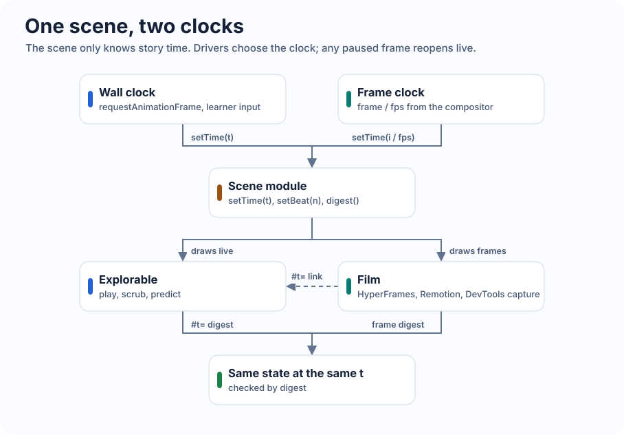

# Time contract: one scene, two clocks

Most handoffs in this catalogue are files: a GLB, an SVG, numbered frames, a master. The most valuable handoff between catalogue tools is a function instead: **scene state as a pure function of time**. With it, the same Three.js, SVG or HTML scene plays live, renders to a frame-exact film and opens the film's paused frame as a live scene. Without it, every renderer needs its own copy of the animation and the copies drift apart.

The [seekable scene fixture](../../fixtures/seekable-scene/README.md) proves this contract end to end. It plays live, renders a 600-frame MP4 and passes the four checks below.

## The contract

A scene module that keeps the contract exposes:

| Member | Meaning |
| --- | --- |
| `setTime(t)` | Put every visible value in its state at story time `t` seconds and draw. Idempotent: calling it twice with the same `t` draws the same frame. |
| `setBeat(n)` | `setTime(beats[n].t)`. Beats are the named teaching or story moments. |
| `beats` | Ordered list of `{ t, id, caption }`, plus any interaction a beat waits for. |
| `duration` | Story length in seconds. |
| `digest()` | Rounded scene state as a string, for comparing two runs without comparing pixels. |

It obeys six rules:

1. **State is f(t, seed, inputs).** Derive every position, angle, opacity and camera pose from `t`. Speed changes such as slow motion are a closed-form time map. Never integrate per-frame deltas such as `phase += dt`.
2. **No wall clock inside the scene.** `performance.now()`, `Date.now()` and `requestAnimationFrame` timestamps belong to the live driver only.
3. **Seeded randomness.** Use a seeded PRNG. `Math.random()` breaks repeatability.
4. **Frames are not part of the scene.** The scene knows seconds. The driver chooses 24, 30 or 60 fps.
5. **Inputs are events at story times.** A learner's choice is recorded as data (`predicted = 1 at t = 14`). The scene computes its state from `t` plus that data, so a run with inputs can still be replayed.
6. **A beat's time is a settled state.** Camera moves and reveals finish by the time a beat starts, not after it. A deep link, a chapter link or a live clock paused for a question all land on a beat's exact time, so that frame must show what the caption describes. The fixture first broke this rule: its film looked right, but opening `#beat=5` showed the previous beat's camera under the prediction question. Only the live check caught it.

## Three kinds of clock

| Clock | How state advances | Seek to an arbitrary `t` | Catalogue examples |
| --- | --- | --- | --- |
| **Wall** | Reads real time on each frame | No. Recording needs screen capture at real speed. | Magic UI effects and Sakuga VFX reactions in normal use. Sakuga's `look.mjs` stops and steps the clock for review. |
| **Stepped** | Integrates a fixed `dt` per frame | Only by replaying from zero | Line Art Animation's `run((t, dt) => …)` with its one-frame-per-screenshot capture script |
| **Seekable** | Computes state from `t` | Yes, in any order | HyperFrames compositions, Remotion's `useCurrentFrame()`, Motion Canvas timelines, this fixture |

A stepped clock is fine for film and for live play. It cannot open a paused film frame as a live scene without replaying everything before it. Convert integrated motion to closed form where you can. Where you can't, as with physics, cache keyframes every second and replay from the nearest one.

## How each renderer drives the contract

| Driver | Clock source | Documented upstream | Verified here |
| --- | --- | --- | --- |
| Live page | `requestAnimationFrame` wall time → `setTime` | n/a | Yes |
| Chrome DevTools frame capture | `seek(i / fps)` then `Page.captureScreenshot` | Line Art Animation's `scripts/capture.ts` uses the same method | Yes, in `render.mjs` |
| HyperFrames | Composition time, seekable animations to deterministic MP4 | Yes | No |
| Remotion | `useCurrentFrame() / fps`, `@remotion/three` for a Three.js canvas | Yes | No |
| Motion Canvas | Generator time signal | Timeline yes, Three.js bridge no | No |
| FFmpeg | Numbered frames at explicit `-framerate` | Yes | Yes |

HyperFrames also ships a `/remotion-to-hyperframes` skill that ports a Remotion project. That makes Remotion → HyperFrames a documented one-way timeline route. The catalogue previously listed timeline interchange as unverified in every direction.

## Acceptance checks

Run these on the representative fixture before batch rendering. `render.mjs` implements all four.

| Check | Passes when |
| --- | --- |
| Seekable | Frames rendered out of order match the same frames rendered in order, byte for byte on one machine |
| Repeatable | A fresh browser and page load reproduce the probe frames |
| Pause to play | The live page opened at `#t=T` reports the same `digest()` as film frame `T` |
| Stream | ffprobe reports the declared size, frame rate, decoded frame count and duration |

Pixel equality is expected only for the same machine, browser build and graphics backend. Across machines, compare `digest()` values instead. Run headless renders with a software backend such as SwiftShader when byte-identical frames matter more than speed.

[Diagram source](../diagrams/time-contract.mmd) · [Interactive learning workflow](../workflows/interactive-learning.md)
