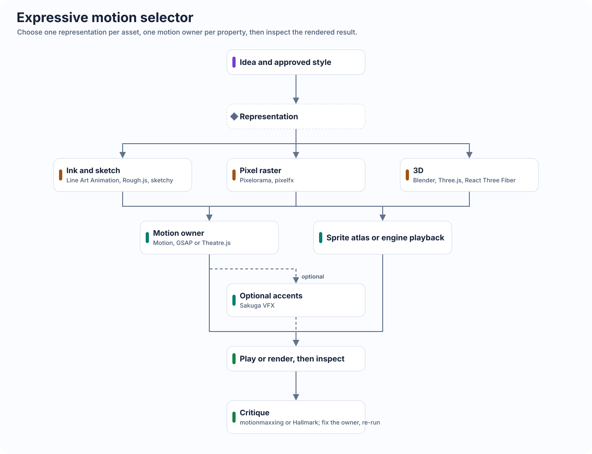

# Expressive motion

Expressive motion is animation with a point of view: a hand-drawn character that reacts, a pixel-art spell with wind-up and hit-stop, a 3D object that settles like it has weight. This section covers how to choose a representation, how to keep one owner for every animated property, and how to review the result until it reads.

Three things decide most outcomes:

1. **One representation per asset.** Ink and sketch, pixel raster or 3D. Mixing them inside one asset means two drawing systems fighting over one silhouette.
2. **One motion owner per property, one clock per render.** This is tested, not a style preference. When two libraries animate the same property, the last writer wins without an error ([ownership](ownership.md)).
3. **A critique loop on rendered output.** Look at frames or a contact sheet, fix the owner of the problem, render again.

[Editable diagram](../diagrams/expressive-motion-selector.mmd)

## Evidence levels on these pages

| Label | Meaning |
| --- | --- |
| **Tested** | Ran in [fixtures/expressive-motion](../../fixtures/expressive-motion/README.md) (Chrome 158 headless, 24 fps frame times, recorded 2026-11-27) or in a [`kit/`](../../kit/README.md) tool's own test. |
| **Documented** | Stated in the pinned upstream files listed in each tool's guide. Not run here. |
| **Proposed** | A handoff or practice this catalogue suggests. Neither documented upstream nor run here. |

## Choose a representation

| Representation | Choose it when | Tools | Clock to expect |
| --- | --- | --- | --- |
| Ink and sketch | The brief wants a drawn, human line: characters, diagrams, editorial scenes. | [Line Art Animation](../repositories/line-art-animation.md) for moving figures, [Rough.js](../repositories/rough-js.md) or the kit's [sketchy](../../kit/sketchy/README.md) for sketch marks | Line Art Animation is a stepped clock (`phase += dt`), documented. Rough.js redraws randomly unless you fix the seed. |
| Pixel raster | A 2D game, a retro look, sprites that must stay crisp at integer scale. | [Pixelorama](../repositories/pixelorama.md) for hand-drawn sprites, [pixelfx](../repositories/pixelfx.md) for code-driven effects | A sprite sheet is a fixed set of frames. Pick a frame with `floor(t * fps)`. Tested on pixelfx output. |
| 3D | The subject must turn, deform or be seen from several sides. | Blender (with [Blender MCP](../repositories/blender-mcp.md) if authorized) or [Blockbench](../repositories/blockbench.md), then [Three.js](../repositories/three-js.md) or [React Three Fiber](../repositories/react-three-fiber.md) | `mixer.setTime(t)` is seekable. Tested in R3F with `frameloop: 'never'`. |

If the motion is ordinary interface feedback (a panel opening, a list reordering), you don't need this section. Use [Motion](../repositories/motion.md) or CSS and follow the [accessibility gate](../../QUALITY_GATES.md).

## Choose one motion owner

| Owner | Use it for | Seek call (tested) |
| --- | --- | --- |
| [Motion](../repositories/motion.md) | React and vanilla UI, gestures, springs, layout transitions | `controls.pause()`, then `controls.time = t`; wait one animation frame before reading the DOM |
| [GSAP](../repositories/gsap.md) | Precise coded sequences, SVG, timelines a renderer seeks | `tween.time(t)` on a paused tween or timeline |
| [Theatre.js](../repositories/theatre.md) | Keyframes a person edits in a studio panel | `sheet.sequence.position = t` |
| Engine or mixer | Game simulation, skinned clips | `mixer.setTime(t)` for three.js clips; a game engine owns its own fixed step |

GSAP, Motion and Theatre.js are recommended alternatives for the same job (registry: [compatibility](../../COMPATIBILITY.md)). Pick one per scene. If you must use two, split them by property or by element, never by time on the same property. [Ownership](ownership.md) has the contract and the evidence.

Optional accents sit on top of an owner, never in place of one. [Sakuga VFX](../repositories/sakuga-vfx.md) adds anime-style bursts to individual controls. Its reduced-motion mode turns every effect off and keeps the state change (documented). pixelfx and Sakuga VFX are alternatives: pixelfx for pixel-art games and sheets, Sakuga VFX for web interaction bursts.

## Critique loop

1. Render or capture real frames. For a page, use [framecap](../../kit/framecap/README.md) (tested: it seeks each frame to `t = i / fps` and waits two animation frames before capture). For a sprite sheet, use the tool's contact sheet.
2. Review against the brief, not against taste alone. [motionmaxxing](../repositories/motionmaxxing.md) brings measured timing rules and scripted gates for films (documented). [Hallmark](../repositories/hallmark.md) brings Floor, Reflex and Finish tiers for pages (documented).
3. Name the owner of each problem: the drawing, the ease, the timing table or the clock. Fix it there.
4. Re-render the affected frames and repeat the check.

## Pages in this section

| Page | Covers |
| --- | --- |
| [Ownership](ownership.md) | The ownership contract, clock rules and the tested GSAP and Motion conflict |
| [Pixel effects](pixel-effects.md) | pixelfx and Pixelorama to a sprite atlas, then Phaser or Godot |
| [Reference comparison](reference-comparison.md) | reanimate: capture an authorized reference, build an original, recapture and compare |
| [React 3D](react-3d.md) | React Three Fiber, Three.js and optional Theatre.js keyframes |

Workflows that use these pages: [expressive motion production](../workflows/expressive-motion-production.md) and [interactive React 3D](../workflows/interactive-react-3d.md). For films, see the [cinematic pipeline](../cinematic-pipeline/README.md). Any scene that plays live and also renders must keep the [time contract](../contracts/time-contract.md).
