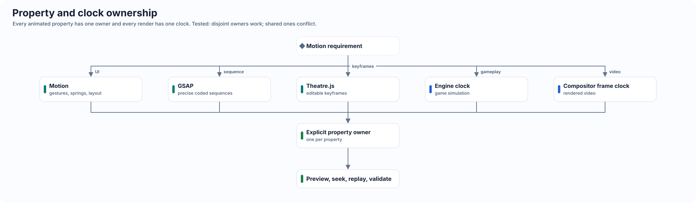

# Property and clock ownership

Every animated property has exactly one owner. Every render has exactly one clock. This page states the rule, gives the contract to write down for each animated asset, and shows the fixture evidence for why the rule exists.

[Editable diagram](../diagrams/motion-ownership.mmd)

## The rule

- **Property owner.** One library, engine or component writes a given property of a given element or object. `transform` on `#hero` belongs to GSAP, or to Motion, never to both.
- **Clock owner.** One clock decides story time `t` for a render. In live play that is the page's animation frame loop or the game engine. In a film it is the compositor's frame clock: `t = i / fps`.
- **Split by property or by element, never by time.** Handing the same property from one library to another partway through a scene is still two owners. Merge the motion into one owner's timeline instead.
- **No shared live simulation.** Never let a game engine and a video renderer share mutable live simulation state. Export a replay (inputs and seeds at story times) or fixed-rate captures, and render from those.

## What the fixture proved

[fixtures/expressive-motion](../../fixtures/expressive-motion/README.md) seeks each library to story time `t` in headless Chrome 158 and reads back what the browser shows. Each check runs in a fresh browser launched with `--disable-threaded-animation`, at 24 fps frame times. Results are in [out/result.json](../../fixtures/expressive-motion/out/result.json). Everything in this section is **tested**.

### Each library can obey one clock

| Library (version) | Seek call | Result | Catch |
| --- | --- | --- | --- |
| motion 14.14.0, ease | `controls.pause()`, then `controls.time = t` | 25 frame times over 1 s, 0 to 200 px, within 0.0004 px of an independent cubic-bezier(0.42, 0, 0.58, 1). Repeat, reverse-order and fresh-browser seeks were identical. | The DOM updates on the next animation frame. A synchronous read at t = 0.5 s returned 85.7 px (the previous frame) instead of 100 px. Wait one frame before capture. framecap already waits two. |
| motion 14.14.0, spring (stiffness 180, damping 9, mass 1) | Same | Seekable: identical on repeat, reverse and fresh load. Matches the closed-form damped spring until Motion's rest detection. | At its reported 1.5 s duration Motion snaps 0.24 px to the target. Overshoot was 65.3 px. |
| @theatre/core 0.7.2, no studio | `sheet.sequence.position = t` | 49 frame times over 2 s, error 0 against the keyframes. The DOM followed the value. | The value is ready synchronously. The public repo has not moved since 2024-08-14 (see [Theatre.js](../repositories/theatre.md)). |
| @react-three/fiber 9.8.2 with three 0.187.0 and React 19.3.1 | `frameloop: 'never'`, `mixer.setTime(t)`, then `advance()` | No frames rendered on their own in 600 ms. Each `advance()` rendered exactly one frame. Pixels at the same `t` were SHA-256 identical on repeat, after a jump from another time, and in a fresh browser. | Byte-identical pixels hold only on the same machine, browser build and graphics backend (SwiftShader here). See [React 3D](react-3d.md). |
| gsap 3.15.1 | `tween.time(t)` on a paused tween | x within 0.0003 px of the expected value | Writes synchronously, but its cached transform does not see other libraries' writes (below). |

### Disjoint owners work

Element `#a`: GSAP owns `x`, Motion owns `opacity`. Both were seeked from the same `t`. GSAP's x stayed within 0.0003 px of expected and Motion's opacity was exact at every frame.

### Shared owners fail silently

Element `#c`: GSAP animates x from 0 to +200 px and Motion animates x from 0 to -100 px, both seeked from the same `t`.

| Observation | Result |
| --- | --- |
| Immediately after the seek | The DOM showed GSAP's value at all 24 moving frames |
| Two animation frames later | The DOM showed Motion's value at all 24 frames, whichever library was seeked first |
| GSAP's own state at t = 0.5 s | GSAP believed x = 100 px. The element showed `translateX(-50px)`. GSAP's cache disagreed with the DOM at 24 of 24 frames. |
| Errors or warnings | None |
| Both libraries playing live on their own wall clocks | Motion won all 40 sampled frames. The outcome depended on write timing, not on intent. |

Each library writes the whole `transform` string, so the last writer wins and the loser's state goes stale. A capture taken at a different moment shows a different owner's value. This is why the registry marks GSAP and Motion as **potentially conflicting** (tested) and GSAP, Motion and Theatre.js as **recommended alternatives**: pick one per scene ([compatibility](../../COMPATIBILITY.md)).

## Ownership contract

Write one record per animated asset, next to the [asset manifest](../../templates/asset-manifest.json) or inside it. The record is what lets a second agent, a renderer or a game engine pick the asset up without guessing.

| Field | What to write | Example |
| --- | --- | --- |
| Asset ID | Stable name used in code and files | `ice-lance`, `hero-limb`, `cta-button` |
| Representation | Ink and sketch, pixel raster or 3D | `pixel raster` |
| Source and version | Tool, pinned commit or package version, source file | pixelfx `5294518`, `src/fx/ice/ice-lance.js` |
| Coordinate space | What positions are relative to | Screen pixels, SVG `viewBox`, three.js world (meters, +Y up) |
| Units | Distance, angle and time units | px, degrees, seconds |
| Origin and pivot | The point transforms and placement use | pixelfx `meta.pixelfx.pivot` `[146, 32]` in a 176x64 frame |
| Frame rate | The rate the asset was authored or exported at | 30 fps (the committed ice-lance sheet) |
| Integer frame range | First and last frame, inclusive | 0 to 23 |
| Event cues | Named story-time or frame events other systems listen to | `release` at frame 6, `impact` at frame 14 |
| Easing | Named ease or curve per segment | `cubic-bezier(0.42, 0, 0.58, 1)`, spring 180/9/1 |
| Seed | Seed for any randomness | `42` for Rough.js strokes |
| Loop policy | Once, loop, ping-pong; how the last frame meets the first | `loop`, first and last poses match |
| Alpha and color space | Straight or premultiplied alpha; sRGB or linear | RGBA8888 straight alpha, sRGB |
| Reduced-motion behavior | What the user sees with reduced motion on | Static end state; state change kept, effect removed |
| Property owner | The one writer per property | `transform`: GSAP; `opacity`: Motion |
| Clock owner | Who decides `t` in live play and in render | Live: game loop. Render: compositor frame clock. |
| Exporter | Tool and command that produced the file | `node tools/render.mjs ice/ice-lance --sheet --out <dir>` |
| Importer | Loader and settings on the consuming side | Phaser atlas loader, nearest filtering |
| License | License of code, assets and any bundled runtime | MIT; GSAP under its Standard no-charge license |

Two fields are easy to forget:

- **Reduced-motion behavior.** Motion's `reducedMotion` defaults to `"never"`, so reduced motion is opt-in (documented). Set it, or use `useReducedMotion`, and record what replaces the motion.
- **License of the runtime, not only the asset.** GSAP's license is a custom no-charge license, not an OSI license. motionmaxxing and Huashu Motion bundle GSAP. @theatre/studio is AGPL-3.0-only while @theatre/core is Apache-2.0 (documented).

## Clock rules in practice

- **Seek, don't step, when a film is possible.** A stepped clock (`phase += dt`, `mixer.update(delta)`, pixelfx's `update(1/fps)` export loop) can only reach time `t` by replaying from zero. Convert to closed form where you can, or cache keyframes and replay from the nearest one. See the [time contract](../contracts/time-contract.md).
- **Index fixed frame sets by time.** A sprite sheet or numbered frame sequence is selected with `floor(t * fps)` at the asset's own fps, wrapped by the loop policy (tested on pixelfx output, see [pixel effects](pixel-effects.md)).
- **Wait for the write before capture.** Motion's DOM write lands one animation frame after `controls.time = t` (tested). [framecap](../../kit/framecap/README.md) waits two frames, then captures until two consecutive captures match.
- **Unhook the default ticker for offline renders.** GSAP advances on `requestAnimationFrame` unless you remove `gsap.updateRoot` from its ticker and step it yourself (documented). framecap pauses `gsap.globalTimeline` and sets its time instead (tested in the kit).
- **Engines own their own step.** A game engine runs a fixed simulation step. Record a replay or capture at a fixed rate; do not let a video renderer seek the engine's live state.

## Checks

| Check | Passes when |
| --- | --- |
| One writer | For every animated property in the scene, exactly one owner is listed and the code agrees |
| Seek repeat | The same `t` seeked twice, out of order and in a fresh browser gives the same values (or pixels on one machine) |
| Settled capture | Values read after the capture wait match the expected curve, not the previous frame |
| Reduced motion | The reduced-motion state is reachable and matches the record |

Record the evidence with the [quality gates](../../QUALITY_GATES.md) (time contract, accessibility, motion and video).

[Back to expressive motion](README.md)
