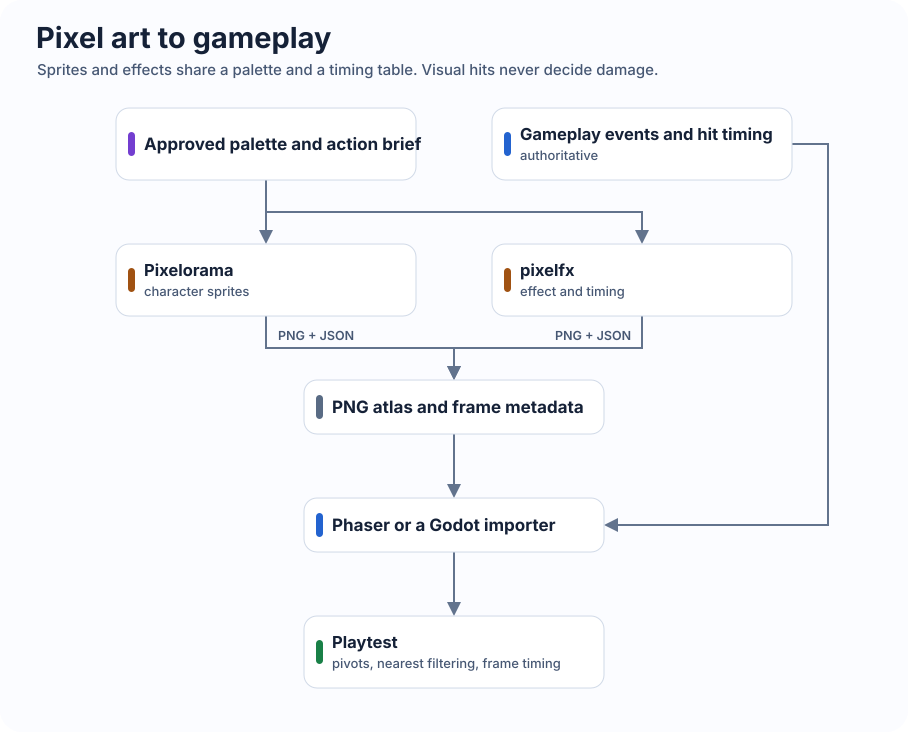

# Pixel effects and sprite atlases

Pixel art reaches a game as a PNG sheet plus frame metadata. Characters are usually hand-drawn in [Pixelorama](../repositories/pixelorama.md). Effects such as spells, hits and pickups can be drawn in code with [pixelfx](../repositories/pixelfx.md). Both feed one atlas contract, and the game engine ([Phaser](../repositories/phaser.md) or [Godot](../repositories/godot.md)) plays them. Gameplay events decide damage and hit timing. The art follows; it never decides.



[Editable diagram](../diagrams/pixel-atlas-import.mmd)

## What was tested

The optional `pixelfx-sheet` check in [fixtures/expressive-motion](../../fixtures/expressive-motion/README.md) ran pixelfx's own export at commit `5294518` (MIT) after reading its render tool in full. **Tested:**

| Effect | Sheet | Frames | Notes |
| --- | --- | --- | --- |
| `ice/ice-lance` | 528x512 RGBA | 24 frame rectangles, 176x64 each, 3 columns | Committed as a sample in [out/pixelfx](../../fixtures/expressive-motion/out/pixelfx/NOTICE.md) |
| `ice/frost-nova` | 2592x2304 RGBA | 103 frame rectangles | Not copied (847 KB) |

For both sheets the fixture checked that every rectangle lies inside the PNG, rectangles are distinct and match the frame size, the frame count matches the metadata and the alpha channel is used.

The JSON is Aseprite-style: a `frames` array of `{ frame: {x, y, w, h}, duration }` entries, `meta.frameTags`, and a `meta.pixelfx` block. In the committed ice-lance sample, `meta.pixelfx` reads `fps: 30`, `loop: true`, `frames: 24`, `frameSize: [176, 64]`, `pivot: [146, 32]`, `columns: 3`, and each frame's `duration` is 33 ms.

pixelfx's export steps each effect with a fixed `update(1/fps)` per frame. That is a stepped clock. Once exported, the sheet is a fixed set of frames, so pick a frame by time:

```js
// t in seconds since the effect started; fps from meta.pixelfx.fps
const i = Math.floor(t * fps);
const frame = loop ? i % frameCount : Math.min(i, frameCount - 1);
```

Use the sheet's own fps (30 for ice-lance), not the game's frame rate.

Not tested here: loading a pixelfx sheet into Phaser or Godot, any Pixelorama export, and the pixelfx library's live in-browser mode.

## Pixelorama exports (documented)

- PNG sprite sheets laid out by columns, by rows, or one row (or column) per tag.
- A command-line exporter for batch work: `--export`, `--spritesheet`, `--frames`, `--tag`, `--split-layers`, `--json`. Video formats fail unless FFmpeg is installed.
- `.aseprite` files, GIF, APNG and single frames.

Its `--json` output is Pixelorama's own serialized project data, not an Aseprite atlas. An engine that expects Aseprite-style JSON needs the `.aseprite` export plus an importer, or a small converter you write. For a fixed grid, the simplest route is a sheet with one frame size and slicing by grid in the engine (proposed).

## Atlas contract

Declare these once for every sheet, in the [ownership record](ownership.md#ownership-contract):

| Field | Pixelorama sheet | pixelfx sheet |
| --- | --- | --- |
| Image | PNG, RGBA | PNG, RGBA (tested) |
| Frame rectangles | Fixed grid: frame size, columns, rows | `frames[].frame` in the JSON (tested) |
| Frame timing | Your timing table (fps or per-frame ms) | `meta.pixelfx.fps` and `frames[].duration` (tested) |
| Animation names | Tags, exported one row per tag | `meta.frameTags` (tested) |
| Pivot | Set by hand and recorded | `meta.pixelfx.pivot` in frame pixels (tested) |
| Loop | Recorded | `meta.pixelfx.loop` (tested) |
| Palette | The approved palette file | Recorded with the effect source |
| Event cues | Frames where something happens (release, impact) | pixelfx records act timing (wind-up, hit-stop, recovery) in `meta.pixelfx` (documented) |

Pivot in engine terms is the pivot divided by the frame size. For ice-lance that is (146 / 176, 32 / 64), about (0.83, 0.5) as a normalized origin (proposed arithmetic; check it in the engine).

## Importing into an engine

These are proposed handoffs except where marked. pixelfx's README says Phaser's atlas loader and Aseprite importers for Godot and Unity read its JSON (documented, not run here).

| Engine | Load | Settings that matter |
| --- | --- | --- |
| Phaser 4 | pixelfx: the atlas loader (`this.load.atlas(key, png, json)`), then build animations from the frame names or tags. Pixelorama grid sheet: a spritesheet loader with frame width and height. | Pixel-art rendering mode (nearest filtering, no smoothing), integer zoom, origin from the pivot |
| Godot 4 | pixelfx: an Aseprite importer add-on that reads Aseprite JSON. Pixelorama grid sheet: slice by grid into `SpriteFrames`, or set `hframes` and `vframes` on a sprite. | Texture filter set to Nearest, import without mipmaps, offset from the pivot |

Keep the effect's frame index driven by `floor(t * fps)` from the moment gameplay fires the event, as above, so the art stays in step with game time even when the game's frame rate varies.

## Gameplay owns the hit

- The game decides when damage happens, from its own fixed simulation step. The sheet's `impact` frame is a visual cue that is placed to match that event.
- Hit-stop is a gameplay decision too. If the game freezes for a few frames on impact, freeze the effect's clock for the same story time, rather than letting the art pause on its own.
- Never read a pixel or a frame index to decide a collision.

## Playtest checks

| Check | Passes when |
| --- | --- |
| Pivots | The effect leaves the hand or weapon at the right point at every facing |
| Filtering | No blur at the target zoom; pixels stay square at integer scale |
| Frame timing | Each frame shows for its declared duration; the loop has no seam or extra frame |
| Alignment with gameplay | The impact frame lands on the damage event within one frame |
| Palette | Sprites and effects share the approved palette |
| Reduced motion | Screen shake and flashes can be turned down without hiding the game state |

Record results with the [quality gates](../../QUALITY_GATES.md). Keep pixelfx's attribution with any sheet you ship, as the fixture does in its [NOTICE](../../fixtures/expressive-motion/out/pixelfx/NOTICE.md).

## Security and licensing notes (documented)

- pixelfx code and effects are MIT. Its Patch Pixel gallery font is not covered. The optional Patch CLI install suggests piping a remote script into `sh`; prefer the npm route and treat any Patch install as a global change.
- Pixelorama is MIT. Its extensions are community code that runs inside the app; review them before installing.

[Back to expressive motion](README.md)
