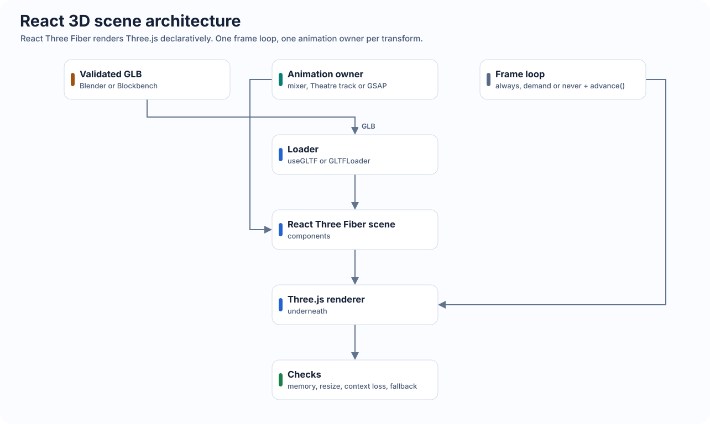
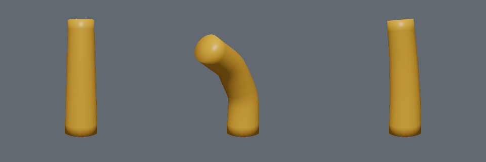

# React 3D

[React Three Fiber](../repositories/react-three-fiber.md) (R3F) is a React renderer for [Three.js](../repositories/three-js.md), not a second engine. You describe the scene as components; Three.js does the rendering underneath. [Theatre.js](../repositories/theatre.md) is an optional keyframe layer when a person needs to edit a camera move or object timing by hand. The rules are the same as everywhere in this section: one frame loop, one animation owner per transform.

[Editable diagram](../diagrams/react-3d-architecture.mmd)

## What was tested

The `r3f-frameloop` check in [fixtures/expressive-motion](../../fixtures/expressive-motion/README.md) ran @react-three/fiber 9.8.2 with three 0.187.0 and React 19.3.1 in headless Chrome 158 (SwiftShader WebGL). **Tested:**

- `toy_limb.glb` from the [Blender fixture](../../fixtures/blender-glb/README.md) loads through R3F's `useLoader` with three's `GLTFLoader`: 1 skinned mesh, 3 bones (root, mid, tip) and the clip `bend` (2 s, 9 tracks).
- With `frameloop: 'never'`, no frames rendered on their own in 600 ms.
- Each `advance()` call rendered exactly one frame.
- After `mixer.setTime(t)`, pixels at the same `t` were SHA-256 identical on repeat, after jumping from another time, and in a fresh browser. Times 0, 0.5 and 1.0 s gave three different images.

Not tested: drei's `useGLTF`, `frameloop: 'demand'`, `@theatre/r3f`, and performance on real GPUs.

**Units of `advance()`.** In the pinned R3F `loop.ts`, `frameloop: 'never'` sets `clock.elapsedTime` to the timestamp passed to `advance()`, so pass seconds, the clock's unit (documented in the [R3F guide](../repositories/react-three-fiber.md)). The fixture page passes `t * 1000`. It still passed because the pose comes from `mixer.setTime(t)`, not from the clock. Code that reads `state.clock` or the `delta` in `useFrame` will see wrong values if you pass milliseconds.

## Frame loop modes

| Mode | Renders | Use it for | Catch |
| --- | --- | --- | --- |
| `always` (default) | Every animation frame | Live scenes with constant motion | Costs battery when nothing moves |
| `demand` | When props change or `invalidate()` is called | Mostly static scenes, product viewers | Code that mutates objects directly, such as camera controls, must call `invalidate()` (documented) |
| `never` plus `advance()` | Only when you call `advance()` | Offline frame capture, a film from the same scene | You own the clock; set the animation to `t` first (tested) |

Passing a numeric priority to `useFrame` turns off automatic rendering, so you must render yourself (documented).

## One animation owner per transform

Pick one writer for each object's position, rotation and scale:

| Owner | Use it for |
| --- | --- |
| `AnimationMixer` | Clips authored in Blender or Blockbench. Seek with `mixer.setTime(t)`, never `mixer.update(delta)` when a film is possible. |
| Theatre.js sequence | A camera path or object timing a person tunes by hand |
| GSAP timeline | A coded sequence of object properties |
| Your own function of `t` | Procedural motion under the [time contract](../contracts/time-contract.md) |

A camera driven by Theatre.js and also by orbit controls has two owners. Disable the controls during the sequence, or let the controls own the camera and Theatre.js own something else.

## Theatre.js with R3F v9

- **Version clash (documented).** `@theatre/r3f` requires `@react-three/fiber` ^8 (React 18). Current R3F is v9 (React 19). Either drive R3F from Theatre's core sequence yourself, or pin R3F 8 and React 18 for the whole project.
- **Drive it from core (proposed).** Create the project, sheet and objects with `@theatre/core`. For each frame, set `sheet.sequence.position = t`, read the object values (tested: the value is ready synchronously), write them to the camera or mesh, then render. In live play, Theatre's own `play()` can own the clock; in capture, your loop does.
- **Studio stays out of production.** `@theatre/studio` is the editing UI and is AGPL-3.0-only. `@theatre/core` is Apache-2.0. Load the studio only during authoring and ship the saved project state JSON with core only (documented).
- **Maintenance risk.** The fixture used `@theatre/core` 0.7.2, the latest release. The public repository's last push was 2024-08-14, and its README says work moved to a private repo. It works; treat it as unmaintained and keep the project state JSON under version control so you can replace the runtime later.

## Fixed-frame capture

When the scene must also become a film:

1. Use `frameloop: 'never'` and set `preserveDrawingBuffer` if you read pixels from the canvas (the fixture did).
2. For frame `i`, compute `t = i / fps`, set every owner to `t` (`mixer.setTime(t)`, `sequence.position = t`), then call `advance(t)`.
3. Read pixels, or expose the scene as `window.__scene.seek(t)` and let [framecap](../../kit/framecap/README.md) capture it (tested in the kit with a canvas page).
4. Check seek, repeat and pause-to-play as in the [time contract](../contracts/time-contract.md). Expect byte-identical pixels only on one machine and graphics backend; compare values across machines.

## Production checks

Use the interactive 3D gate in the [quality gates](../../QUALITY_GATES.md): poster or static fallback, controls outside the canvas, GLB size, p95 frame time and draw calls on target hardware. Also check:

| Check | Passes when |
| --- | --- |
| Memory | Geometries, materials and textures are disposed on unmount; repeated mount and unmount does not grow GPU memory |
| Resize | The canvas and camera aspect follow the container; device pixel ratio is capped |
| Context loss | Losing the WebGL context shows the fallback and restores or reloads cleanly |
| Versions | React, R3F and three are pinned together (R3F 9 needs React 19; the pinned guide lists the range) |

The [interactive React 3D workflow](../workflows/interactive-react-3d.md) runs this end to end.

[Back to expressive motion](README.md)
