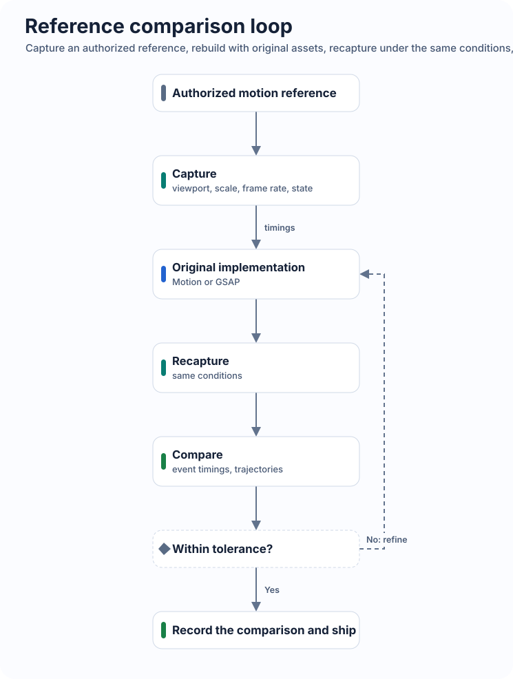

# Reference comparison

Sometimes the brief is "move like this": a reference animation whose timing and easing the client likes. The honest way to meet it is a loop: capture the reference, write your own implementation with your own assets, capture that the same way, compare, and refine until the difference is inside an agreed tolerance. [reanimate](../repositories/reanimate.md) is a skill built around that loop.

[Editable diagram](../diagrams/reference-comparison.mmd)

Nothing on this page was run in the catalogue. reanimate's behavior below is **documented** from its pinned files. The loop structure and tolerances are **proposed** practice.

## Ethics and scope

Set these before any capture:

- **Authorized references only.** Use a reference you own, one the client owns and supplies, or one whose terms allow this use. Write the source and the permission in the brief.
- **Original assets.** Rebuild with your own drawings, fonts, images, models and code. reanimate's README warns that fonts, images and code copied from another site still belong to their owners. Its `--assets` option can save a site's models, textures and scripts; use that for analysis only, and never ship what it saves without rights.
- **No bypassing access controls.** Do not script past logins, paywalls, bot checks or DRM. reanimate's own guidance is to skip references behind a login, on YouTube or on Loom and to hand it a screen recording instead. A recording the client makes of their own product is the clean route.
- **Tolerance, not replication.** The goal is motion that feels the same within a stated tolerance: event timing, trajectory shape, ease character. Do not promise an exact copy. The registry pairs reanimate with a design critic for this reason ([compatibility](../../COMPATIBILITY.md)).

## The loop

1. **Capture the reference.** Fix the viewport, device scale factor, frame rate and starting state (scroll position, hover, data). Record them. reanimate records a live page, screen recording, MP4, GIF or Lottie file.
2. **Write a spec.** For each element and property: start time, end time, distance, ease shape, overshoot and settle. reanimate writes a spec table per element and property, and fits springs from overshoot and settle time rather than reading them from source.
3. **Build an original implementation** in the project's stack with one motion owner per property ([ownership](ownership.md)). reanimate outputs CSS, Framer Motion, GSAP or three.js code.
4. **Recapture under the same conditions.** Same viewport, scale, frame rate and state. reanimate's `--clock virtual` steps a seeded virtual clock so captures repeat. For your own pages, [framecap](../../kit/framecap/README.md) gives the same frame-exact capture (tested in the kit).
5. **Compare.** Event timings and trajectories first, pixels last. reanimate produces comparison numbers and side-by-side diff sheets, and falls back to a blurred density comparison for random particles.
6. **Refine the biggest gap and repeat.** reanimate's README says this usually takes 2 to 5 rounds and that leftovers after 5 rounds are reported with reasons.

## Tolerances

Agree these in the brief before the first comparison. The values below are starting suggestions, not measured defaults.

| Measure | How to compare | Starting tolerance |
| --- | --- | --- |
| Event timing | Frame where each element starts, peaks and settles | Within one frame at the capture rate |
| Trajectory | Position per frame along the main axis | Within a few pixels at delivery size, shape matched |
| Ease character | Acceleration at start and end; overshoot count and size | Same shape; overshoot within a stated percentage |
| Duration | Total time to settle | Within one or two frames |
| Pixels | Diff sheet | Informational only, since your assets differ by design |

Record anything that stays outside tolerance and why, for example a reference spring that settles on a real-time worker clock.

## Setup notes (documented)

- Install: `npx skills add NiazMorshed2007/reanimate -g`, then its `scripts/setup.sh`. The repository is MIT licensed.
- Needs Bun 1.1 or later. Documented for macOS and Linux; Windows is untested upstream. Upstream tested it only with Claude Code.
- The first run downloads a static ffmpeg and Playwright's Chromium, about 250 MB together. Review [installation](../../INSTALLATION.md) and [security](../../SECURITY.md) guidance first: it runs headless Chromium against third-party sites.
- Captures stay local. No API keys or hosted services are used.

## Deliverables

The brief with the reference source and permission, capture settings, the spec table, your implementation, both captures, the comparison numbers and diff sheets, and a short report of what still differs. Review the result for taste with a design critic and record evidence with the [quality gates](../../QUALITY_GATES.md).

The [expressive motion production workflow](../workflows/expressive-motion-production.md) uses this loop as its reference-inspired route.

[Back to expressive motion](README.md)
