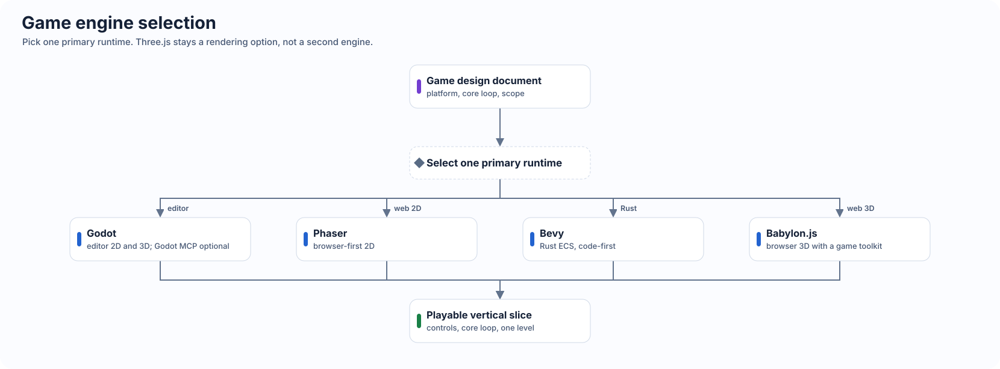

# Game development

How an agent builds a small, finished game with the catalogue's tools: one design document, one runtime, the engine's own physics, assets and levels that import cleanly, sound and story with one owner each, optional online play, a playtest and an export. A launch trailer comes last, from real gameplay.

[Editable diagram](../diagrams/game-engine-selection.mmd)

## Status

| Part | Status | Evidence |
| --- | --- | --- |
| Phaser Arcade physics, input, scoring and reload repeatability | **Tested** | [fixtures/game-dev](../../fixtures/game-dev/README.md) `phaser-slice` |
| Matter.js and Rapier same-machine repeatability | **Tested** | `matter-determinism`, `rapier-determinism` |
| Ink compile, branch walk, save and restore (inkjs) | **Tested** | `ink-branches` |
| jsfxr sound effects rendered to WAV | **Tested** | `jsfxr-sfx` |
| Colyseus authoritative room on loopback with two clients | **Tested** | `colyseus-room` |
| Babylon.js loading the catalogue's skinned GLB | **Tested** | `babylon-glb` |
| Godot, Godot MCP, Bevy, Jolt, Nakama, Pixelorama, Blockbench, LDtk, Howler.js | **Documented only**. Read at pinned commits, not run here | Each tool's guide under [repositories](../../REPOSITORIES.md) |
| The order of stages and the artifact contracts on these pages | **Proposed**. Catalogue guidance | — |

All fixture numbers come from one run set on 2026-11-27 (Node v24.14.0, Chrome 158 headless, Windows 11), recorded in [result.json](../../fixtures/game-dev/out/result.json).

## The order of work

| Stage | Output | Page |
| --- | --- | --- |
| 1. Game design document | Platform, core loop, scope, controls and the vertical slice's acceptance criteria | [Artifact contracts](artifact-contracts.md#game-design-document) |
| 2. One primary runtime | Godot, Phaser, Bevy or Babylon.js, with the version pinned | [Engines and physics](engines-and-physics.md) |
| 3. Native physics | The engine's own solver at a fixed step, with units and collision groups declared | [Engines and physics](engines-and-physics.md#physics-routing) |
| 4. Assets and levels | Sprite sheets, models and level data, with editor originals kept apart from runtime imports | [Assets and levels](assets-and-levels.md) |
| 5. Audio and narrative | Sound effects, one audio owner, one story runtime with save and resume | [Audio and narrative](audio-and-narrative.md) |
| 6. Online play (optional) | A server-authoritative match with validation, reconnect and protocol versioning | [Multiplayer](multiplayer.md) |
| 7. Playtest | Notes from players who match the brief, plus the automated checks | [Artifact contracts](artifact-contracts.md#delivery) |
| 8. Export | Builds for each target platform, each opened and played once | [Artifact contracts](artifact-contracts.md#delivery) |
| 9. Launch trailer (optional) | A cut made from captured gameplay, encoded with FFmpeg | [Cinematic pipeline](../cinematic-pipeline/README.md) |

Write the vertical slice first: controls, the core loop and one level, playable from start to finish. Do not add levels, online play or a trailer until the slice passes its acceptance criteria. A slice that is not fun will not get better with more content.

## Rules that apply on every page

- **One runtime per game.** Pick Godot, Phaser, Bevy or Babylon.js. Three.js stays a rendering option for bespoke browser scenes, not a second engine in the same game.
- **One rigid-body solver per world.** Use the engine's own physics first. Never run two solvers on the same bodies.
- **Fixed simulation step.** Physics and game rules advance by a constant step, not by frame time.
- **Editor originals stay separate from runtime imports.** `.pxo`, `.bbmodel`, `.blend` and `.ldtk` files are sources; PNG sheets, GLB files and level JSON are what the game loads.
- **One owner for each kind of state.** One story runtime, one audio system, one authoritative server.
- **Determinism claims need measurements.** The fixture proves same-machine repeatability for Matter.js and Rapier. It does not prove cross-platform determinism.
- **Nothing public without authorization.** No public server, analytics or player-data collection unless the owner approves it in writing.

## Pages in this folder

| Page | Covers |
| --- | --- |
| [Engines and physics](engines-and-physics.md) | Choosing the runtime; physics routing, fixed steps, collision groups, units and tunnelling tests |
| [Assets and levels](assets-and-levels.md) | Pixelorama, pixelfx, Blockbench, Blender, LDtk; import checks for filtering, pivots, collisions and scale |
| [Audio and narrative](audio-and-narrative.md) | jsfxr, engine audio or Howler.js, Ink compiled to JSON, save and branch tests |
| [Multiplayer](multiplayer.md) | Server authority with Colyseus or Nakama, validation, rate limits, reconnect, protocol versions |
| [Artifact contracts](artifact-contracts.md) | What each stage hands to the next: design, assets, levels, audio, narrative, multiplayer, delivery |

## Workflows

| Workflow | Route |
| --- | --- |
| [Web 2D game](../workflows/web-2d-game.md) | Phaser with bundled physics, Pixelorama and pixelfx sprites, optional LDtk, jsfxr with native audio or Howler.js, optional Ink, browser tests |
| [Standalone game](../workflows/standalone-game.md) | 2D indie game in Godot, low-poly 3D adventure in Godot or Babylon.js, Rust simulation in Bevy with Rapier, and a launch campaign from real gameplay |
| [Multiplayer arena](../workflows/multiplayer-arena.md) | A client engine plus a Colyseus or Nakama authoritative match, with network and security tests |

Related: [3D asset factory](../workflows/3d-asset-factory.md), [asset validation](../3d-pipeline/asset-validation.md), [pixel effects](../expressive-motion/pixel-effects.md), [cinematic video](../workflows/cinematic-video.md) and the [quality gates](../../QUALITY_GATES.md).
