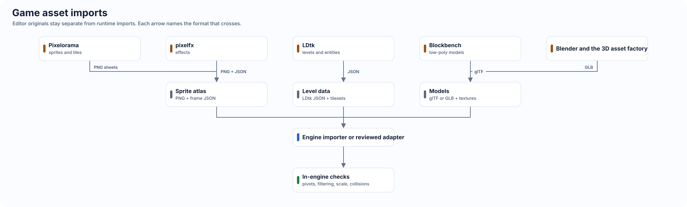

# Assets and levels

Make sprites, tiles, models and levels in the editor that suits each, export a runtime format, and check every import inside the engine. Editor originals are sources. Runtime imports are build outputs.

None of the editors on this page (Pixelorama, Blockbench, LDtk) was run here; their guidance is **documented** from pinned source files. Blender export to GLB was **tested** in [fixtures/blender-glb](../../fixtures/blender-glb/README.md), and Babylon.js loading that GLB was **tested** in [fixtures/game-dev](../../fixtures/game-dev/README.md). pixelfx sheet export was **tested** in [fixtures/expressive-motion](../../fixtures/expressive-motion/README.md). Import checks are **proposed** practice.

[Editable diagram](../diagrams/game-asset-imports.mmd)

## Which editor for which asset

| Asset | Tool | Runtime export | Evidence |
| --- | --- | --- | --- |
| Pixel sprites, animations, tilesets | [Pixelorama](../repositories/pixelorama.md) | PNG sprite sheets (by columns, rows, or one row or column per tag), PNG, WebP, GIF, APNG, `.aseprite` | Documented |
| Procedural pixel effects (hits, explosions, magic) | [pixelfx](../repositories/pixelfx.md); see [pixel effects](../expressive-motion/pixel-effects.md) | Transparent PNG sheet plus Aseprite-style JSON | Sheet export **tested** |
| Blocky low-poly models with pixel textures | [Blockbench](../repositories/blockbench.md) | glTF or GLB with optional embedded textures, armature and animations; FBX, OBJ and others | Documented |
| Everything else in 3D | Blender, optionally with [Blender MCP](../repositories/blender-mcp.md), through the [3D asset factory](../workflows/3d-asset-factory.md) | GLB | Export **tested** |
| 2D levels and entities | [LDtk](../repositories/ldtk.md) | `.ldtk` JSON (format 1.5.3, schema published), or Super Simple export (PNG per layer, CSV per IntGrid layer) | Documented |

Notes from the pinned files:

- **Pixelorama** runs from source only on Godot 4.7.1. Its command-line exporter takes `--export`, `--spritesheet`, `--frames`, `--tag`, `--split-layers` and `--json`. Video export needs FFmpeg. Its `--json` output is Pixelorama's own project data, not an Aseprite-style atlas; engines that expect Aseprite JSON need the `.aseprite` export or a converter. Extensions are community code; review them before installing.
- **Blockbench** source is GPL-3.0, but the assets you make are yours. It is a low-poly, cube-first editor, not a sculpting or retopology tool. JavaScript plugins run with the app's privileges.
- **LDtk** documents its JSON field by field and publishes QuickType parsers for C++, C#, Go, JavaScript, Python and Rust. The pinned repository names only the Haxe API as a loader. It lists no Godot or Phaser loader, so either review a community loader and pin it, or write a small adapter from the schema or the Super Simple export.

## Keep originals separate from runtime imports

| Folder (suggested) | Holds | Who writes it |
| --- | --- | --- |
| `art-src/` | `.pxo`, `.aseprite`, `.bbmodel`, `.blend`, `.ldtk` and per-level `.ldtkl` | People and editor tools |
| `assets/` (or the engine's import folder) | PNG sheets plus frame JSON, GLB, level JSON, tileset PNGs | Export commands only |
| `asset-manifest.json` per asset | Source path, export command, tool version, output hashes | The export step |

Rules:

1. Never hand-edit a runtime import. Change the source and re-export.
2. Record the export command and tool version for each asset in the [asset manifest](../../templates/asset-manifest.json), so the build can be repeated.
3. Do not let the engine's import cache (for example Godot's `.godot/` folder) into the asset review. Review the exported file.
4. Keep licenses with the source: who made it, under what terms. Generated content records the model and settings, as the 3D asset factory requires.

## Import checks in the engine

Check every asset after import, in the engine, not in the editor that made it.

| Check | Why | How (proposed) |
| --- | --- | --- |
| **Filtering** | Pixel art blurs under linear filtering and mipmaps | Use nearest-neighbor filtering and no mipmaps for pixel sprites. Screenshot at 1×, 2× and the target scale. |
| **Pixel snapping and scale** | Sprites shimmer at fractional positions or scales | Scale by whole numbers. Round camera and sprite positions if the art needs crisp pixels. |
| **Pivots and origins** | Feet float or sink; rotations swing around a corner | Declare the pivot per animation (pixelfx writes one into `meta.pixelfx`). Put the sprite on a known floor height and check the contact row. |
| **Frame timing** | Animations play too fast or too slow | Compare the engine's frame durations with the sheet's JSON. |
| **Collision shapes** | Art and hitbox disagree | Draw the collision shape over the sprite in a debug view. Hitboxes are usually smaller than the art. |
| **Model scale and up axis** | GLB arrives 100× too big or lying on its side | glTF is meters and Y up. Measure the bounding box after import. The fixture's limb reads 0.3000 m in both Babylon.js and Three.js. |
| **Clip names** | Code plays an animation by name | List clip names after import and compare with the manifest. See [animation and physics](../3d-pipeline/animation-and-physics.md#clip-names-are-part-of-the-contract). |
| **Level layers and entities** | An importer drops layers or misreads fields | Count tiles, IntGrid cells and entities per level after import and compare with the counts in the LDtk file. |
| **Tileset seams** | Gaps or bleeding between tiles | Add padding or extrusion to the tileset; check at the target zoom. |

For 3D assets, run the [asset validator](../3d-pipeline/asset-validation.md) on the GLB before it reaches the engine, then the engine's own checks after.

### What the fixture proved for 3D import

`babylon-glb` loaded `fixtures/blender-glb/out/toy_limb.glb` in Babylon.js 9.38.0: 1 skinned mesh, 1 skeleton with bones `root`, `mid` and `tip`, a `bend` animation group, a skinned height of 0.3000 m, and a tip bone that moves 5.9 cm at a quarter of the clip. That matches the Three.js result for the same file. One Blender export served two runtimes with the same scale, bone names and clip name.

## Acceptance

Floor: every runtime asset comes from a recorded export of a kept source; pixel sprites use nearest filtering; scale, pivots, collisions and clip names checked in the engine. Reflex: level entity counts match the editor; no hand edits to exported files. Record evidence with the [quality gates](../../QUALITY_GATES.md).

Back to [game development](README.md).
