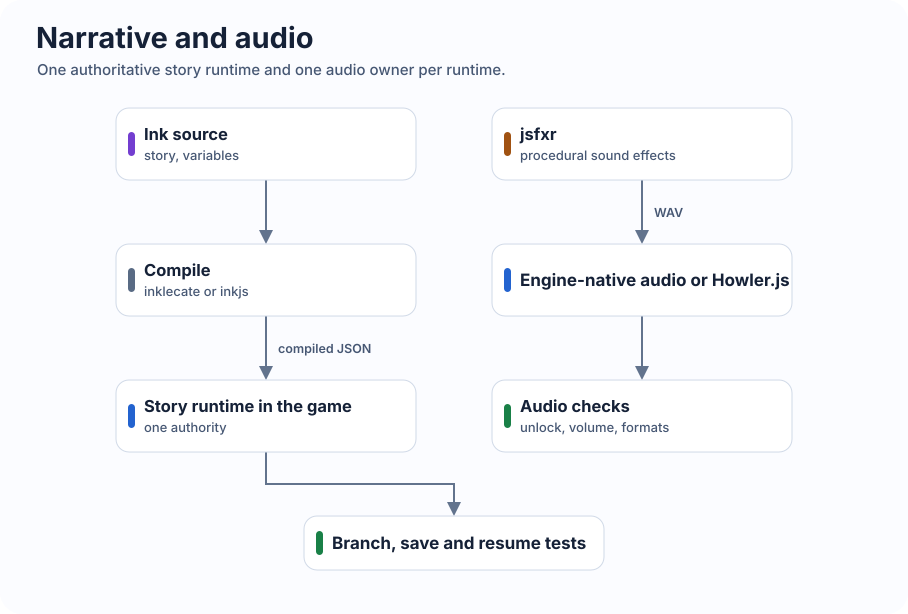

# Audio and narrative

Generate short sound effects, play them through one audio system, and run branching story from one compiled source. Each game has one audio owner and one story runtime.

jsfxr and inkjs were **tested** in [fixtures/game-dev](../../fixtures/game-dev/README.md). Howler.js, inklecate and the C# ink runtime were **not run**; their guidance is **documented** from pinned files. Test plans marked **proposed** are catalogue guidance.

[Editable diagram](../diagrams/narrative-audio.mmd)

## Sound effects with jsfxr

[jsfxr](../repositories/jsfxr.md) synthesizes retro sfxr-style effects from presets or saved parameters, in the browser or in Node. It does not make music, voice or realistic recorded sound.

**Tested** (`jsfxr-sfx`, jsfxr 1.4.1):

| File | Preset | Duration | Format | RMS |
| --- | --- | --- | --- | --- |
| `jump.wav` | `jump` | 0.312 s | 44100 Hz mono 16-bit PCM | −12.2 dBFS |
| `coin.wav` | `pickupCoin` | 0.274 s | same | −13.9 dBFS |

Both rebuilt byte-identical from a fixed seed. jsfxr presets call `Math.random`, so the check swaps in a seeded generator while rendering. Do the same if you need repeatable files, and save the parameter JSON (not only the WAV) as the source. The coin preset reaches full scale on 3 samples; that is the preset's own level, so normalize or lower it in your mix.

Bundle the npm package. The upstream browser snippet loads scripts from sfxr.me, a third-party host. The `sfxr-to-wav` CLI reads stdin from `/dev/stdin`, so piping JSON may not work on Windows; pass the base58 definition as an argument instead.

## One audio owner

| Runtime | Audio owner | Evidence |
| --- | --- | --- |
| Godot, Bevy, Babylon.js | The engine's own audio | Documented |
| Phaser | Phaser's sound manager (Web Audio, HTML5 Audio or NoAudio) by default | Documented |
| Plain web page or a web game whose engine lacks what you need | [Howler.js](../repositories/howler.md) 2.2.4 | Documented, **not run** |

Do not run Howler.js and Phaser's sound manager side by side for the same sounds. Two owners means two volume settings and two unlock paths.

### Howler.js in the browser

- **Autoplay unlock.** Audio on mobile browsers and desktop Chrome and Safari stays locked until a sound plays inside a user interaction. `autoUnlock` (default true) tries to unlock on the first touch or click and fires an `unlock` event. If you start sound on page load, catch `playerror` and retry on `unlock`.
- **Formats.** Howler.js picks the first source it can play, so list webm first with an mp3 fallback. Webm needs cue elements to seek in Firefox.
- **HTML5 pool.** HTML5 Audio nodes unlock one by one from a pool of `html5PoolSize` (default 10).
- **Serve your own files** to avoid CORS and mixed-content failures.

### Audio checks (proposed)

1. A start screen or first input unlocks audio. No sound is expected before it.
2. Mute and separate music and effects volumes exist, are reachable by keyboard and persist across reloads.
3. Every file decodes: `ffprobe` reports the declared codec, sample rate and duration.
4. No clipping at the loudest moment of play. Keep effects below music if both play.
5. The game is playable with sound off. Important events also have a visual cue.

## Narrative with Ink

[Ink](../repositories/ink.md) is a scripting language for branching story. You write `.ink` files, compile them to JSON and run that JSON in your game with a story runtime. It is not a game engine and brings no UI.

| Step | Tool | Notes |
| --- | --- | --- |
| Write | `.ink` files, optionally in Inky | Keep the `.ink` files as the only source of truth |
| Compile | `inklecate` (needs .NET 6+), or the compiler in `inkjs/full` | Commit the compiled JSON or build it in CI, not both by hand |
| Run | The C# runtime (1.2.1 at the pinned commit) or inkjs | One runtime per game |

The pinned ink README lists Inky, the Unity integration and inkjs as integrations. It lists no Godot or Bevy integration. For those engines, review a community integration, pin it and record it as proposed until you have tested it.

The runtime loop is small: create a `Story` from the JSON, call `Continue()` while `canContinue`, show `currentChoices`, then call `ChooseChoiceIndex`. The game reads and writes story variables through the runtime, never by parsing text.

**Tested** (`ink-branches`, inkjs 2.4.0 with the `inkjs/full` compiler): an original short story compiled with 0 errors. Four choice paths reached all three endings (`beacon`, `home`, `map`). Variables updated as written (`courage` reached 2 on the beacon path; `coins` ended at 2 after a trade). A choice gated on `coins >= 3` stayed hidden when the player had fewer coins. A state saved mid-story and loaded into a new `Story` gave the same choices and the same text to the end.

### Story tests (proposed, following the fixture)

1. **Compile with zero errors and zero warnings you have not read.**
2. **Walk every path** for a small story. For a large one, walk every knot at least once and every ending at least once, with a seeded random walk for the rest.
3. **Every path ends.** No dead ends and no loops without exit.
4. **Gated choices** appear only when their condition holds. Test both sides of each condition.
5. **Save and resume.** Save at several points, load into a fresh runtime and compare the next choices and text. Save the game state and the story state together, in one save file, so they cannot drift apart.
6. **Version saves.** Changing the `.ink` can break old saves. Put the story version in the save and decide what happens when it does not match.

## Acceptance

Floor: one audio owner and one story runtime; audio unlocks on first input; mute works; every ending reachable; save and resume tested. Reflex: effects reproducible from saved parameters; no clipped samples in the mix. Record evidence with the [quality gates](../../QUALITY_GATES.md).

Back to [game development](README.md).
