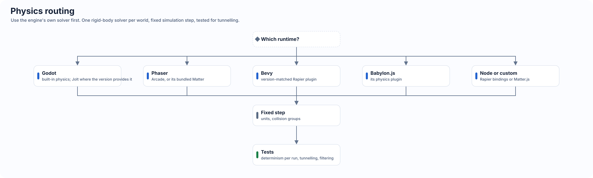

# Engines and physics

Choose one runtime for the whole game, then use that runtime's own physics. This page covers which engine fits which brief, what each one brings for physics, and the checks that keep a simulation stable: fixed step, one solver per world, collision groups, units and tunnelling tests.

Phaser, Matter.js, Rapier and Babylon.js were **tested** in [fixtures/game-dev](../../fixtures/game-dev/README.md). Godot, Godot MCP, Bevy and Jolt were **not run**; what this page says about them comes from their source files at the pinned commits (**documented**). Practices marked **proposed** are catalogue guidance.

## Choose one runtime

| Runtime | Pick it when | Physics it brings | Evidence |
| --- | --- | --- | --- |
| [Godot](../repositories/godot.md) | You want an editor for 2D or 3D scenes and native exports to desktop, mobile and web | Built-in 2D physics; 3D through GodotPhysics3D or Jolt | Documented. Pinned commit is 4.8 rc |
| [Phaser](../repositories/phaser.md) | The game is 2D and runs in a browser, often inside an existing site | Arcade, or its bundled, modified Matter.js 0.20.0 | **Tested**: 4.2.1, Arcade, headless Chrome |
| [Bevy](../repositories/bevy.md) | The team writes Rust and wants code-first ECS with no editor | None built in; add a version-matched Rapier plugin | Documented. Pinned main is 0.20.0-dev |
| [Babylon.js](../repositories/babylonjs.md) | The game is 3D in the browser and needs a game toolkit (physics, audio, input, inspector) | Physics V2 offers only the Havok plugin | **Tested**: 9.38.0 loads the catalogue GLB |

Three.js is not on this list. It is a rendering library for bespoke browser scenes ([guide](../repositories/three-js.md)). Use it when the brief is an interactive scene rather than a game, and do not run it next to Babylon.js or Phaser in the same game. The registry's compatibility note puts it plainly: Babylon.js when the brief needs a game engine's physics, audio, input and inspector, Three.js for bespoke scenes.

Upstream cautions to read before choosing:

- **Godot** runs project scripts and GDExtension native libraries with your privileges. Open only trusted projects.
- **Phaser** 4 removed the v3 Mesh class and targets 2D. Phaser 3 code needs migration. The code is MIT, but the Phaser logo and characters are all rights reserved. Phaser ships 28 agent `SKILL.md` files under `skills/`, including `physics-arcade` and `physics-matter`.
- **Bevy** warns that important features are missing and that breaking releases arrive about every three months. Its pinned commit declares Rust 1.100.0 as the minimum.
- **Babylon.js** loads glTF through the separate `@babylonjs/loaders` package. Its README warns not to use the Babylon CDN in production; the fixture loads it from jsDelivr for testing only. The Havok WASM license is not in the pinned files, so check it before you ship Havok. The repository also publishes `@babylonjs/mcp-servers` for its graph editors.

### Godot MCP is optional agent tooling

[Godot MCP](../repositories/godot-mcp.md) lets an agent launch the editor, run a project and read its console output. It has 14 tools, including `create_scene`, `add_node`, `load_sprite`, `run_project` and `get_debug_output`. Documented, **not run** here.

| What it does | What that means for you |
| --- | --- |
| `run_project` starts `godot -d --path <project>` | Full script and native-extension execution. Use it only on projects you trust. |
| Reads stdout and stderr only | It cannot see the editor or the running scene tree. Check gameplay yourself, by playing or by in-game test scripts. |
| Writes and overwrites `.tscn` files and resaves resources | Commit before you let it edit, and review the diff. |
| Path validation only rejects `..` | Absolute paths elsewhere on disk are not blocked. Run it in an isolated project folder. |
| Needs Node 18+; UID tools need Godot 4.4+ | Check both before setup. |
| The README installs `@coding-solo/godot-mcp`; the pinned `package.json` names the package `godot-mcp` 0.1.1 | Confirm which package you install and pin it. |

## Physics routing

[Editable diagram](../diagrams/physics-routing.mmd)

### Use the engine's own solver first

| Runtime | Use | Do not | Evidence |
| --- | --- | --- | --- |
| Godot 2D | Built-in 2D physics | — | Documented |
| Godot 3D | The engine chosen in `physics/3d/physics_engine`: GodotPhysics3D or Jolt Physics | Add a standalone Jolt build. That is only for custom C++ engines | Documented |
| Phaser | Arcade for boxes and circles; the bundled Matter for rotation, polygons and joints | Install a second `matter-js` package next to Phaser's bundled copy. Two engines disagree | Arcade **tested**; bundled Matter documented |
| Bevy | `bevy_rapier2d` or `bevy_rapier3d` at the version that matches Bevy | Mix plugin and Bevy versions | Documented: `bevy_rapier` 0.37 targets Bevy 0.20 and lives in the Rapier repository |
| Babylon.js | Physics V2 with the Havok plugin | Mix the legacy V1 plugins (Ammo.js, Cannon.js, Oimo.js) with V2 | Documented |
| Node, server or custom loop | [Rapier](../repositories/rapier.md) bindings, or [Matter.js](../repositories/matter-js.md) for 2D | — | **Tested**: both, same machine |

### Godot and Jolt: check the project setting

Godot 4.4 added Jolt as an alternative 3D physics engine (4.4-stable CHANGELOG). At the pinned commit, the editor writes `physics/3d/physics_engine = Jolt Physics` into every new project, and the docs say Jolt is the default for projects created starting in Godot 4.6. The setting's `DEFAULT` value still maps to GodotPhysics3D, so older projects and projects not created by the editor keep GodotPhysics3D unless you change them. Changing the engine needs a restart.

Read `project.godot` and record the 3D engine in the game design document. Godot bundles Jolt 5.6.0 without upstream's hair, compute and shader folders, so Jolt's GPU hair simulation is not available through Godot. Standalone [Jolt](../repositories/jolt-physics.md) is 5.7.0.

### Rules for every world (proposed)

1. **One rigid-body solver per world.** Each body belongs to exactly one solver. A second solver for a separate, non-interacting world (for example a UI toy) is acceptable if you name it in the design document.
2. **Fixed step.** Advance physics by a constant step, 1/60 s unless the brief says otherwise. Render at whatever rate the display gives, and interpolate if motion looks uneven. Never feed variable frame time into the solver.
3. **Units.** Declare them once. Matter.js and Phaser work in pixels; Rapier, Jolt and glTF assets work in meters. Write the pixels-per-meter ratio in the design document if any data crosses between them.
4. **Collision groups.** Name every layer (player, enemy, world, pickup, trigger) and write the matrix of which pairs collide. Test the matrix, not just one collision.
5. **Tunnelling.** Fast, thin objects pass through walls at a fixed step. Write a test that fires the fastest object in the game at the thinnest wall and asserts that it stops. Enable continuous collision detection where the engine offers it, or thicken the wall.
6. **Sleep and rest.** Check that a settled stack comes to rest and stays there. The fixture asserts this for both solvers it runs.

### What the fixture proved

| Check | Setup | Result |
| --- | --- | --- |
| `phaser-slice` | Phaser 4.2.1, Arcade, WebGL in headless Chrome, stepped by hand at 1000/60 ms | The player lands at y = 274.0 (platform top 290 minus half of 32 px). Holding Right for 75 steps moves it 197.33 px (74 × 160/60). A coin overlap scores 0 → 1. After release, vx = 0. A reload gives an identical state trace. |
| `matter-determinism` | matter-js 0.20.0, a 10-box pyramid, 300 calls to `Engine.update(1000/60)` | Two runs bitwise equal. The pyramid stands and is at rest. |
| `rapier-determinism` | `@dimforge/rapier2d-compat` 0.21.0, 8 boxes, 300 steps of 1/60 s | Two runs bitwise equal, same SHA-256 world snapshot, all 8 bodies asleep. |

Lessons:

- **Phaser input lands one step late.** Phaser runs the physics step before `Scene.update()`, so a velocity set in `update()` takes effect on the next step. That is why 75 held steps move 74 steps' worth. Write tests that expect it.
- **Manual stepping in Phaser uses a private field.** To drive the clock from a test, the fixture sleeps `game.loop`, empties the Arcade world's private `_elapsed` accumulator and calls `game.step(t, 1000/60)`. `_elapsed` is not public API and may break in a later version. Re-run the check after every Phaser upgrade.
- **Drive Matter.js yourself for repeatable runs.** `Matter.Runner` has used a fixed timestep (1000/60 by default) since 0.20.0, but its docs say it favors smoothness and is mainly for development. The fixture calls `Engine.update` with a constant delta in its own loop.

### Determinism: measure before you claim it

Both fixture checks compare two runs in one process on one machine. That proves same-machine repeatability, nothing more. Upstream says:

| Solver | Documented determinism |
| --- | --- |
| Rapier JS | The main `@dimforge/rapier2d`/`rapier3d` builds are deterministic only on the same machine. Separate `-deterministic` builds are cross-platform deterministic and less optimized. There are also `-simd` and `-compat` variants. |
| Rapier Rust | Opt in with the `enhanced-determinism` feature. Rapier is 0.36.1 at the pinned commit. |
| Jolt | Deterministic by default for the same binary and the same API call order. `CROSS_PLATFORM_DETERMINISTIC` extends this across compilers, systems and architectures at about 8% slower. Broadphase query order, listener callback order and active-body order stay non-deterministic. |
| Matter.js | No determinism claim in the pinned files. |
| Phaser, Godot, Bevy, Babylon.js | None stated in the files the catalogue read. |

Do not write "deterministic" in a design document, a store page or a netcode plan unless you ran the same scenario on each target platform and compared the results. Lockstep multiplayer and replays depend on it.

## Acceptance

Floor: one runtime, pinned; one solver per world, named; a fixed step; units and the collision matrix written down; a tunnelling test that passes. Reflex: same-machine repeatability measured for any feature that replays or rewinds. Record evidence with the [quality gates](../../QUALITY_GATES.md).

Back to [game development](README.md).
