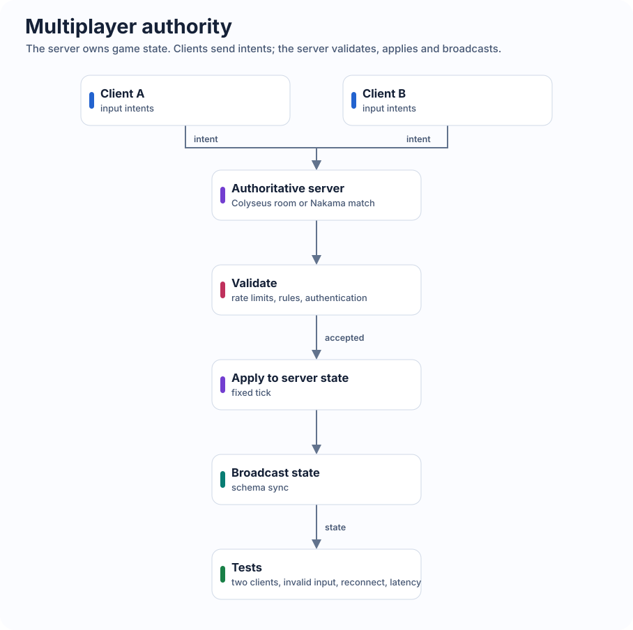

# Multiplayer

Online play is optional. Add it only after the single-player slice passes. When you add it, the server owns the game state: clients send what the player wants to do, and the server decides what happens.

Colyseus was **tested** on loopback in [fixtures/game-dev](../../fixtures/game-dev/README.md). Nakama was **not run**; its guidance is **documented** from the pinned repository. The test plan and security rules are **proposed** catalogue guidance.

[Editable diagram](../diagrams/multiplayer-authority.mmd)

## Server authority

- **Clients send intents, not results.** "Move left", "fire", "pick choice 2". Never "I am at x = 400" or "I hit player B for 50".
- **The server validates every message**: shape, type, range, rate and whether the action is legal now.
- **The server applies accepted intents at a fixed tick** and broadcasts the resulting state.
- **Clients may predict** their own movement for responsiveness, then correct to the server's state. The server's state always wins.

## Colyseus or Nakama

Pick one. Both run authoritative matches; they differ in what else they bring.

| | [Colyseus](../repositories/colyseus.md) | [Nakama](../repositories/nakama.md) |
| --- | --- | --- |
| Shape | Node.js rooms with automatic binary state sync through `@colyseus/schema` | A full game backend: accounts, storage, chat, leaderboards, tournaments, matchmaking, authoritative matches |
| Match code | TypeScript room classes | Handlers `match_init`, `match_join_attempt`, `match_join`, `match_leave`, `match_loop`, `match_terminate`, `match_signal` in Lua, TypeScript/JavaScript or Go |
| Needs | Node 22+ for the server (colyseus 0.18.12) | CockroachDB or a Postgres-compatible database, even for local work |
| License | MIT | Apache-2.0 |
| Watch out for | Accounts, storage and social features are yours to build | Anonymous telemetry to Segment is on by default (set `NAKAMA_TELEMETRY=0` to opt out). The example docker-compose runs CockroachDB with `--insecure` and the default server key `defaultkey`; never use either in production. The Console listens on port 7351. |
| Evidence | **Tested** on 127.0.0.1 | Documented, **not run** |

Choose Colyseus when you need rooms and state sync and already have (or do not need) accounts. Choose Nakama when the brief needs accounts, persistence and social features from one server.

## What the fixture proved

`colyseus-room` used `@colyseus/core` 0.18.30, `@colyseus/ws-transport` 0.18.5, `@colyseus/schema` 5.0.52 and two `@colyseus/sdk` 0.18.10 clients, with the server bound to 127.0.0.1:

| Test | Result |
| --- | --- |
| Two clients join one room | Both see identical server-owned state (tick 6, A at x = 6, B at (12, 4)) |
| A message carrying `x: 9999` (teleport) | Rejected and counted |
| A move of `dx: 500` | Clamped to one step |
| B drops and reconnects with its token | Same session, same position; B's next move reaches both clients |
| Shutdown | Clean |

Limits: reconnect used the manual path (`client.reconnect(token)` with `allowReconnection` in the server's `onDrop`), with the SDK's automatic reconnection turned off. The fixture used `@colyseus/sdk` 0.18, not `colyseus.js`; the newest `colyseus.js` is 0.16 and was not tested against the 0.18 server. Installs used `npm ci --ignore-scripts --legacy-peer-deps` after the install scripts were reviewed; only `msgpackr-extract` has one, and it is not needed.

## Rules for the server (proposed)

| Area | Rule |
| --- | --- |
| Validation | Check every field of every message against a schema. Reject unknown fields. Clamp or reject values outside the legal range, as the fixture does for teleports and oversized moves. |
| Rate limits | Cap messages per client per second and per tick. Count rejections; disconnect clients that keep breaking rules. |
| Authentication | Decide who can join before a match starts. Do not trust a client-supplied player ID. Keep server keys and console passwords out of the repository and out of chat. |
| Reconnect | Hold a dropped player's slot for a stated time. Resume with a reconnection token, never by player name. |
| Protocol versioning | Send a protocol version on join. Reject or upgrade clients whose version does not match, with a clear message. Bump it on every message or state schema change. |
| Tick rate | Fix it and write it down. Server tick and physics step can differ, but both are constant. |
| Determinism | Do not plan lockstep or rollback netcode on a solver whose cross-platform determinism you have not measured. See [engines and physics](engines-and-physics.md#determinism-measure-before-you-claim-it). |
| Logging | Log rejected messages and disconnects without personal data. |

## Security and authorization

- **Loopback by default.** Bind development servers to 127.0.0.1, as the fixture does. Open a port to a network only when the owner asks.
- **No public deployment without written authorization.** That includes cloud hosting, port forwarding and tunnels.
- **No player-data collection without authorization**: accounts, analytics, chat logs or telemetry. Turn off telemetry you did not approve, such as Nakama's.
- **Never expose development or admin endpoints.** Keep MCP servers, debug consoles, the Nakama Console, inspectors and remote-control protocols (for example Bevy's remote protocol) off any public interface.
- Follow the catalogue's [security review](../../SECURITY.md) before installing a server.

## Network tests (proposed)

1. **Two clients, one match.** Both see the same state after the same inputs.
2. **Invalid input.** Teleports, out-of-range values, wrong types, unknown fields and messages from players not in the match are rejected and counted.
3. **Flooding.** A client that sends faster than the rate limit is throttled or disconnected; the others keep playing.
4. **Reconnect.** A dropped client returns with its token inside the hold time and keeps its state; after the hold time, it cannot.
5. **Version mismatch.** A client with an old protocol version gets a clear rejection.
6. **Latency and packet loss.** Play with added delay and loss (for example 100 ms and 2%, then 250 ms and 5%) and record whether the game stays playable. Use an OS or proxy network shaper on a local machine.
7. **Shutdown.** The server stops cleanly and clients see a clear message.

## Acceptance

Floor: server authority; every message validated; invalid input rejected; reconnect works; nothing public without authorization; no admin endpoint exposed. Reflex: protocol version checked on join; latency and loss tested and recorded. Record evidence with the [quality gates](../../QUALITY_GATES.md).

Back to [game development](README.md).
