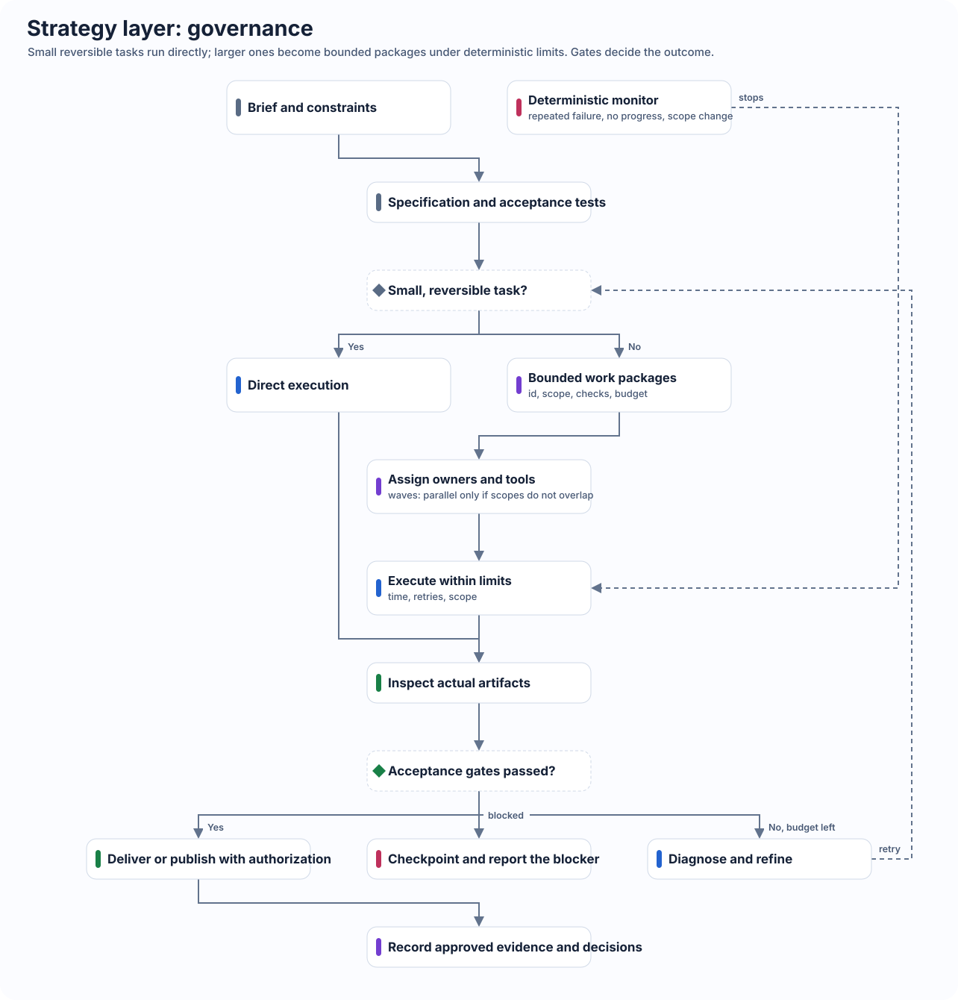

# Strategy layer: governing the specialist tools

How an agent plans, splits, watches, records and learns from work that uses the catalogue's tools. It governs the existing capabilities; it adds no repository and requires no agent framework.

## Status

| Part | Status | Evidence |
| --- | --- | --- |
| The six practices below | **Proposed.** V7's synthesis, adopted here as guidance | — |
| Work packages, deterministic monitor, plan/action ledger, decisions with alternatives | **Tested** as [kit/workledger](../../kit/workledger/README.md) | 17 of 17 checks; [measured comparison](../../kit/workledger/out/strategy-evaluation.md) with a direct-execution baseline |
| Contracts for packages, ledger and decisions | **Tested**: the fixture's output validates against them | [registry/contracts](../../registry/contracts/) |
| The source article (`x.com/0xcodio/status/2109275834984915150`) | **`source_content_pending`**. Its body could not be retrieved, so nothing here is attributed to it. | [SOURCES.md](../../SOURCES.md) |

## The six practices

1. [Spec-first scaffolding](spec-first.md): write the deliverable, constraints, non-goals, ownership and acceptance tests before acting.
2. [Bounded decomposition and delegation](delegation.md): split by verifiable artifact; parallelise only independent packages; one owner validates the whole.
3. [Independent monitoring and termination](monitoring.md): deterministic limits on time, retries, repetition and scope; stop and report instead of blind retries.
4. [Plan/action evidence ledger](evidence-ledger.md): record intended and observed effects; reconcile with diffs and tests.
5. [Alternatives and measured learning](alternatives.md): compare viable options, including keeping the current one; never report an unrun alternative as observed.
6. [Memory and context hygiene](memory-hygiene.md): keep the current specification apart from memory, history and guesses; nothing hidden is collected.

## When to use it

A small, reversible task runs directly: brief, act, inspect, deliver. Use packages when a task has several artifacts with different owners, risky side effects, or long runs worth bounding. Delegation is worth it only when it improves quality or delivery. The fixture's baseline comparison is the honest test.

## Contracts

| File | Holds | Schema |
| --- | --- | --- |
| `work-packages.json` | id, parent, goal, owner, inputs, outputs, dependencies, edit scope, acceptance checks, budget, retry limit, status, evidence | [work-packages.schema.json](../../registry/contracts/work-packages.schema.json) |
| `execution-ledger.jsonl` | One line per attempt: planned and observed effect, changed paths, validation, deviation, status | [execution-ledger.schema.json](../../registry/contracts/execution-ledger.schema.json) |
| `decision-log.jsonl` | Constraints, two or more alternatives, the choice, rationale, evidence, uncertainty, review trigger, approval | [decision-log.schema.json](../../registry/contracts/decision-log.schema.json) |
| `strategy-evaluation.md` | Baseline against the governed process on the same tasks, with measured numbers only | [template](../../templates/strategy-evaluation.md) |

Store them in the project's own documentation or state folder. Never log credentials, private prompts or hidden reasoning.

[Editable diagram](../diagrams/strategy-governance.mmd)
