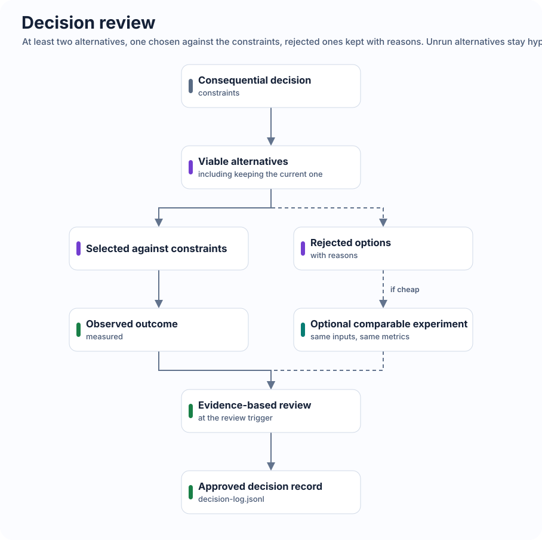

# Alternatives and measured learning

For a consequential decision, compare a few real options, including keeping what already works.



## Record

Use the [decision log contract](../../registry/contracts/decision-log.schema.json): constraints, at least two alternatives, the choice, a short rationale, evidence, uncertainty and a review trigger. workledger's `decide` refuses a decision with only one option.

```sh
python kit/workledger/workledger.py decide decision-log.jsonl \
  --constraints "Render must finish on a 24 GB GPU" \
  --alternative "keep HyperFrames" --alternative "switch to Remotion" \
  --chosen "keep HyperFrames" --rationale "Existing compositions work; no measured gain from switching" \
  --uncertainty medium --review-trigger "if render time exceeds 10 min per minute of film"
```

## Measure when it is cheap

Run comparable experiments on the same inputs and the same metrics: two image-to-3D models on one authorized image (see the benchmark in [image to 3D](../3d-pipeline/image-to-3d.md)), or two processes on the same work packages (see [the strategy evaluation](../../kit/workledger/out/strategy-evaluation.md)). Keep measured outcomes apart from estimates. An alternative that was not run is a hypothesis, never an observation.

## Do not churn

Do not replace a validated toolchain because of a hypothetical improvement. Do not demand parallel exploration for routine tasks. Change a recorded decision only when its review trigger fires or new evidence contradicts it.

[Editable diagram](../diagrams/decision-review.mmd)
