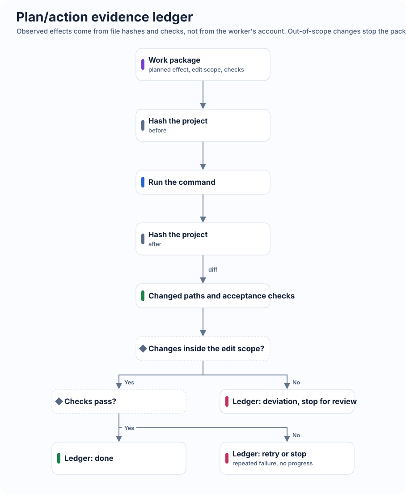

# Plan/action evidence ledger

Before a material action, write what it should do. After it, write what it did. Then compare.

## One entry per attempt

| Field | Example |
| --- | --- |
| `work_package_id` | `P5` |
| `planned_effect` | Generate sound effects |
| `observed_effect` | exit 0; 2 files changed |
| `changed_paths` | `assets/sfx.txt`, `ui/hacked.css` |
| `validation_result` | pass |
| `deviation_reason` | changed outside edit scope: `ui/hacked.css` |
| `status` | stopped |

The changed paths come from hashing the project before and after, not from the worker's own account. That is what makes the comparison independent of the worker. The full format is the [execution ledger contract](../../registry/contracts/execution-ledger.schema.json).

## Reconcile

`python kit/workledger/workledger.py reconcile execution-ledger.jsonl` gives each package's final planned-versus-observed state. A justified change is fine: record its reason and update the plan. An unexplained change outside scope stops the package for review.

## What not to store

Actionable summaries, evidence and decisions only. No hidden reasoning, no secrets and no private context the task did not need.

[Editable diagram](../diagrams/plan-action-ledger.mmd)
