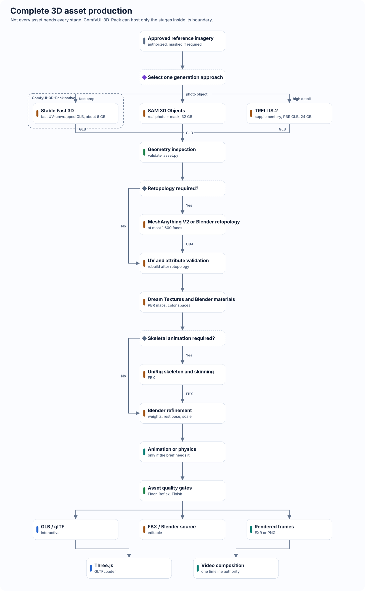

# Workflow 9: 3D asset factory

Turn approved reference imagery into a validated, exported asset with one image-to-3D model and Blender for cleanup, UVs and materials.



## Objectives

- One generator per asset. The raw output is kept unedited as `v1` with model, commit, checkpoint hash, seed and settings recorded.
- Every delivered file (GLB and FBX, not only the open scene) passes all Floor checks of [validate_asset.py](../../scripts/blender/validate_asset.py).
- Reflex checks (`unit_scale`, `max_4_influences`, `watertight` after welding, `no_ngons`) pass, or each failure has a written reason.
- Size in meters is within the tolerance set in the brief (start at 2%) of the reference dimensions.
- The triangle budget in the brief is met. For web delivery, the hero GLB is under 10 MB, or 3 MB for mobile-first work.
- A turntable contact sheet (at least front, back, both sides and three-quarter) is reviewed at full size.

## Prerequisites

- Reference images with recorded rights and consent. A plain background helps every generator; SAM 3D Objects needs a binary mask per object.
- The model's license checked against the intended use before generating (table below).
- Hardware that matches the chosen model. SAM 3D Objects and TRELLIS.2 are Linux-only.
- Blender 5.2 or later (5.2.2 LTS was tested here) and the [asset manifest](../../templates/asset-manifest.json) started for this asset.
- Pipeline guides: [image to 3D](../3d-pipeline/image-to-3d.md), [retopology](../3d-pipeline/retopology.md), [UVs and materials](../3d-pipeline/uv-and-materials.md), [asset validation](../3d-pipeline/asset-validation.md), [export contracts](../3d-pipeline/export-contracts.md).
- Before setup, prove the existing toolchain cannot meet the acceptance criteria. Use the pinned guide from the [index](../../REPOSITORIES.md), [installation guidance](../../INSTALLATION.md) and [security review](../../SECURITY.md).

## Tool selection

None of the generators below was run here; their facts are documented. Blender, the validator and the Three.js load were tested in `fixtures/blender-glb`.

| Need | Pick | Why |
| --- | --- | --- |
| Fast single prop, consumer GPU | [Stable Fast 3D](../repositories/stable-fast-3d.md) | About 6 GB VRAM; UV-unwrapped GLB with delit albedo and material parameters. Stability AI Community License: free commercial use under US$1M annual revenue, registration required. |
| Real photo of an occluded object | [SAM 3D Objects](../repositories/sam-3d-objects.md) | Linux, at least 32 GB VRAM, mask in the alpha channel. Outputs a Gaussian PLY and a GLB; the demo leaves mesh post-processing and texture baking off. SAM License. |
| High detail, full PBR, open surfaces | [TRELLIS.2](../repositories/trellis-2.md) | Linux, at least 24 GB. PBR GLB exported OPAQUE, so wire alpha by hand. MIT code, but the default pipeline pulls DINOv3 and RMBG-2.0 under their own licenses. |
| Retopology, default | Blender | General practice: manual, Remesh, Decimate or QuadriFlow, with full control of the face budget and no license limit. |
| Low-poly retopology, non-commercial only | [MeshAnything V2](../repositories/meshanything-v2.md) | At most 1,600 faces, untextured OBJ, about 8 GB. S-Lab non-commercial code license; the Hugging Face weights are tagged MIT, a contradiction to treat as non-commercial. |
| UVs and materials | Blender, with [Dream Textures](../repositories/dream-textures.md) optional for color images | Dream Textures (GPL-3.0) projects Stable Diffusion images onto faces; Blender nodes assemble the PBR set (proposed pair). |
| Validation | [validate_asset.py](../../scripts/blender/validate_asset.py) | Tested on GLB and FBX in the fixture. |
| Batch runs | [ComfyUI-3D-Pack](../repositories/comfyui-3d-pack.md) | Only for SF3D or TRELLIS v1 batches; see [workflow 12](comfyui-asset-processing.md). |

## Rejected alternatives

- **Two generators merged into one asset.** The registry classes SF3D, SAM 3D Objects and TRELLIS.2 as alternatives: one per asset. Merged predictions disagree about unseen surfaces.
- **Treating the SAM 3D Gaussian PLY as the mesh.** A Gaussian PLY is not a polygon mesh. Use the GLB branch or a modelled mesh.
- **MeshAnything V2 for commercial work, characters or anything above 1,600 faces.**
- **[Dream Loop](../repositories/dream-loop.md).** It sends images to paid fal.ai endpoints and its Plus workflow says not to model in Blender, which conflicts with Blender owning cleanup.
- **Upscaling textures with Real-ESRGAN by default.** It invents detail; use it only after an A/B test at delivery size.
- **Expecting exact reconstruction.** Generators predict the sides they cannot see. Review those sides against references and model them by hand when they matter.

## Execution

1. **Approve references.** Front, side and back where possible, neutral light, plain background, mask if needed. Record paths, rights and consent in the manifest.
2. **Select one generator** from the table. Record repository commit, checkpoint SHA-256, seed and every parameter in the manifest stage.
3. **Generate.** Save the raw file as `v1-original`, read-only.
4. **Inspect.** Run the validator on `v1` for a baseline:
   ```sh
   blender --background --factory-startup --python-exit-code 1 --python scripts/blender/validate_asset.py -- v1.glb reports/v1.json
   ```
   Generated GLBs often arrive at the wrong orientation or scale. Fix both and apply transforms. Author in meters; glTF export converts Blender's Z up to Y up.
5. **Clean geometry.** Merge by distance, recalculate normals outward, delete loose parts and internal faces, fill holes that should be closed. A GLB re-import shows open seams because glTF splits vertices along UV seams and hard edges; judge watertightness on `boundary_edges_welded`, not `boundary_edges`.
6. **Retopologize if required.** Bake normals from the cleaned high mesh to the low mesh. Save as `v2-retopo`.
7. **Unwrap UVs** after retopology, never before. Keep texel density even, add padding, and keep islands inside 0-1 (the report's `outside_0_1`).
8. **Build materials.** Principled BSDF. Base color in sRGB; roughness, metallic, normal and alpha in Non-Color. The validator fails `colour_spaces_valid` when an sRGB image feeds those sockets.
9. **Validate** each export, fill the [mesh quality report](../../templates/mesh-quality-report.md) and render the turntable sheet.
10. **Export.** GLB for real-time use and FBX plus `.blend` as editable sources. Re-run the validator on the exported files. Load the GLB with Three.js GLTFLoader and check size, up axis and materials, as the fixture's `check.mjs` does.

## Handoff contracts

| Producer | Consumer | Format | What to check |
| --- | --- | --- | --- |
| Owner | Generator | PNG references, masks in alpha for SAM 3D | Rights, consent, one object per image. |
| Generator | Blender | GLB `v1` (Gaussian PLY is not accepted as mesh) | Baseline validator report saved; model, seed, hash recorded. |
| Blender cleanup | Retopology | `.blend` or OBJ | Welded, normals consistent, scale applied. |
| Retopology | UV and materials | OBJ or `.blend` `v2` | Face budget met; normal bake matches the high mesh. |
| Materials | Export | `.blend` `v3` | Color spaces valid; texture sizes recorded. |
| Export | Engine or renderer | GLB, FBX, `.blend` | Floor checks pass on the files themselves; GLB loads in Three.js. |

## Quality gates

Apply the [quality gates](../../QUALITY_GATES.md): **Geometry** (validator Floor checks, transforms applied, meters; triangle budget and silhouette from three angles as Reflex), **UVs and materials** (UVs exist, Non-Color data maps, a material on every face; even texel density), **Rigging** only if the asset is skinned, **Interactive 3D** when the asset goes to a browser (scale and materials match the source, GLB size, draw calls) and **Delivery** (every file opens, rights recorded for references, weights and textures, reproducible export command).

## Deliverables

Asset manifest with every stage, raw `v1` output, cleaned and final `.blend`, GLB and FBX, validator JSON for each file, the mesh quality report, turntable contact sheet, Three.js load evidence, and the license record for model, weights and inputs.

[Editable diagram](../diagrams/3d-asset-production.mmd)
