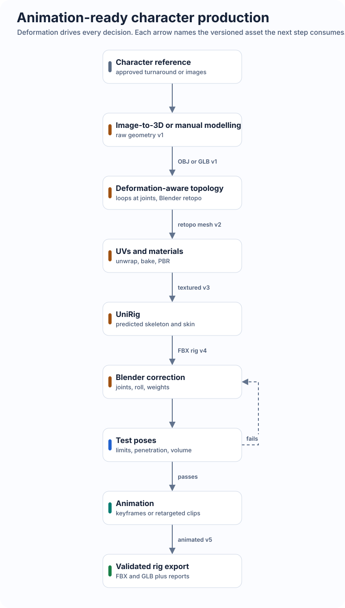

# Workflow 10: Animation-ready character

Produce a character whose topology, skeleton and weights hold up in test poses, and export it as validated FBX and GLB with named clips.

## Objectives

- Every test pose in the table below passes, or each failure has a written reason accepted by the creative owner.
- [validate_asset.py](../../scripts/blender/validate_asset.py) Floor checks pass on the exported FBX and GLB, including `rig_weights_normalised` (no unweighted and no non-normalized vertices). Reflex `max_4_influences` passes.
- Bone names, count, single root and hierarchy match the skeleton spec exactly.
- Every clip name in the export contract is present after re-import of both FBX and GLB.
- The GLB loads in Three.js with the declared skinned meshes, bone count and clips, and seeking a clip gives the same pose on repeat (as in the fixture).

## Prerequisites

- An approved turnaround: front, side and back in an A-pose or T-pose, neutral expression, consistent scale. Rights and consent recorded.
- A skeleton spec: bone names, count, root, deform bones, engine naming rules and the influence limit (4 for glTF).
- A clip list with names, frame ranges and fps.
- Hardware for UniRig: CUDA GPU with at least 8 GB VRAM; its launch scripts are bash.
- Templates: [asset manifest](../../templates/asset-manifest.json), [mesh quality report](../../templates/mesh-quality-report.md), [rig validation report](../../templates/rig-validation-report.md).
- Before setup, prove the existing toolchain cannot meet the acceptance criteria. Use the pinned guide from the [index](../../REPOSITORIES.md), [installation guidance](../../INSTALLATION.md) and [security review](../../SECURITY.md).

## Tool selection

| Need | Pick | Why |
| --- | --- | --- |
| Base geometry | Manual modelling in Blender, or one generator through [workflow 9](3d-asset-factory.md) | A generated mesh is a sculpt reference; its topology is not built to bend. |
| Deformation topology | Blender retopology | General practice. Registry note: characters still need Blender retopology; MeshAnything V2 caps at 1,600 faces and cannot place loops at joints. |
| Skeleton and skin, first pass | [UniRig](../repositories/unirig.md) | Documented: predicts a skeleton, then skin weights; takes OBJ, FBX, GLB or VRM (also DAE and glTF) and writes FBX, merged through bpy 4.2. MIT, but bundles GPL-3.0 Michelangelo code. Not run here. Check its successor SkinTokens for new work. |
| Correction, weights, rest pose | Blender rigging | Tested in [the fixture](../../fixtures/blender-glb/make_asset.py): automatic weights, normalize, limit to 4 influences, FBX and GLB export. |
| Validation | validate_asset.py and Three.js GLTFLoader | Tested on the fixture's GLB and FBX. |
| Agent-driven Blender, optional | [Blender Skills](../repositories/blender-skills.md) or [Blender MCP](../repositories/blender-mcp.md) | Documented: run Blender Python headless or live. Arbitrary code execution; use a disposable scene. |

## Rejected alternatives

- **Shipping UniRig output unchecked.** A predicted rig is a starting point. Skinning drops sharply when the skeleton misses bones such as tails or wings.
- **MeshAnything V2 for character topology.** Face cap, no edge-loop control, non-commercial code license.
- **Automatic weights alone.** In the fixture they left a visible crease at the middle joint of a three-bone chain. Weight sums were correct; the pose was not.
- **ComfyUI-3D-Pack for rigging.** It has no UniRig node; run UniRig standalone with file handoffs.
- **Physics bone attributes from UniRig.** Bone-attribute prediction is not released.

## Execution

1. **Block the base mesh** at real scale in meters, from the turnaround or a generated `v1`. Save `v1`.
2. **Build deformation-aware topology.** Quads only in deforming areas. At least three edge loops across elbows, knees, wrists and ankles. Loops that follow the deltoid around the shoulder and the gluteal fold at the hip. Loops around eyes and mouth if the face animates. Poles away from joints. Symmetry on. Apply transforms. Save `v2-retopo`.
3. **Unwrap and texture** after topology is final. Save `v3-textured`.
4. **Predict a rig with UniRig.** Run `generate_skeleton.sh` on `v3` with two or three `--seed` values; seeds give skeleton variations. Pick the closest to the spec and add any missing bones before skinning. Run `generate_skin.sh`, then `merge.sh` with the **skin** FBX, not the skeleton-only FBX, which carries no weights. Save `v4-rig`. Check arguments in the [UniRig guide](../repositories/unirig.md).
5. **Correct in Blender.** Rename bones to the spec. Place joints at anatomical pivots. Make bone roll consistent down each chain. Keep one root. Turn off deform on control bones. Repaint weights where needed, smooth, normalize all, limit total influences to 4 and clean weights below a small threshold.
6. **Run test poses** (table below). Pose, inspect from front, side and top, and fix weights or topology. Repeat until the set passes.
7. **Animate** keyframed or retargeted clips with the names and ranges from the clip list. Save `v5-animated`.
8. **Export and validate.** Export FBX and GLB, then run the validator on each file and load the GLB in Three.js. Fill the rig validation report.

### Test poses

| Pose | Look for |
| --- | --- |
| Arms raised overhead, and forward 90° | Shoulder collapse, armpit penetration, torso pulled by arm weights |
| Elbow and knee bent about 130° | Volume loss, inner-joint penetration, a crease at the middle joint |
| Forearm twisted 90° | Candy-wrapper pinching at the wrist |
| Deep squat | Hip and knee volume, thigh-into-belly penetration |
| Spine bent and twisted 45° | Even distribution across spine bones, no stepped bands |
| Head turned 70° | Neck stretching, collar following the head |
| Fist, if fingers are rigged | Finger interpenetration, palm collapse |

### Lessons from the fixture

These come from `fixtures/blender-glb` (Blender 5.2.2, three r187) and apply to every character:

1. glTF splits vertices along UV seams and hard edges: the GLB re-imported with 430 vertices and 224 boundary edges, against 314 and 0 for FBX. Judge watertightness after welding (`boundary_edges_welded`).
2. The FBX round trip renamed the action `bend` to `toy_rig|toy_rig|bend`. Record clip names in the export contract and check them after import.
3. Blender's glTF importer adds an `Icosphere` bone-display helper mesh. Exclude bone custom shapes from asset checks; the validator lists them in `ignored_helpers`.
4. Automatic weights on a three-bone chain creased the middle joint in test poses. Check poses, not only weight sums.
5. glTF skins carry 4 joint influences per vertex set. Limit and normalize weights before export.

## Handoff contracts

| Producer | Consumer | Format | What to check |
| --- | --- | --- | --- |
| Modelling | Retopology | OBJ or GLB `v1` | Real scale, applied transforms. |
| Retopology | UV and materials | `.blend` `v2` | Loops at every joint in the spec; quads in deforming areas. |
| Materials | UniRig | OBJ, FBX or GLB `v3` | One mesh object or a declared set; scale applied. |
| UniRig | Blender | Skinned FBX `v4` | Skin FBX merged, not skeleton-only; seed and checkpoint recorded. |
| Blender | Animation | `.blend` | Test poses pass; bone names match the spec. |
| Animation | Engine | FBX and GLB `v5` | Clip names after re-import; Floor checks on both files; GLB seeks repeatably in Three.js. |

## Quality gates

Apply the [quality gates](../../QUALITY_GATES.md): **Rigging** (single root, bind pose, every vertex weighted and normalized, at most 4 influences; test poses and clip names as Reflex), **Geometry** (edge flow that follows deforming forms is its Finish tier; here it is required by the objectives), **UVs and materials**, **Physics and animation** (timing matches the clip list, no popping), **Interactive 3D** for web delivery, **Time contract** when a scene must play live and render (seeking a clip must deform repeatably), and **Delivery** (rights for references and weights, reproducible export command). This workflow raises the test-pose table to a release blocker.

## Deliverables

Manifest with versions `v1` to `v5`, final `.blend`, FBX and GLB, validator JSON for each export, a test-pose contact sheet, the rig validation report, the clip list as exported, Three.js load evidence, and license notes for UniRig's GPL-3.0 component if it is redistributed.

[Editable diagram](../diagrams/animation-ready-character.mmd)
