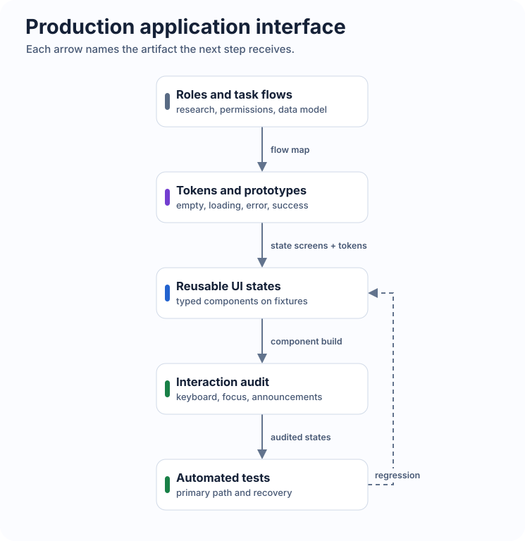

# Production application interface

Deliver a production surface showing the core user journey and all operational states.

## Objectives

- Every task in the core journey works for each role, including empty, loading, error and success states.
- Keyboard-only use, focus restoration and announcements pass.
- Automated tests cover the primary path and its failure recovery.

## Prerequisites and selection

Confirm user roles, data model, permissions, research findings, current design system and component test commands.

Penpot for collaborative prototype or Figma Context MCP when Figma owns design. Astryx only for a React 19+ project with a genuine design-system gap.

Use real or synthetic fixture data appropriate to policy. Keep the house design system if sufficient.

Before setup, prove the existing toolchain cannot meet the acceptance criteria. Use the selected tool's pinned guide from the [index](../../REPOSITORIES.md). Review commands and record the revision in the project lockfile or tool manifest. Use [installation guidance](../../INSTALLATION.md) for isolated setup and [security review](../../SECURITY.md) before external processing.

## Rejected alternatives

| Not chosen | Why |
| --- | --- |
| Stitch for an app with an existing design system | Hosted generation adds a second authority. |
| Astryx in a non-React-19 project | Requires React 19+ and StyleX peers. |
| Decorative motion libraries | Operational screens need clarity before flourish. |

## Execution

1. Map tasks to routes and document role permissions.
2. Define tokens and prototype empty, loading, error and success screens.
3. Implement reusable components against typed fixtures or approved APIs.
4. Audit keyboard order, focus restoration, announcements and contrast.
5. Automate the primary path and failure recovery.

## Asset contract

User research → flow map and tokens → prototype → typed component state and tests. Keep token semantics and contrast explicit.

## Acceptance and deliverables

Exercise keyboard-only use, slow and failed requests, long content and restricted roles.

Prototype, tokens, application source, state coverage, tests and screenshots. Record tool versions, preview evidence and any blocked checks using the [quality gates](../../QUALITY_GATES.md).

[Editable diagram](../diagrams/application-interface.mmd)
