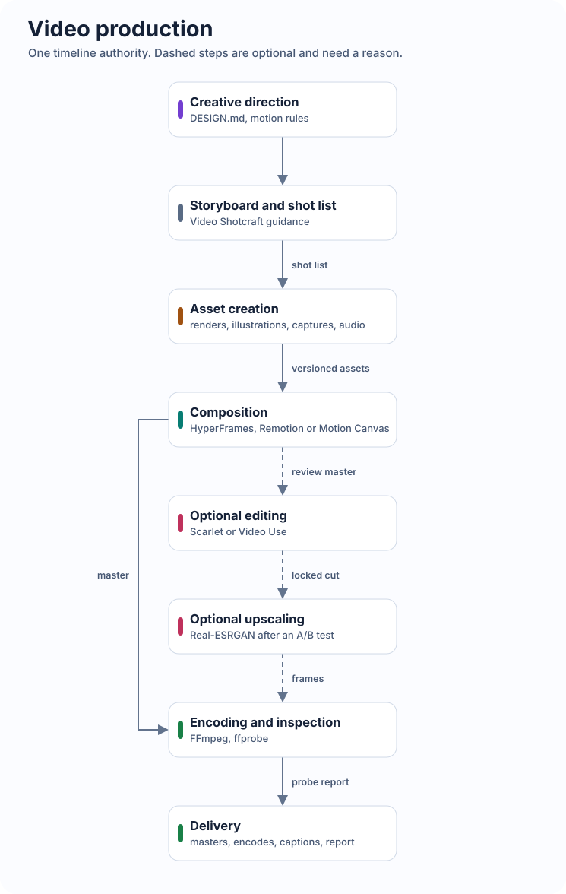

# Cinematic promotional video

Deliver an approved promotional cut and technically validated media masters.

## Objectives

- An approved cut with sync, captions and safe areas checked.
- Masters and platform encodes pass ffprobe against the shot list.
- No unnecessary re-encode between steps.

## Prerequisites and selection

Confirm footage rights, target distribution, safe areas, frame rate, aspect ratios and audio/caption requirements.

Choose HyperFrames for HTML, Remotion for React or Motion Canvas for procedural motion. Use Scarlet or Video Use only if editing adds value. Use FFmpeg at the output boundary.

Use the existing editor when it meets the timeline needs. Upscale with Real-ESRGAN only if an A/B test gives a visible gain.

Before setup, prove the existing toolchain cannot meet the acceptance criteria. Use the selected tool's pinned guide from the [index](../../REPOSITORIES.md). Review commands and record the revision in the project lockfile or tool manifest. Use [installation guidance](../../INSTALLATION.md) for isolated setup and [security review](../../SECURITY.md) before external processing.

## Rejected alternatives

| Not chosen | Why |
| --- | --- |
| Two compositors on one timeline | No portable editable-timeline interchange is verified. |
| Scarlet and Video Use on the same cut | Two editors own one cut list. |
| Upscaling every shot | Only shots that win an A/B test at delivery size. |

## Execution

1. Storyboard shots and create a cue sheet.
2. Compose and inspect a low-cost draft from one timeline.
3. Approve final edits and mix and check speech against cuts.
4. Restore selected shots only when the test justifies it.
5. Export a master and inspect streams and representative frames before target encoding.

## Asset contract

Storyboard and licensed media → timeline → master video plus caption files → platform deliverables. Declare FPS, color metadata and audio sample rate.

## Acceptance and deliverables

Review opening, closing, cut points, sync, safe areas and captions. Confirm output codecs, dimensions and duration with ffprobe.

Timeline source, cue sheet, master, distribution exports, captions and stream report. Record tool versions, preview evidence and any blocked checks using the [quality gates](../../QUALITY_GATES.md).

[Editable diagram](../diagrams/cinematic-video.mmd)
