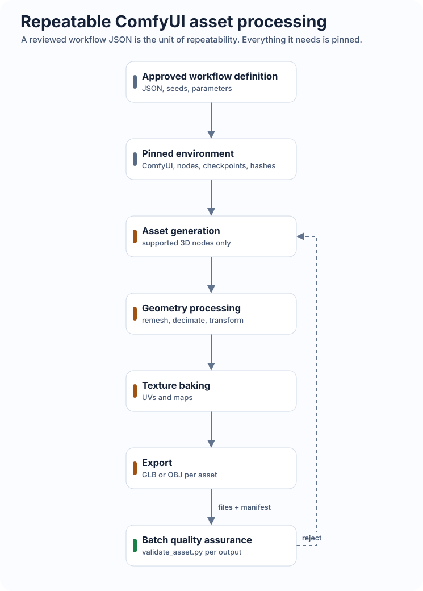

# Workflow 12: ComfyUI asset processing

Run one reviewed ComfyUI workflow JSON over a batch of inputs in a pinned environment, and pass every output through the same validator before it is accepted.



## Objectives

- The environment is fully pinned: ComfyUI commit, ComfyUI-3D-Pack commit, every other custom node's commit, `pip freeze` output and the SHA-256 of every checkpoint. Unrecorded components: zero.
- Every node `class_type` in the workflow JSON is a native ComfyUI or ComfyUI-3D-Pack node from the reviewed list. Anything else runs as an external adapter.
- 100% of outputs have a [validate_asset.py](../../scripts/blender/validate_asset.py) report. Accepted outputs pass every Floor check.
- Re-running the same input and seed on the same machine gives a report with the same mesh statistics, or the difference is recorded as GPU nondeterminism.
- Each rejected output has a reason and at most two automatic retries before it goes to a manual queue.
- The batch manifest maps every input to its output, seed, report and verdict.

## Prerequisites

- **An isolated ComfyUI install** (its own Python environment). ComfyUI-3D-Pack's install pins torch 2.7.0 and xformers into the ComfyUI Python, which can replace the torch other custom nodes expect.
- **A reviewed `install.py`.** It downloads prebuilt binary wheels from a third-party repository (`DenisKochetov/Comfy3D_Pre_Builds`) at its default branch with no hash check, installs them with `--no-deps --force-reinstall`, and writes source files into the Python root. Pin the wheel URLs and record their hashes before running it.
- **Local-only serving.** The pack adds a `/viewfile` route that returns local `.png`, `.jpg`, `.obj`, `.glb`, `.ply`, `.mtl` and `.splat` files to allow-listed IPs; behind a local reverse proxy that becomes an arbitrary file read. Bind to 127.0.0.1 and put no proxy in front.
- **A read-only Hugging Face token.** The pack stores it in plain text in `Configs/system.conf`. Keep that file out of repositories and shared backups.
- **Licenses per model.** Node code is MIT; outputs follow each model's license (Stability AI Community License for SF3D, Tencent Hunyuan Community License for Hunyuan3D, MIT or Apache-2.0 for TripoSG and InstantMesh).
- Blender 5.2 or later for validation. Before setup, prove the existing toolchain cannot meet the acceptance criteria. Use the pinned guide from the [index](../../REPOSITORIES.md), [installation guidance](../../INSTALLATION.md) and [security review](../../SECURITY.md).

## Tool selection

| Need | Pick | Why |
| --- | --- | --- |
| Batch image-to-3D inside ComfyUI | [ComfyUI-3D-Pack](../repositories/comfyui-3d-pack.md) native nodes | Documented: Stable Fast 3D, TRELLIS v1 (not TRELLIS.2), Hunyuan3D, TripoSG, InstantMesh and its own 3DGS nodes. Not run here. |
| Multi-view texture baking, orbit renders | ComfyUI-3D-Pack glue nodes | Documented: nvdiffrast baking, orbit camera stacks, axis switching between model coordinate systems. |
| SAM 3D Objects, TRELLIS.2, UniRig, MeshAnything V2 | External adapters | Documented: none has a native node at the pinned commit. Each runs standalone in its own environment with a file handoff. |
| Geometry fixes the pack lacks | Blender headless | General practice; same Blender used for validation. |
| Per-output QA | validate_asset.py | Tested on the fixture's GLB and FBX. |

## Rejected alternatives

- **Wrapping non-native models in ad-hoc custom nodes.** Their dependencies would land in the ComfyUI Python and fight over torch. An adapter keeps each environment separate.
- **"Update all" in a node manager.** It breaks the pin. Update one component, re-run the smoke batch, record the new commit.
- **Running `install.py` unreviewed**, or ComfyUI listening on a LAN address.
- **Hunyuan3D outputs for commercial work** before the community license's conditions are checked for the project.
- **Visual spot checks instead of a validator run per file.** A batch hides the one bad mesh.

## Execution

1. **Pin the environment.** Write `env.lock.md`: ComfyUI and node commits, Python and CUDA versions, `pip freeze`, checkpoint paths and SHA-256, wheel URLs and hashes.
2. **Review the workflow.** Export it in API format. List every node `class_type` and check it against the native list. Fix seeds and parameters in the JSON, not in the UI. Commit the JSON.
3. **Smoke-test** on two or three inputs. Validate the outputs and look at them at full size before scaling up.
4. **Run the batch** through ComfyUI's local HTTP API (general practice: submit the API-format JSON per input to `/prompt`). Name outputs `<input-id>_<seed>.glb`.
5. **Run external adapters** for steps outside the native list. Each adapter reads from an input folder, runs the standalone tool in its own environment and writes the file plus a sidecar JSON (tool, commit, checkpoint hash, seed, parameters).
6. **Validate every output:**
   ```sh
   mkdir -p reports
   for f in out/*.glb; do
     id=$(basename "$f" .glb)
     blender --background --factory-startup \
       --python scripts/blender/validate_asset.py -- "$f" "reports/$id.json" \
       || echo "$id" >> rejects.txt
   done
   ```
   The script exits 1 when a Floor check fails. Check orientation and scale too: generators use different axis conventions.
7. **Reject loop.** Classify each reject: geometry Floor failure, scale or axis, color space, or visual defect. Retry with a new seed or one changed parameter, at most twice, then move it to the manual queue for [workflow 9](3d-asset-factory.md) cleanup.
8. **Write the manifest.** One row per input: input, output, seed, report path, verdict, retries. One [asset manifest](../../templates/asset-manifest.json) per accepted asset.

## Handoff contracts

| Producer | Consumer | Format | What to check |
| --- | --- | --- | --- |
| Owner | ComfyUI | API-format workflow JSON | Native nodes only; seeds and parameters fixed; committed. |
| Environment owner | ComfyUI | `env.lock.md` | Commits, hashes, torch version; matches the running install. |
| ComfyUI | Adapter or QA | GLB or OBJ per input | Filename carries input id and seed. |
| Adapter | QA | File plus sidecar JSON | Tool commit, checkpoint hash, seed recorded. |
| QA | Owner or retry | Validator JSON, `rejects.txt` | Floor results per file; reason per reject. |
| QA | Downstream workflow | Accepted files plus batch manifest | Every accepted file has a passing report. |

## Quality gates

Apply the [quality gates](../../QUALITY_GATES.md): **Geometry** and **UVs and materials** on every output, **Engineering** (clean rebuild from the lock file), **Delivery** (rights per model and input, reproducible command for each artifact) and **Interactive 3D** when outputs ship to a browser. The validator's Floor checks gate every file; its Reflex checks need a fix or a reason.

## Deliverables

`env.lock.md`, the committed workflow JSON, adapter scripts and sidecars, accepted outputs, a validator report per output, `rejects.txt` with reasons, the batch manifest, asset manifests for accepted assets, and a license note per model used.

[Editable diagram](../diagrams/comfyui-asset-processing.mmd)
