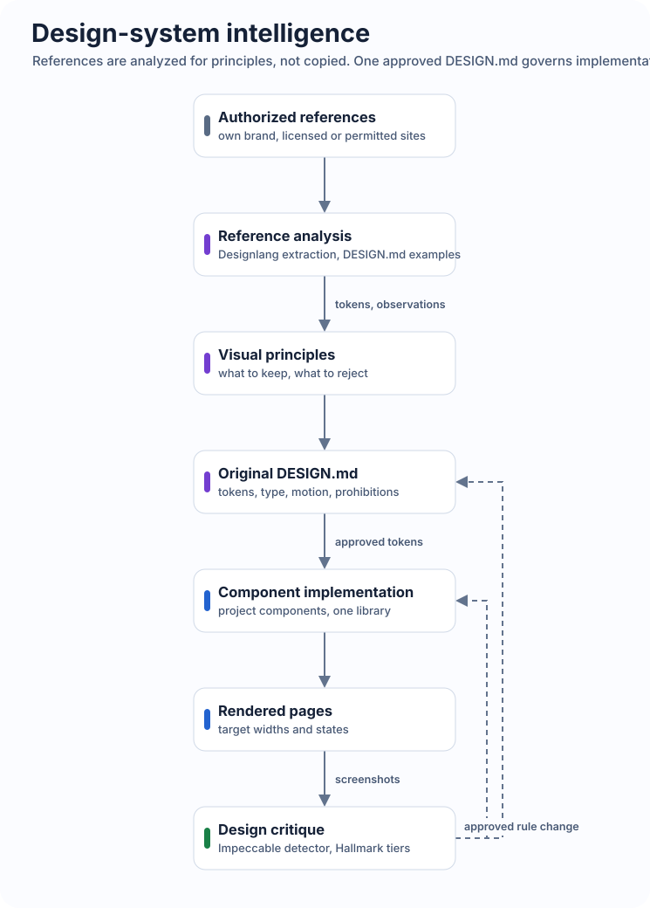

# Workflow 8: Design-system extraction

Turn authorized references into visual principles and an original `DESIGN.md`, build components against it, and audit the rendered pages.

## Objectives

- Every reference has a recorded basis: own site, licensed, or written permission. Unrecorded references: zero.
- The final `DESIGN.md` names no other brand, logo or proprietary font, and copies no other brand's palette, type pairing and layout as a set.
- Every token in `DESIGN.md` traces to a principle in `principles.md`.
- Components read color, type, spacing and motion from tokens only. Hard-coded values outside the token file: zero, checked by search.
- Pages are rendered at every target width and state, and the Visual design and Accessibility Floor checks pass (text contrast at least 4.5:1, or 3:1 for large text).
- Detector findings: zero open, or each closed with a written reason.

## Prerequisites

- A reference register, `references.md`: URL or file, owner, basis for use, terms-of-service check for automated access, date captured.
- Font licenses for every family the new system will use, including web embedding rights.
- The template [design-system.md](../../templates/design-system.md) and the project's current [DESIGN.md](../../DESIGN.md), if one exists. An existing approved system wins over new extraction.
- A local or staging build of the product to render and audit.
- Before setup, prove the existing toolchain cannot meet the acceptance criteria. Use the pinned guide from the [index](../../REPOSITORIES.md), [installation guidance](../../INSTALLATION.md) and [security review](../../SECURITY.md).

## Tool selection

| Need | Pick | Why |
| --- | --- | --- |
| Measure an own or permitted site | [Designlang](../repositories/designlang.md) | Documented: reads computed styles off the live DOM, captures hover, focus and runtime animations, and writes W3C DTCG tokens. Canonical repo is `Manavarya09/design-extract`; the original `Manavarya09/designlang` URL returned 404 on 2026-11-26, and npm `designlang` 13.4.1 points to the new repo. |
| Learn the file format | [Awesome DESIGN.md](../repositories/awesome-design-md.md) | Documented: 84 example files in the nine-section Stitch `DESIGN.md` format. Use the structure, not the content. |
| Deterministic audit | [Impeccable](../repositories/impeccable.md) detector | Documented: 62 rules, no model, no key, JSON or SARIF output that can gate pull requests. Reads `DESIGN.md`. |
| Review pass | [Hallmark](../repositories/hallmark.md), or Impeccable's critique | Documented: Floor, Reflex and Finish tiers, lints at eight widths, fresh-context reviewer. One critic per pass. |
| Drift check in CI | Designlang `verify-ui` | Documented: checks a page at 390, 768 and 1280 px plus dark mode against a `DESIGN.md` and exits 1 on drift. |
| Components | The project's existing component library | One library. Tokens flow into it; it does not get replaced. |

The Designlang and Awesome DESIGN.md pair is complementary (documented). Impeccable and Hallmark are recommended alternatives for the critic role; the detector can still run in CI while Hallmark owns the review (documented).

## Rejected alternatives

- **Copying an Awesome DESIGN.md file into the project root**, as its own instructions suggest. Every file describes another company's brand. MIT covers the repository text but cannot grant trademarks, trade dress or font licenses (the files name fonts such as SF Pro and Sohne). Values also drift as the live sites change.
- **Designlang `clone`, `pair`, `theme-swap` and `brand`.** They make a near-copy of another brand easy. The near-copy is the thing this workflow prevents.
- **Designlang `--smart`.** It sends classification data to an LLM provider, and the principles step does not need it.
- **The hosted extractor at designlang.app.** Extraction then runs on the author's servers.
- **Sites whose terms forbid automated access.** Headless Chromium also runs the target's JavaScript, so run extraction in an isolated directory.
- **`--insecure`, and cookie files inside the repository.** Use `--cookie` only for your own authenticated staging pages.
- **Two critics in one pass.** Contradictory fix lists cost more than they find.

## Execution

1. **Register references.** Fill `references.md`. Drop anything without a basis for use.
2. **Extract (own or permitted sites only).** Install with `npm i -g designlang` and `designlang install-browser`. Run with `--responsive` and `--interactions`, plus `--no-history` if the run should leave no local record. Check the guide for exact syntax. Keep outputs in `research/extraction/`, outside the source tree.
3. **Study the format.** Read two or three Awesome DESIGN.md files for structure only: theme, color roles, typography, components, layout, depth, do's and don'ts, responsive, agent prompt guide.
4. **Write principles.** In `principles.md`, turn each observation into a principle and a keep or reject call. "Body text 17 px on a 1.5 line height reads well at 390 px" is a principle. "Use the reference's exact accent hex" is not.
5. **Write the original `DESIGN.md`** from the template. Choose your own palette, licensed fonts, spacing scale and motion durations. Add a prohibitions section, including "no other brand's names, logos or fonts". Export tokens as DTCG JSON.
6. **Approve.** The owner signs off. `DESIGN.md` is now the single creative authority, and agents treat it as instructions, so review every line.
7. **Implement.** Map tokens into the component library. Build default, hover, focus, active, disabled, error, empty and dark states.
8. **Render.** Capture each page at the target widths and states.
9. **Audit.** Run `npx impeccable detect --json .` (documented). Run one review pass with Hallmark or Impeccable's critique. Run `verify-ui` on localhost against `DESIGN.md`.
10. **Close the loop.** Fixes go to components. A rule change goes back into `DESIGN.md` only with owner approval, and is logged as a decision ([persistent intelligence](persistent-intelligence.md)).

## Handoff contracts

| Producer | Consumer | Format | What to check |
| --- | --- | --- | --- |
| Owner | Designlang | `references.md` | Basis for use and terms check per URL. |
| Designlang | Designer or agent | `*-design-tokens.json`, `*-design-language.md` | Kept in `research/`; never copied into the product as is. |
| Designer or agent | Owner | `principles.md` | Every principle cites an observation; reject calls recorded. |
| Owner | Implementation | `DESIGN.md` plus DTCG tokens | No other brand's names or fonts; font licenses listed; approval date. |
| Implementation | Critic | Screenshots per width and state; source tree | All states present; tokens only. |
| Critic | Implementation | JSON or SARIF findings, fix list | Each finding fixed or closed with a reason. |

## Quality gates

Apply the [quality gates](../../QUALITY_GATES.md): **Visual design** (screenshots at every target size, contrast, one focal point, no tool's default theme left unchanged), **Accessibility**, **Engineering** (components reused, not copied) and **Delivery** (rights recorded for fonts and images). The no-copied-brand and tokens-only objectives are Floor for this workflow.

## Deliverables

`references.md`, extraction outputs in `research/`, `principles.md`, the approved `DESIGN.md` and DTCG token file, component changes, screenshots per width and state, detector and review reports, the `verify-ui` result, and a font and asset rights list.

[Editable diagram](../diagrams/design-system-intelligence.mmd)
