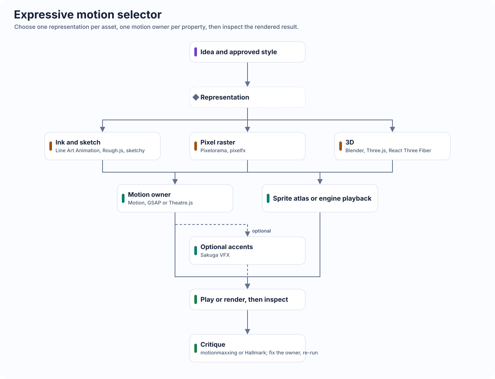

# Expressive motion production

Ship motion with character on one of three routes: a hand-drawn interactive character, motion inspired by an authorized reference, or a refined cinematic motion piece. Every route keeps one representation per asset, one owner per animated property and one clock per render, and ends with a review of rendered frames.

## Objectives

- The motion reads at delivery size and matches the approved style.
- Every animated property has one recorded owner, and every render has one clock ([ownership](../expressive-motion/ownership.md)).
- Captures are frame-exact and repeatable, and reduced-motion users get a defined static or reduced state.

## Prerequisites and selection

Confirm the deliverable (interactive page, film or both), the approved style, target devices, frame rate, and the rights to every reference and asset. Choose the route:

| Route | Choose it when | Tools |
| --- | --- | --- |
| A. Hand-drawn interactive character | A drawn character responds to the user on a page | [Line Art Animation](../repositories/line-art-animation.md) for the figure, [Rough.js](../repositories/rough-js.md) for sketch props and backgrounds, one animation owner, optional [Sakuga VFX](../repositories/sakuga-vfx.md) accent on a control |
| B. Reference-inspired motion | The client supplies or owns a reference whose timing they want | [reanimate](../repositories/reanimate.md) loop, then [Motion](../repositories/motion.md) or [GSAP](../repositories/gsap.md) as owner |
| C. Cinematic motion refinement | A short film or sting needs better timing and finish | [motionmaxxing](../repositories/motionmaxxing.md) or the compositor already in the project, optional GSAP, [Hallmark](../repositories/hallmark.md) scoped review, [FFmpeg](../repositories/ffmpeg.md) |

For each route, pick one motion owner per scene from Motion, GSAP and Theatre.js. They are recommended alternatives, and GSAP and Motion conflict when they share a property (tested in [fixtures/expressive-motion](../../fixtures/expressive-motion/README.md)).

Before setup, prove the existing toolchain cannot meet the acceptance criteria. Use the selected tool's pinned guide from the [index](../../REPOSITORIES.md). Review commands and record the revision in the project lockfile or tool manifest. Use [installation guidance](../../INSTALLATION.md) for isolated setup and [security review](../../SECURITY.md) before external processing.

## Rejected alternatives

| Not chosen | Why |
| --- | --- |
| GSAP and Motion on the same property | Tested: the last writer wins silently and GSAP's cache goes stale (it believed x = 100 px while the DOM showed `translateX(-50px)`). |
| Line Art Animation and Rough.js on the same figure | Two stroke systems fight on one character. Give Rough.js the props and background. |
| Sakuga VFX on the character or the story | Built for individual controls, not narrative motion. |
| Copying a reference's assets or code | The rights stay with the owner. Build originals and compare within tolerance. |
| A second compositor to refine an existing film | Keep whichever compositor already owns the timeline. |
| Unseeded Rough.js strokes in a render | Strokes shimmer from frame to frame. |

## Execution

### Route A: hand-drawn interactive character

1. **Approve one figure.** Line Art Animation's skill shows one figure for approval before building the rest (documented). Fix the line weight, palette and silhouette.
2. **Draw the world with Rough.js** (or the kit's [sketchy](../../kit/sketchy/README.md), its tested seeded stand-in) with a fixed seed, so props and backgrounds redraw identically.
3. **Assign one animation owner per property.** The figure's gait and secondary motion belong to Line Art Animation's own loop. Page-level properties (the figure's container position, panel opacity) belong to one of Motion or GSAP. Record the split.
4. **Add an accent only on a control.** If the style calls for it, Sakuga VFX on the button or toggle that triggers the character. Its reduced-motion mode turns effects off and keeps the state change (documented).
5. **Handle the clock for capture.** Line Art Animation is a stepped clock (`phase += dt`). Its `scripts/capture.ts` advances one frame per screenshot (documented), so seeking replays from the start. For a film that must open at any paused frame, convert the motion you need to closed form under the [time contract](../contracts/time-contract.md).
6. **Set reduced motion.** Motion's `reducedMotion` defaults to `"never"` (documented); opt in and define the static state.

### Route B: reference-inspired motion

1. **Record the reference source and permission** in the brief. No capture behind logins or access controls.
2. **Capture, spec, build, recapture and compare** as in [reference comparison](../expressive-motion/reference-comparison.md), with your own assets and one owner per property.
3. **Stop at tolerance.** Agree event timing and trajectory tolerances before the first comparison. Report what stays outside after five rounds.
4. **Review taste separately.** A design critic reviews the result against the brief; matching numbers is not the same as reading well.

### Route C: cinematic motion refinement

1. **Keep the existing owner.** If a compositor (HyperFrames, Remotion, Motion Canvas or a method's own renderer) already owns the timeline, refine inside it. Use motionmaxxing only for a new film or when the team adopts its runtime. See the [cinematic pipeline](../cinematic-pipeline/README.md).
2. **Refine timing.** motionmaxxing brings 12 named eases and measured timing rules, and its runtime builds on GSAP (documented). In another compositor, GSAP is optional; if used, sample it against the compositor's frame clock, never its own ticker.
3. **Render frame by frame.** motionmaxxing renders through Chrome and ffmpeg and its `Motion.selfTest` proves frames are functions of time (documented). For an HTML page, [framecap](../../kit/framecap/README.md) renders frame-exact MP4 (tested).
4. **Run a scoped Hallmark review.** Review representative frames and the source page against the brief, using Hallmark's Floor, Reflex and Finish tiers. Hallmark is built for pages, so applying it to film frames is proposed; keep the scope written down.
5. **Finish with FFmpeg.** Encode the master once, then probe it.

motionmaxxing needs Node 22+, Python 3, ffmpeg and Chrome. Its vendored GSAP 3.12.5 keeps GreenSock's Standard license, which its own NOTICE says is not open source, and it also vendors three.js r186. Optional ElevenLabs voice and music and Codex CLI images send data to outside services and need approval (all documented).

## Asset contract

Brief and approved style → ownership record per animated asset ([fields](../expressive-motion/ownership.md#ownership-contract)) → source (SVG, page, timeline) → captures or frames at a declared fps → page build or film master → encodes. Declare the property owner, clock owner, seed, frame rate, event cues, loop policy and reduced-motion state for each asset, and the reference source and permission for route B.

## Quality gates

Apply the [quality gates](../../QUALITY_GATES.md): accessibility (reduced motion honored, a static or paused equivalent), time contract (seekable, repeatable, pause to play) for anything that plays live and renders, motion and video (ffprobe streams, cuts on beats) for films, and visual design at every target size. Add the ownership checks: one writer per property, settled capture (wait one frame after a Motion seek), and repeatable seeks.

## Deliverables

Source, ownership records, contact sheets or captured frames, the page build or film master and encodes, the reduced-motion state, and for route B the reference permission, spec and comparison report. Record tool versions, preview evidence and any blocked checks using the [quality gates](../../QUALITY_GATES.md).

[Editable diagram](../diagrams/expressive-motion-selector.mmd)
