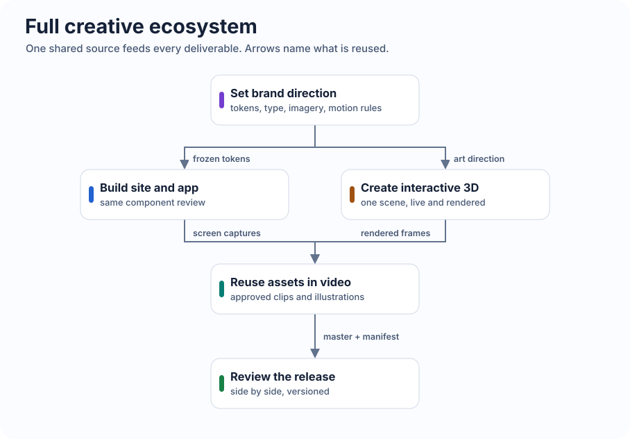

# Full creative ecosystem

Release a coordinated site, app, interactive scene, animated assets and promotional video.

## Objectives

- One identity reads the same across site, app, 3D and video, side by side.
- Every deliverable passes its own workflow's gates.
- The release manifest names every asset version and license.

## Prerequisites and selection

Define one brand owner, delivery owners, acceptance checklist, licensing inventory and shared storage conventions.

Use one creative skill or existing direction. Choose a prototype tool, existing frontend, Blender and Three.js where needed, and one compositor.

Reuse assets, tokens and code across deliverables. Keep any fully satisfied stages in the current stack.

Before setup, prove the existing toolchain cannot meet the acceptance criteria. Use the selected tool's pinned guide from the [index](../../REPOSITORIES.md). Review commands and record the revision in the project lockfile or tool manifest. Use [installation guidance](../../INSTALLATION.md) for isolated setup and [security review](../../SECURITY.md) before external processing.

## Rejected alternatives

| Not chosen | Why |
| --- | --- |
| A different design skill per deliverable | Breaks the shared identity. |
| Regenerating 3D assets per medium | Reuse one validated asset and render variants from it. |
| A memory tool by default | A decision log is enough unless the project already approved one. |

## Execution

1. Freeze the shared tokens, typography, imagery rules and motion principles.
2. Create the website and app during the same component review.
3. Build the 3D asset and export interactive and rendered variants.
4. Reuse illustrations and approved clips in the video.
5. Review the complete set side by side and release versioned outputs.

## Asset contract

Shared brief and asset manifest → approved assets and tokens → web, app, 3D and video outputs. Preserve identifiers, rights and source versions.

## Acceptance and deliverables

Compare brand signatures across media and run each workflow's visual and technical checks.

Release manifest with all five deliverables, source projects, provenance, screenshots and media reports. Record tool versions, preview evidence and any blocked checks using the [quality gates](../../QUALITY_GATES.md).

[Editable diagram](../diagrams/full-creative-pipeline.mmd)
