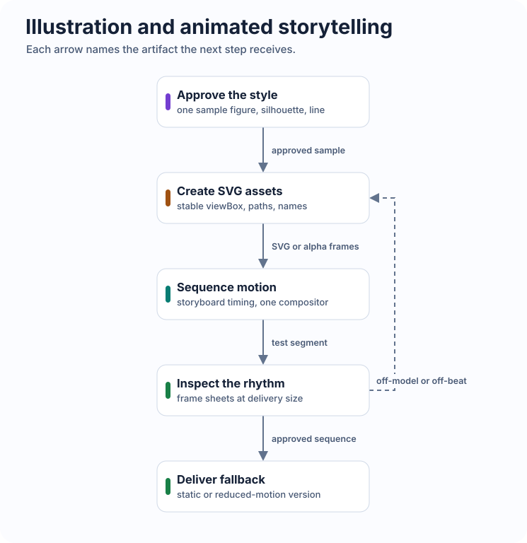

# Illustration and animated storytelling

Produce reusable illustrations and an accessible animated sequence.

## Objectives

- One consistent figure and line system across every asset.
- The sequence reads at delivery size and has a static or reduced-motion version.
- Frames are inspected, not only the source.

## Prerequisites and selection

Approve references, line system, palette, storyboard, aspect ratio, cadence and target surfaces.

Rough.js for sketch geometry or Line Art Animation for moving SVG characters. Add Motion Canvas when sequence timing needs a compositor.

Use static SVG for nonessential motion. Sakuga VFX fits isolated UI effects when the style calls for it.

Before setup, prove the existing toolchain cannot meet the acceptance criteria. Use the selected tool's pinned guide from the [index](../../REPOSITORIES.md). Review commands and record the revision in the project lockfile or tool manifest. Use [installation guidance](../../INSTALLATION.md) for isolated setup and [security review](../../SECURITY.md) before external processing.

## Rejected alternatives

| Not chosen | Why |
| --- | --- |
| Line Art Animation and Rough.js on the same figure | Two stroke systems fight on one character. |
| Sakuga VFX on storytelling scenes | Built for controls, not narrative. |
| Real-ESRGAN on vector art | Re-render at the target size instead. |

## Execution

1. Draw one sample and approve its silhouette and vocabulary.
2. Create assets with stable viewBox, paths and naming.
3. Sequence scenes against a storyboard and export a test segment.
4. Review rhythm and legibility at delivery size.
5. Provide a static, paused or reduced-motion alternative.

## Asset contract

Illustration source → standalone SVG or transparent frames → scene project and preview. Declare alpha and frame numbering.

## Acceptance and deliverables

Check figure consistency, viewBox clipping, background contrast, captions where needed and motion preferences.

Source illustrations, animation source, preview or frame sequence, static fallback. Record tool versions, preview evidence and any blocked checks using the [quality gates](../../QUALITY_GATES.md).

[Editable diagram](../diagrams/illustration-and-animation.mmd)
