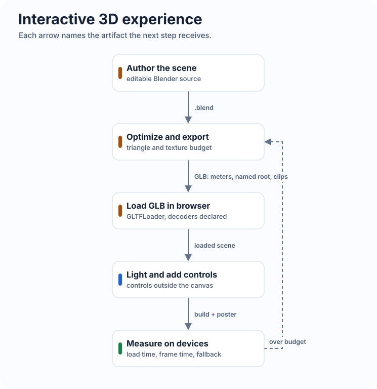

# Interactive 3D experience

Ship a responsive browser scene with usable controls and a fallback.

## Objectives

- The scene loads on target hardware with a poster fallback.
- Controls work outside the canvas and by keyboard.
- Hero GLB within budget, p95 frame time under 20 ms on target hardware.

## Prerequisites and selection

Confirm ownership of geometry and textures, target hardware and load, memory and frame-time budgets.

Blender and optional Blender MCP for authoring. Three.js for browser rendering.

Use existing assets or a static poster when the brief tolerates it. Avoid duplicate render engines.

Before setup, prove the existing toolchain cannot meet the acceptance criteria. Use the selected tool's pinned guide from the [index](../../REPOSITORIES.md). Review commands and record the revision in the project lockfile or tool manifest. Use [installation guidance](../../INSTALLATION.md) for isolated setup and [security review](../../SECURITY.md) before external processing.

## Rejected alternatives

| Not chosen | Why |
| --- | --- |
| An image-to-3D model when the asset already exists | Generation adds cleanup and license questions for nothing. |
| Gaussian Splatting for an interactive product | Splats need a splat viewer and cannot be rigged or edited like a mesh. |
| Two render engines on one page | Doubles load and draw cost. |

## Execution

1. Author a scene and save an editable Blender source.
2. Reduce geometry and size textures before export.
3. Export GLB and verify axes, units, materials and animation clips.
4. Import with GLTFLoader and implement lighting and accessible controls.
5. Measure load and frame time on representative devices.

## Asset contract

Blender file → GLB plus mesh, texture and animation metadata → browser canvas and poster. Declare decoders and external paths.

## Acceptance and deliverables

Compare desktop and mobile visuals, verify controls out of canvas and poster fallback, record file size and frame timing.

Editable scene, optimized GLB, web integration, fallback, device results. Record tool versions, preview evidence and any blocked checks using the [quality gates](../../QUALITY_GATES.md).

[Editable diagram](../diagrams/interactive-3d.mmd)
