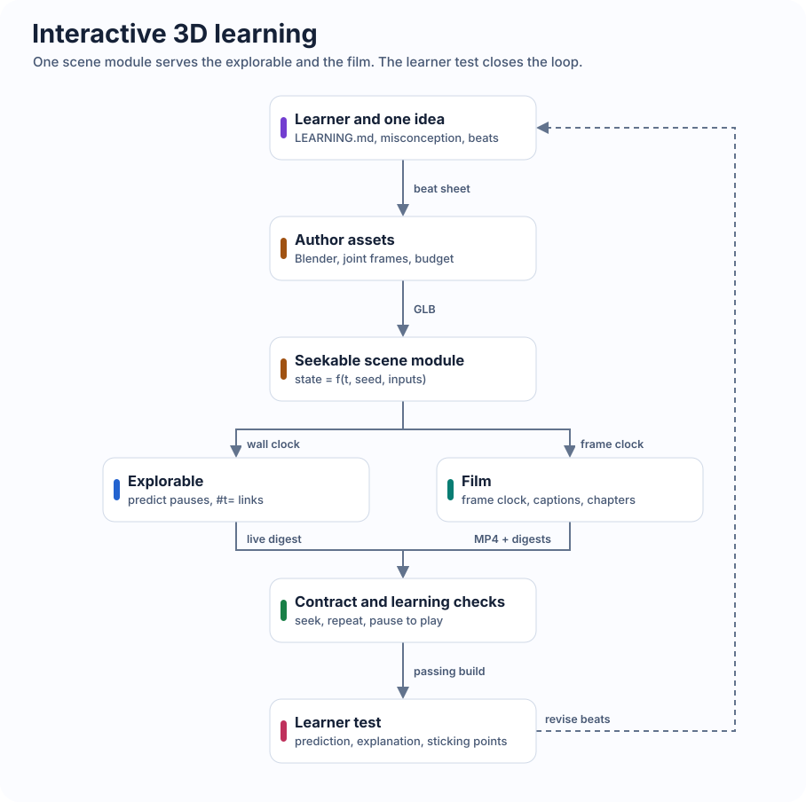

# Interactive 3D learning

Teach one idea with a 3D scene the learner can handle, and a film of the same scene that explains it. Both come from one scene module, and any paused frame of the film opens as the live scene.

## Objectives

- The learner can state the one idea in their own words after the explorable or film.
- The prediction can be answered from what was shown, and the reveal checks it.
- The film and the explorable agree at every beat (`pauseToPlay` check).

## Prerequisites and selection

Confirm the learner (age, prior knowledge, device), the one idea, the misconception it should correct and how you will know it was learned. Write these in a `LEARNING.md` next to the brief.

Use Blender, with Blender MCP if authorized, for hero assets. Three.js for the scene. HyperFrames or Remotion for the film, or the fixture's DevTools renderer when no compositor is needed. FFmpeg at the output boundary.

Keep a static diagram or a short film when the idea doesn't need handling. A 3D scene earns its place when the learner must see something from several sides, take it apart, change it or watch it over time.

Before setup, prove the existing toolchain cannot meet the acceptance criteria. Use the selected tool's pinned guide from the [index](../../REPOSITORIES.md). Review commands and record the revision in the project lockfile or tool manifest. Use [installation guidance](../../INSTALLATION.md) for isolated setup and [security review](../../SECURITY.md) before external processing.

## Rejected alternatives

| Not chosen | Why |
| --- | --- |
| A separate film and a separate interactive | Two copies of the animation drift; the time contract keeps one. |
| Decorative motion around the scene | Competes with the teaching object. |
| A 3D scene for an idea that needs no handling | A diagram or a short film teaches it faster. |

## Execution

1. **Write the beats.** Five to nine moments, each with a time, a caption, the move it uses (see below) and what the learner does. Put one prediction before the main reveal.
2. **Build the scene to the [time contract](../contracts/time-contract.md).** State is a function of story time and a seed. Start from the [seekable scene fixture](../../fixtures/seekable-scene/README.md).
3. **Make the explorable.** Play, pause, scrub, beat buttons and keyboard. Pause the clock at each prediction until the learner commits. Every pause writes a `#t=` link.
4. **Render the film from the same module.** Burn captions in or ship a caption track. Link each chapter to the live scene at the same `#t=`.
5. **Run the checks.** Seekable, repeatable, pause to play, stream, then the learning gate in [quality gates](../../QUALITY_GATES.md).
6. **Test with a learner.** Watch one person who matches the brief use it without help. Record their prediction, what they said afterwards and where they got stuck.

## Teaching moves

Name the move for each beat, the way Impeccable names its design commands. The fixture uses *slow*, *x-ray*, *predict* and *rewind*.

| Move | The learner sees | Built with |
| --- | --- | --- |
| explode | Parts separate along their real assembly axes | Offsets along named joint frames |
| slice | A plane cuts through the solid | Clipping planes with stencil caps |
| x-ray | The shell turns glassy and the insides stay solid | Per-material opacity and depth write |
| slow | Time stretches around one event | A closed-form time map in the scene |
| trace | Force, energy or flow drawn as a moving path | Trails along curves, flow textures |
| predict | A question before the reveal | The live clock waits for input |
| break | A part removed or changed, and the failure | Part toggles plus state rules |
| compare | Two versions on one clock | Two viewports, one shared `t` |
| scale | Zoom across orders of magnitude | Logarithmic dolly with level-of-detail swaps |
| assemble | Rebuild from loose parts | Snap-to-socket drag |
| rewind | Scrub back to any moment | The seekable clock itself |

## Asset contract

`LEARNING.md` and beats → Blender source → GLB (meters, named joint frames, animation clips) → scene module → explorable page and film master → platform encodes. Declare beat times, caption text, fps and the `#t=` link format.

## Acceptance and deliverables

Each beat is legible as a still at delivery size, with its caption clear of the subject. The prediction is answerable from what the scene has shown. Keyboard-only and reduced-motion users can reach every beat. The film's chapter links open the live scene in the same state.

Scene module, explorable page, film master and encodes, caption files, `LEARNING.md`, beat sheet, fixture evidence and learner-test notes. Record tool versions, preview evidence and any blocked checks using the [quality gates](../../QUALITY_GATES.md).

[Editable diagram](../diagrams/interactive-learning.mmd)
