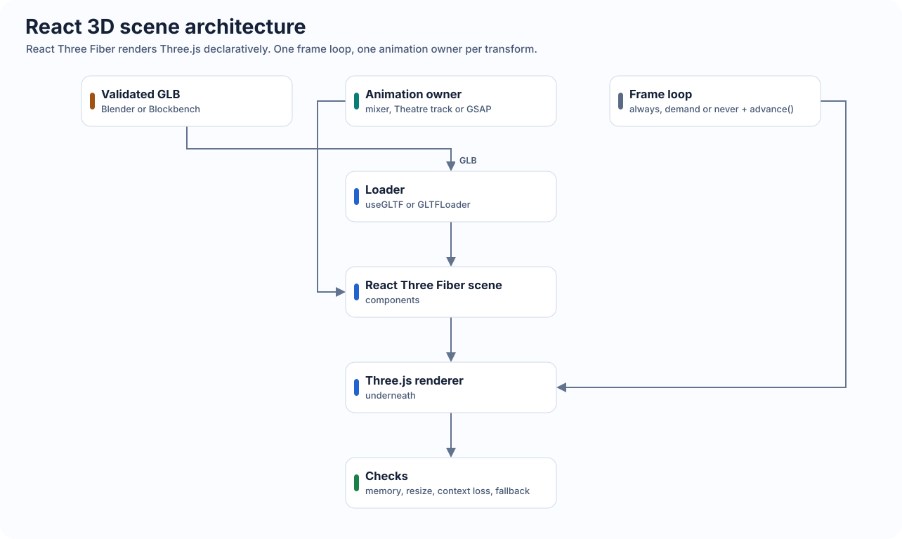

# Interactive React 3D

Ship a 3D scene inside a React app: a validated GLB from Blender or Blockbench, rendered with React Three Fiber on Three.js, with an optional Theatre.js camera sequence a person can edit, and a fixed-frame capture route when the same scene must also become a film.

## Objectives

- The scene loads on target hardware with a poster fallback, and controls work outside the canvas.
- Every transform has one animation owner, and the app has one frame loop.
- If a film is needed, frames come from the same scene module at fixed story times and repeat exactly.

## Prerequisites and selection

Confirm the app's React version, ownership of geometry and textures, target hardware, and load, memory and frame-time budgets. Decide early whether a film or stills will be rendered from the scene.

Author in Blender (with [Blender MCP](../repositories/blender-mcp.md) if authorized) or [Blockbench](../repositories/blockbench.md) for low-poly models with pixel-art textures. Render with [React Three Fiber](../repositories/react-three-fiber.md) on [Three.js](../repositories/three-js.md). Add [Theatre.js](../repositories/theatre.md) only when a person must tune keyframes by hand, typically a camera sequence.

Match versions before anything else. R3F 9 needs React 19 (the pinned guide gives `>=19 <19.4`); R3F 8 pairs with React 18. The tested set is @react-three/fiber 9.8.2, three 0.187.0 and React 19.3.1 ([fixtures/expressive-motion](../../fixtures/expressive-motion/README.md)).

Use plain Three.js when the app is not React, and the [interactive 3D workflow](interactive-3d.md) for that route.

Before setup, prove the existing toolchain cannot meet the acceptance criteria. Use the selected tool's pinned guide from the [index](../../REPOSITORIES.md). Review commands and record the revision in the project lockfile or tool manifest. Use [installation guidance](../../INSTALLATION.md) for isolated setup and [security review](../../SECURITY.md) before external processing.

## Rejected alternatives

| Not chosen | Why |
| --- | --- |
| R3F plus a second render engine on the page | R3F renders through Three.js; another engine doubles load and draw cost. |
| `@theatre/r3f` on R3F 9 | It requires `@react-three/fiber` ^8 (React 18). Drive R3F from Theatre's core sequence yourself, or pin R3F 8 for the whole app. |
| Shipping `@theatre/studio` | It is the editing UI and AGPL-3.0-only. Ship saved project state with Apache-2.0 `@theatre/core` only. |
| Orbit controls and a Theatre sequence on the camera at once | Two owners of one transform. Hand over explicitly at a beat. |
| `mixer.update(delta)` when a film is possible | A stepped clock cannot seek. Use `mixer.setTime(t)`. |

## Execution

1. **Export and validate the GLB.** Meters, applied transforms, named clips, at most 4 influences per vertex. Run the [asset validator](../3d-pipeline/asset-validation.md) and follow [export contracts](../3d-pipeline/export-contracts.md) and [animation and physics](../3d-pipeline/animation-and-physics.md). Blockbench's glTF codec exports `.gltf` or `.glb` with armature and animation as options (documented).
2. **Load it in R3F.** `useLoader(GLTFLoader, url)` is the tested route (the fixture loaded `toy_limb.glb` with 1 skinned mesh, 3 bones and the `bend` clip). drei's `useGLTF` is untested here. Serve assets from your own origin.
3. **Choose the frame loop.** `always` for constant motion, `demand` for mostly static viewers (call `invalidate()` after direct mutations), `never` plus `advance()` for capture.
4. **Assign animation owners.** Clips belong to an `AnimationMixer` seeked with `setTime(t)`. A hand-tuned camera belongs to a Theatre sequence. Coded property sequences belong to GSAP. Record one owner per transform in the [ownership record](../expressive-motion/ownership.md#ownership-contract).
5. **Optional: Theatre keyframes for the camera.** Author with `@theatre/studio` in development only. In the app, set `sheet.sequence.position = t` (tested: value ready synchronously), read the camera values and apply them to the R3F camera (proposed). Commit the project state JSON. The public Theatre.js repo has not moved since 2024-08-14, so keep that JSON as the durable artifact.
6. **Performance QA.** Measure on target hardware: GLB size, p95 frame time, draw calls, memory across mount and unmount, resize with a capped device pixel ratio, and WebGL context loss falling back to the poster.
7. **Fixed-frame capture, if a film is needed.** With `frameloop: 'never'`, for each frame set every owner to `t = i / fps`, call `advance(t)` (seconds, per the pinned `loop.ts`), and read pixels with `preserveDrawingBuffer` on. Or expose `window.__scene.seek(t)` and capture with [framecap](../../kit/framecap/README.md). Tested in the fixture: one `advance()` renders one frame, and the same `t` gives SHA-256 identical pixels on repeat, out of order and in a fresh browser.

## Asset contract

Blender or Blockbench source → validated GLB (meters, named clips, recorded durations) → R3F scene module with one owner per transform → optional Theatre project state JSON → app build, plus frames and a master when a film is needed. Declare clip names and durations as the consumer reports them, the camera owner, the frame loop mode, fps for capture and the React, R3F and three versions.

## Quality gates

Apply the interactive 3D gate in the [quality gates](../../QUALITY_GATES.md): poster or static fallback, controls outside the canvas, GLB under budget, p95 frame time and draw calls on target hardware. Apply the accessibility gate for keyboard controls and reduced motion, and the time contract gate (seekable, repeatable, pause to play) when the scene also renders. Expect byte-identical pixels only on one machine and graphics backend; compare values across machines.

## Deliverables

GLB and its validation report, scene module, optional Theatre project state JSON, app build, poster fallback, performance measurements on target hardware, and capture evidence and master when a film is made. Record tool versions, preview evidence and any blocked checks using the [quality gates](../../QUALITY_GATES.md).

See also [React 3D](../expressive-motion/react-3d.md) for frame loop modes and the Theatre.js version clash.

[Editable diagram](../diagrams/react-3d-architecture.mmd)
