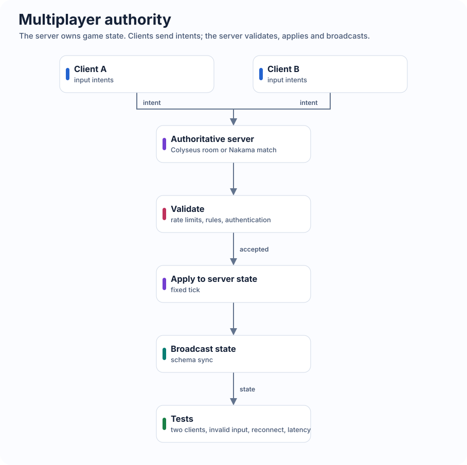

# Multiplayer arena

Add online play to a game whose single-player slice already works: the selected client engine sends intents, a Colyseus room or a Nakama match owns the state, and network and security tests prove it holds up.

## Objectives

- Two clients in one match see the same server-owned state after the same inputs.
- Invalid input (teleports, out-of-range values, unknown fields, floods) is rejected or clamped and counted.
- A dropped client reconnects with its token and keeps its session and state.
- Nothing is exposed publicly, and no player data is collected, without written authorization.

## Prerequisites and selection

A working single-player slice in one engine ([web 2D game](web-2d-game.md) or [standalone game](standalone-game.md)). A `NETWORK.md` with the authority matrix, protocol version, tick rate and message schemas from the [multiplayer contract](../game-development/artifact-contracts.md#multiplayer).

Pick one server. [Colyseus](../repositories/colyseus.md) for rooms and state sync in Node.js: **tested** on loopback in [fixtures/game-dev](../../fixtures/game-dev/README.md) with `@colyseus/core` 0.18.30 and `@colyseus/sdk` 0.18.10; the server needs Node 22+. [Nakama](../repositories/nakama.md) when the brief needs accounts, storage, leaderboards and matchmaking from one backend: documented, **not run**; needs CockroachDB or a Postgres-compatible database, sends anonymous telemetry by default (`NAKAMA_TELEMETRY=0` to opt out), and its example docker-compose runs CockroachDB with `--insecure`.

Keep local split-screen or hot-seat play when the brief tolerates it. It needs no server.

Before setup, prove the existing toolchain cannot meet the acceptance criteria. Use the selected tool's pinned guide from the [index](../../REPOSITORIES.md). Review commands and record the revision in the project lockfile or tool manifest. Use [installation guidance](../../INSTALLATION.md) for isolated setup and [security review](../../SECURITY.md) before external processing.

## Rejected alternatives

| Not chosen | Why |
| --- | --- |
| Client-authoritative state | Any client can cheat; the server cannot settle disagreements. |
| Colyseus and Nakama in one game for the same responsibility | Two authorities over one match. If both are used, give each a separate responsibility in writing. |
| `colyseus.js` 0.16 against a 0.18 server | Not tested. The fixture used `@colyseus/sdk` 0.18. |
| Lockstep netcode on an unmeasured solver | Cross-platform determinism was not measured; the fixture proved same-machine repeatability only. |
| Nakama's example compose file in production | `--insecure` database and the default server key. |
| Peer-to-peer without a server | No authority to validate input. |

## Execution

1. **Write `NETWORK.md`.** Authority matrix, protocol version, tick rate, every message with fields, types, ranges and rate limits, state schema, reconnect hold time, bind address.
2. **Stand up the server on 127.0.0.1.** Install the pinned packages after reviewing install scripts. The fixture used `npm ci --ignore-scripts --legacy-peer-deps`; only `msgpackr-extract` had a script and it was not needed. For Nakama, set `NAKAMA_TELEMETRY=0` unless telemetry is approved, and change the server key and Console credentials.
3. **Move game rules to the server.** Clients send intents. The server validates, applies at a fixed tick and broadcasts. Clients may predict their own movement and correct to the server.
4. **Validate and limit.** Reject unknown fields and wrong types, clamp or reject out-of-range values, cap message rates, check the protocol version on join and decide who may join.
5. **Add reconnect.** Hold a dropped slot for the stated time and resume by token. The fixture tested the manual path (`client.reconnect(token)` with `allowReconnection` in `onDrop`) with automatic reconnection off.
6. **Run the network tests** in [multiplayer](../game-development/multiplayer.md#network-tests-proposed): two clients, invalid input, flooding, reconnect inside and after the hold time, version mismatch, latency and packet loss, clean shutdown.
7. **Playtest** with real players on a local network. Record where the game felt unfair or laggy.
8. **Deploy only with written authorization**, and never with development MCP servers, the Nakama Console, inspectors or other admin endpoints reachable from outside.

## Asset contract

Client build (one engine) + `NETWORK.md` + message and state schemas → server project and lockfile → test scripts and evidence (JSON like the fixture's `result.json`) → optional deployment record with its authorization. See [artifact contracts](../game-development/artifact-contracts.md).

## Quality gates

Floor: two clients agree on state; invalid input rejected; reconnect keeps the session; server bound to loopback unless authorized; no admin endpoint exposed; no unapproved data collection or telemetry. Reflex: protocol version enforced; latency and loss results recorded; rate limits tested. Apply the engineering and delivery rows of the [quality gates](../../QUALITY_GATES.md).

## Deliverables

`NETWORK.md`, server source and lockfile, client changes, network test scripts and their evidence, playtest notes, and any deployment record with its authorization. Record tool versions and any blocked checks using the [quality gates](../../QUALITY_GATES.md).

[Editable diagram](../diagrams/multiplayer-authority.mmd)
