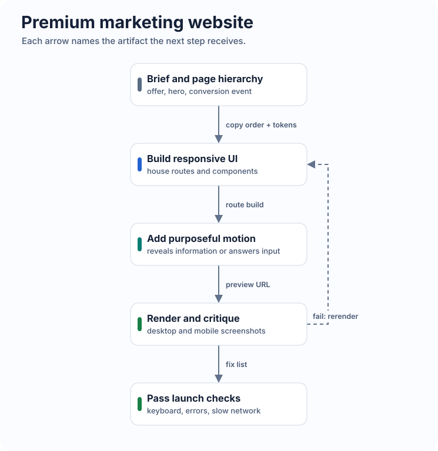

# Premium marketing website

Build a deployment-ready page that explains the offer and makes the primary action obvious.

## Objectives

- The offer is understood within one screen on mobile and desktop.
- The primary action is reachable by keyboard and works on a slow network.
- Largest Contentful Paint under 2.5 s on a mid-range phone profile.

## Prerequisites and selection

Load the existing site and confirm approved copy, imagery, project commands, target devices and conversion action.

Taste Skill or Anthropic Frontend Design for one authority. Magic UI selectively. Impeccable or Hallmark for critique.

Keep existing components if adequate. Use Figma Context only on an authorized authoritative frame.

Before setup, prove the existing toolchain cannot meet the acceptance criteria. Use the selected tool's pinned guide from the [index](../../REPOSITORIES.md). Review commands and record the revision in the project lockfile or tool manifest. Use [installation guidance](../../INSTALLATION.md) for isolated setup and [security review](../../SECURITY.md) before external processing.

## Rejected alternatives

| Not chosen | Why |
| --- | --- |
| Two design skills at once (for example Taste Skill and Frontend Design) | Competing authorities produce a blended, generic look. |
| Magic UI and React Bits together | Redundant effect libraries; one is enough, and React Bits cannot be resold. |
| 3D hero by default | Only when the offer is spatial; otherwise a still image loads faster. |

## Execution

1. Agree hero, hierarchy, copy order, art direction and conversion event.
2. Build the content structure in house routes and components.
3. Add only motion that reveals information or responds to interaction.
4. Render desktop and mobile and critique imagery, spacing and readability.
5. Fix keyboard, focus, form feedback, reduced motion and loading issues.

## Asset contract

Approved brief and tokens → route and component source → screenshots and build output. Preserve responsive image dimensions and rights.

## Acceptance and deliverables

Test primary conversion with keyboard, error and success outcomes, slow network and narrow viewports.

Deployable build, source, screenshots, test results and asset credits. Record tool versions, preview evidence and any blocked checks using the [quality gates](../../QUALITY_GATES.md).

[Editable diagram](../diagrams/premium-website.mmd)
