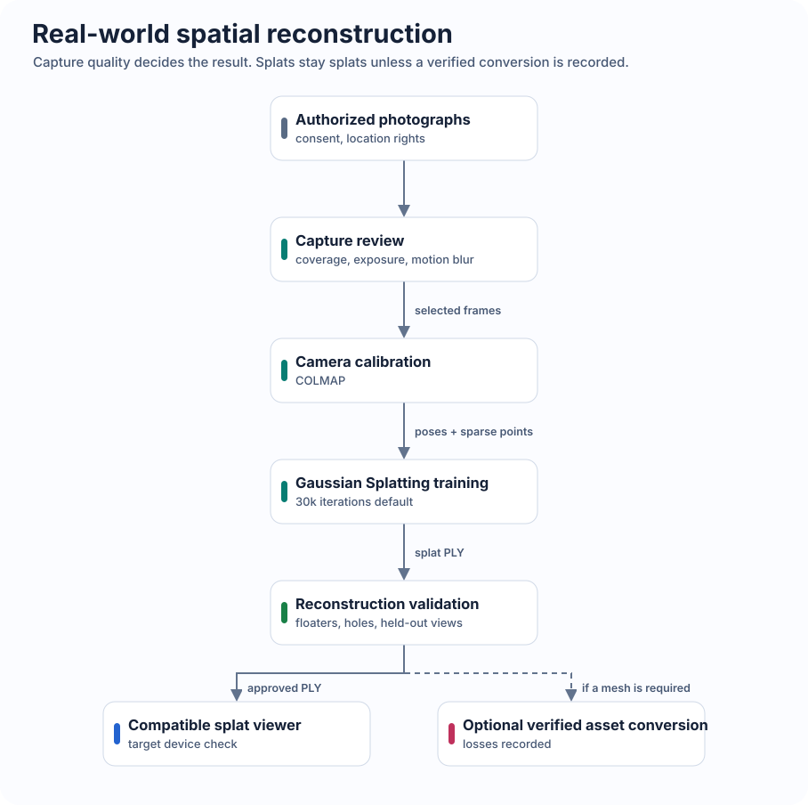

# Workflow 11: Spatial reconstruction

Reconstruct an authorized real place or object from photographs as a validated Gaussian splat, shown in a viewer that supports it.

## Objectives

- Every photo set has a rights record: location permission, and consent from each identifiable person, or that person removed or blurred before training. Photos end up baked into the PLY, so this happens first.
- COLMAP registers at least the share of selected frames set in the brief (start at 90%).
- Held-out views are rendered and PSNR, SSIM and LPIPS are recorded with the iteration count.
- Floaters and holes are reviewed from at least eight viewpoints, including two not near any capture position.
- The splat opens in the chosen viewer on the target device at the frame rate set in the brief.
- The license record says "research and evaluation only" unless a written Inria license exists.

## Prerequisites

- **License.** The [Gaussian Splatting](../repositories/gaussian-splatting.md) code is under the Inria and MPII Gaussian-Splatting License: research and evaluation only, non-commercial. Commercial use needs prior consent from Inria. Stop here for commercial work without it.
- **Authorization.** Written permission for the location, consent for people, and a plan for faces, number plates, screens and documents in frame.
- **Hardware.** CUDA GPU with compute capability 7.0 or higher; 24 GB VRAM for paper-quality 30,000-iteration training, less for 7,000 iterations. Windows or Ubuntu only. The SIBR viewers need OpenGL 4.5 (4 GB VRAM recommended).
- **Software.** COLMAP, ImageMagick for resizing, a C++ compiler for the CUDA submodules.
- Before setup, prove the existing toolchain cannot meet the acceptance criteria. Use the pinned guide from the [index](../../REPOSITORIES.md), [installation guidance](../../INSTALLATION.md) and [security review](../../SECURITY.md).

## Tool selection

| Need | Pick | Why |
| --- | --- | --- |
| Camera poses and sparse points | COLMAP, through the repo's `convert.py` | Documented: the trainer expects a COLMAP dataset (`images/` plus `sparse/0/`), and `convert.py` builds it from raw photos in `<location>/input`. |
| Reconstruction | Gaussian Splatting | Documented: reference-quality radiance fields, 30,000 iterations by default, saves at 7,000 and 30,000. Not run here. |
| Viewing | SIBR viewer from the same repo, or a web splat viewer that reads the standard 3DGS PLY | SIBR is documented. A web viewer is proposed: confirm it loads this PLY and runs on the target device. |
| Mesh, only if a deliverable demands one | Conversion tool chosen per project, then Blender and [validate_asset.py](../../scripts/blender/validate_asset.py) | Proposed and unverified here. Conversion is lossy. |

## Rejected alternatives

- **Single-image generators (SAM 3D Objects, Stable Fast 3D, TRELLIS.2) when multi-view photos exist.** They predict the unseen sides; photographs measure them.
- **A polygon-mesh pipeline by default.** A Gaussian PLY is not a polygon mesh. The registry treats the two as alternatives for different deliverables.
- **ComfyUI-3D-Pack's 3DGS nodes as a drop-in.** They are a separate implementation; results and settings do not transfer from the reference code.
- **Training on raw, unreviewed photos.** People and private details are baked into the result.
- **Exposing the training GUI.** It opens a socket on 127.0.0.1:6009; changing `--ip` puts it on the network.
- **macOS.** Not supported.

## Execution

1. **Plan the capture** (general practice). Static scene, fixed exposure and white balance, no motion blur, 60-80% overlap between neighbors, orbits at two or three heights, extra frames around thin or shiny parts. Avoid mixing close-ups with distant shots; the method struggles with multi-scale scenes.
2. **Review the capture.** Drop blurred, overexposed and duplicate frames. Blur or drop frames with people who have not consented and with private details. Record each removal.
3. **Calibrate.** Place selected frames in `<location>/input` and run `python convert.py -s <location>`. Open the sparse model: check the registered-frame share and that camera positions follow the capture path.
4. **Train.** `python train.py -s <location> --eval` holds out test views. Inputs wider than 1.6K pixels are downscaled automatically. On smaller GPUs, follow the FAQ: fewer iterations, a higher `--densify_grad_threshold`, a lower `--densify_until_iter`, `--data_device cpu`, `--test_iterations -1`. For large scenes, lower the position and scaling learning rates. Commands follow the pinned README; check the [guide](../repositories/gaussian-splatting.md).
5. **Validate.** Render the held-out views and compute metrics with the repo's render and metrics scripts. Fly the viewer through the scene: look for floaters, holes, smeared thin parts and view-dependent color that flips. Crop or clean the PLY and record what was removed.
6. **Deliver to a viewer.** Open the approved PLY in the chosen viewer on the target device. Record frame rate, load time and file size.
7. **Convert only if required.** If a mesh is contractually needed, convert, then validate the mesh as in [workflow 9](3d-asset-factory.md). Record the losses: view-dependent effects (spherical harmonics) gone, thin and transparent parts degraded, holes where coverage was thin, scale checked against a measured reference.

## Handoff contracts

| Producer | Consumer | Format | What to check |
| --- | --- | --- | --- |
| Photographer | Capture review | Raw photos plus rights record | Consent and location permission for every set. |
| Capture review | COLMAP | `<location>/input/*.jpg` | Removals logged; no unconsented people. |
| COLMAP | Trainer | `images/`, `sparse/0/cameras.bin`, `images.bin`, `points3D.bin` | Registered share meets the brief; PINHOLE or SIMPLE_PINHOLE cameras. |
| Trainer | Validation | `point_cloud/iteration_<N>/point_cloud.ply`, metrics | Iteration count, held-out PSNR, SSIM and LPIPS recorded. |
| Validation | Viewer | Approved Gaussian PLY | Opens on the target device; cleaning recorded. |
| Validation | Conversion (optional) | Gaussian PLY to mesh | Losses listed; mesh passes the validator's Floor checks. |

## Quality gates

Apply the [quality gates](../../QUALITY_GATES.md): **Gaussian reconstruction** (coverage, converged poses, opens in the target viewer; no large floaters or holes in held-out views, moving objects removed, conversion losses recorded), **Geometry** only for a converted mesh, **Interactive 3D** when the splat ships in a browser or app (fallback, controls outside the canvas, frame time on target hardware) and **Delivery** (rights recorded for the photos, people, location and code license; a reproducible command for each artifact). The consent and license objectives are Floor.

## Deliverables

Rights and consent record, capture log with removals, COLMAP sparse model, training command and config, approved Gaussian PLY, held-out renders and metrics, viewer evidence on the target device, and, if made, the converted mesh with its loss record and validator report.

[Editable diagram](../diagrams/spatial-reconstruction.mmd)
