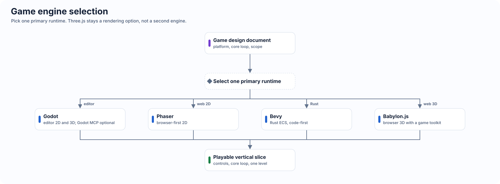

# Standalone game

Build a game that ships as its own build rather than inside a web page, in one of three routes: a 2D indie game in Godot, a low-poly 3D adventure in Godot or Babylon.js, or a Rust simulation in Bevy with Rapier. A fourth route makes the launch campaign from real gameplay once the game is done.

## Objectives

- One runtime and one physics solver per world, both pinned and written into the game design document.
- A vertical slice (controls, core loop, one level) playable from start to finish in an exported build on each target platform.
- Physics at a fixed step with a passing tunnelling test; fixed-step repeatability measured where the game replays or rewinds.
- Any trailer is cut from captured gameplay of the shipped build.

## Prerequisites and selection

Write the [game design document](../game-development/artifact-contracts.md#game-design-document): platforms, input, core loop, slice acceptance criteria, budgets, rights. Choose the route from it.

| Route | Runtime | Physics | Assets | Evidence |
| --- | --- | --- | --- | --- |
| 2D indie game | [Godot](../repositories/godot.md) | Godot 2D physics | [Pixelorama](../repositories/pixelorama.md); optional [LDtk](../repositories/ldtk.md) and [jsfxr](../repositories/jsfxr.md) | Godot, Pixelorama, LDtk documented; jsfxr **tested** |
| Low-poly 3D adventure | Godot, or [Babylon.js](../repositories/babylonjs.md) for a browser build | Godot's 3D engine setting (GodotPhysics3D or Jolt), or Babylon.js Physics V2 with Havok | [Blockbench](../repositories/blockbench.md) or Blender GLB | Babylon.js GLB load **tested**; the rest documented |
| Rust simulation | [Bevy](../repositories/bevy.md) | Version-matched `bevy_rapier` ([Rapier](../repositories/rapier.md)) | glTF, images | Rapier JS **tested**; Bevy and `bevy_rapier` documented |
| Launch campaign | The shipped build | — | Captured gameplay → [cinematic pipeline](../cinematic-pipeline/README.md) → [FFmpeg](../repositories/ffmpeg.md) | FFmpeg used by the fixtures; the campaign route is proposed |

[Godot MCP](../repositories/godot-mcp.md) is optional for the Godot routes. It runs projects with full script execution and reads only console output; it cannot see the editor or the running scene tree.

Before setup, prove the existing toolchain cannot meet the acceptance criteria. Use the selected tool's pinned guide from the [index](../../REPOSITORIES.md). Review commands and record the revision in the project lockfile or tool manifest. Use [installation guidance](../../INSTALLATION.md) for isolated setup and [security review](../../SECURITY.md) before external processing.

## Rejected alternatives

| Not chosen | Why |
| --- | --- |
| A standalone Jolt build inside Godot | Godot already bundles Jolt 5.6.0 as a module. A standalone build is only for custom C++ engines. |
| Mixing `bevy_rapier` and Bevy versions | `bevy_rapier` must match Bevy; 0.37 targets Bevy 0.20 at the pinned commits. |
| Three.js next to Babylon.js | Two render engines in one game. Three.js stays a rendering option for non-game scenes. |
| Claiming cross-platform determinism from the fixture | The fixture proved same-machine repeatability only. Use Rapier's `-deterministic` builds or the `enhanced-determinism` feature, or Jolt's `CROSS_PLATFORM_DETERMINISTIC`, and measure. |
| A trailer from mock-ups or generated footage presented as gameplay | Misleads players. Capture the real build. |
| Bevy for a team that needs a visual editor | Bevy warns important features are missing and breaks its API about every three months. |

## Execution

### 2D indie game (Godot)

1. Create the project in the pinned Godot version and record the version in the design document. Open only trusted projects: scripts and GDExtensions run with your privileges.
2. Build the slice with placeholder shapes, Godot's 2D physics at a fixed physics tick, named collision layers and a written collision matrix.
3. Draw sprites and tiles in Pixelorama; export PNG sheets. Import with nearest filtering and no mipmaps; check pivots and hitboxes ([assets and levels](../game-development/assets-and-levels.md)).
4. Optional: lay out levels in LDtk and load them with a reviewed community loader or an adapter; compare entity counts. Optional: jsfxr effects played through Godot's audio.
5. Add in-game test scenes that assert landing, collisions and the tunnelling case, and run them headless.
6. Export a build per platform; open and play each one.

### Low-poly 3D adventure (Godot or Babylon.js)

1. Pick Godot for native builds, Babylon.js for a browser build. In Godot, read `physics/3d/physics_engine` in `project.godot`: new projects from 4.6 get Jolt, while `DEFAULT` still means GodotPhysics3D.
2. Model in Blockbench (low-poly, pixel textures) or Blender via the [3D asset factory](3d-asset-factory.md). Export GLB in meters with named clips; run the [asset validator](../3d-pipeline/asset-validation.md).
3. Import and check bounding box, bones and clip names in the engine. The fixture's limb loaded in Babylon.js 9.38.0 at 0.3000 m with bones `root`, `mid`, `tip` and clip `bend`, matching Three.js.
4. Add colliders (simple shapes, not render meshes), a character controller and the camera. Test the camera against walls and tight corners, and test the fastest object against the thinnest wall.
5. For Babylon.js, check the Havok WASM license before shipping, bundle the pinned npm packages, and do not use the Babylon CDN in production.
6. Export or bundle, then play the build on target hardware and measure frame time.

### Rust simulation (Bevy and Rapier)

1. Pin Bevy and the matching `bevy_rapier2d` or `bevy_rapier3d`. Check the minimum Rust version (1.100.0 at Bevy's pinned commit).
2. Run physics in Bevy's fixed timestep (Bevy ships an example, `physics_in_fixed_timestep.rs`).
3. Write tests that step the simulation a fixed number of times from a fixed start and compare end states, as the fixture's `rapier-determinism` check does in JavaScript (8 boxes, 300 steps, bitwise-equal runs, equal snapshot hashes, all bodies asleep).
4. If runs must match across machines, enable Rapier's `enhanced-determinism` feature and run the same test on each target platform before claiming it.
5. Keep Bevy's remote protocol (`bevy_remote`) off untrusted interfaces.

### Launch campaign

1. Capture real gameplay from the shipped build at the delivery frame rate. Record the build version on each clip.
2. Plan the trailer or walkthrough with the [cinematic pipeline](../cinematic-pipeline/README.md) and the [cinematic video](cinematic-video.md) workflow.
3. Encode masters and platform versions with FFmpeg; check each with `ffprobe` against the shot list.
4. Publish nothing without the owner's approval.

## Asset contract

Design document → art sources (`.pxo`, `.bbmodel`, `.blend`, `.ldtk`) → PNG sheets, GLB and level JSON with [manifest](../../templates/asset-manifest.json) entries → engine project → exported builds → gameplay capture → trailer master and encodes. See [artifact contracts](../game-development/artifact-contracts.md).

## Quality gates

Floor: the slice plays start to finish in each exported build; one solver per world; tunnelling test passes; asset scale and clip names match the manifest; rights recorded. Reflex: repeatability measured for replays; camera never clips through level geometry; trailer frames come only from the build. Apply the engineering, interactive 3D, physics and animation, motion and video and delivery rows of the [quality gates](../../QUALITY_GATES.md).

## Deliverables

Project source and lockfiles, design document, art sources and exports with manifests, physics and gameplay tests with evidence, builds per platform, playtest notes, and for the campaign, capture files, edit, masters and encodes. Record tool versions, screenshots and any blocked checks using the [quality gates](../../QUALITY_GATES.md).

[Editable diagram](../diagrams/game-engine-selection.mmd)
