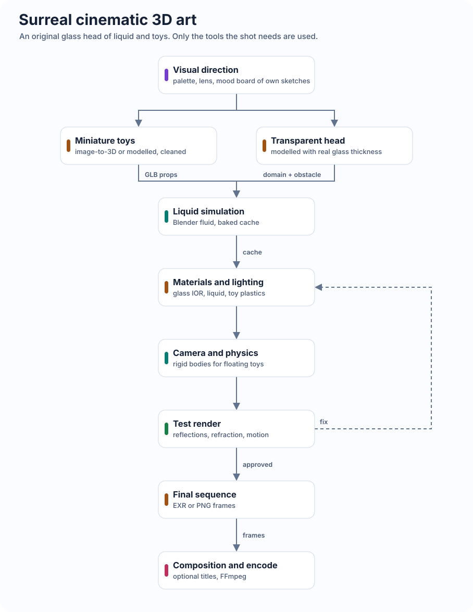

# Workflow 13: Surreal cinematic 3D

Make a short rendered film of an original concept, a transparent sculptural head holding liquid and miniature toys, using only the catalogue tools the shots need.



The concept is an original demonstration written for this catalogue: a clear glass bust, sealed, filled to cheek height with liquid, with small toys (a paper boat, a wooden spinning top, a wind-up tin fish) drifting inside. It does not reproduce or imitate any existing artist's work. Do not prompt with artist names, build mood boards from other artists' images, or describe the result as in a named artist's style. Toy designs must be your own, not trademarked toys.

## Objectives

- Four shots, 16 s, 384 frames at 24 fps, 1920 × 1080, delivered as an EXR master sequence, a PNG sequence and an encoded film.
- The glass head passes [validate_asset.py](../../scripts/blender/validate_asset.py) Floor checks and the `watertight` Reflex check; wall thickness is measured and recorded.
- In every final frame: no liquid outside the glass, no toy crossing the glass, no black regions inside the glass from exhausted light bounces.
- Noise and flicker are reviewed on a full-size 24-frame span per shot before the final render.
- ffprobe reports the declared codec, size, frame rate, frame count (with `-count_frames`) and duration.
- An originality record lists every reference image and its source (own sketches and own photos only).

## Prerequisites

- A brief using the [creative brief template](../../templates/creative-brief.md) and a [shot list](../../templates/shot-list.md) owned by one timeline authority.
- Blender 5.2 or later with Cycles on a GPU (Blender 5.2.2 was tested here for modelling and export, not for fluid or rendering).
- An HDRI or studio set with a recorded license, and FFmpeg (7.1 tested here). A libx264 build is GPL; check build flags before redistributing it.
- Disk for the fluid cache. Measure one baked frame at final resolution and multiply by the frame count before the full bake.
- Before setup, prove the existing toolchain cannot meet the acceptance criteria. Use the pinned guide from the [index](../../REPOSITORIES.md), [installation guidance](../../INSTALLATION.md) and [security review](../../SECURITY.md).

## Tool selection

| Need | Pick | Why |
| --- | --- | --- |
| Modelling, simulation, lighting, rendering | Blender with Cycles and Mantaflow | General practice: one application owns geometry, liquid, rigid bodies and path-traced refraction. Blender modelling and export were tested here. |
| Toys | Modelled in Blender; or one [Stable Fast 3D](../repositories/stable-fast-3d.md) pass from your own sketches through [workflow 9](3d-asset-factory.md) | Toys are 2-4 cm and simple. A generator only saves time if the sketches are detailed. SF3D was not run here. |
| Agent-driven Blender, optional | [Blender Skills](../repositories/blender-skills.md) or [Blender MCP](../repositories/blender-mcp.md) | Documented: headless scripts with numeric checks and contact sheets. Arbitrary Python; use a disposable scene. |
| Asset checks | validate_asset.py | Tested in the fixture. |
| Encode and stream checks | [FFmpeg](../repositories/ffmpeg.md) and ffprobe | Tested: [media delivery example](../examples/media-delivery.md) and the seekable-scene encode. |
| Upscale, conditional | [Real-ESRGAN](../repositories/real-esrgan.md) | Only if frames must be rendered below delivery size and an A/B test at delivery size shows a visible gain. |

## Rejected alternatives

| Not used | Why not |
| --- | --- |
| [UniRig](../repositories/unirig.md) | No toy needs skeletal motion; rigid bodies and keyframes cover it. Use it only if a toy must bend. |
| [Gaussian Splatting](../repositories/gaussian-splatting.md) | Nothing is captured from the real world, a splat does not refract in Cycles, and the license is research-only. |
| [SAM 3D Objects](../repositories/sam-3d-objects.md), [TRELLIS.2](../repositories/trellis-2.md) | No real photos to reconstruct; tiny toys do not need 24-32 GB models on Linux. |
| [MeshAnything V2](../repositories/meshanything-v2.md) | Toys are modelled clean; its code license is non-commercial. |
| [Dream Textures](../repositories/dream-textures.md) | Toy plastics, wood and tin are simple procedural materials. |
| [ComfyUI-3D-Pack](../repositories/comfyui-3d-pack.md) | A one-off film, not a batch. |
| [Dream Loop](../repositories/dream-loop.md), [Three.js](../repositories/three-js.md) | The deliverable is rendered film, not a real-time scene. |
| HyperFrames, Remotion | Only if titles are required; then one of them is the single timeline authority. |

## Execution

### Shot list

| # | Duration | Frames | Lens and camera | Action | Main check |
| --- | --- | --- | --- | --- | --- |
| S01 Reveal | 4 s | 1-96 | 85 mm, slow push-in, three-quarter view | Liquid calm; toys drift; the backdrop bends through the head | Refraction and silhouette |
| S02 Tip | 5 s | 97-216 | 50 mm, locked off, front | The head tips 15° and returns; liquid sloshes; toys tumble | No leaks; no toy crosses the glass |
| S03 Macro | 3 s | 217-288 | 100 mm, f/2.8, rack focus | The paper boat rides the surface past the eye socket | Caustic noise; focus on glass edges |
| S04 Settle | 4 s | 289-384 | 35 mm, slow pull-out | Liquid settles; key light warms | Flicker after denoising |

1. **Model the glass head** at real scale: 0.24 m tall, a closed hollow shell. Give the wall real thickness with Solidify (about 4 mm; general practice for blown glass is 2-6 mm), then apply it. Recalculate normals so the outer surface faces out and the inner surface faces into the cavity. Add a simple UV map (the validator's `has_uvs` Floor check needs one, and a smudge roughness map uses it). Validate and record the thickness.
2. **Make the toys** at 2-4 cm, each a closed mesh with applied scale, and validate each.
3. **Set materials.** Glass: Principled BSDF, transmission 1, roughness near 0, IOR 1.5. Liquid: IOR 1.33 for water, or about 1.45 for an oil look, with a light absorption tint. Let the liquid volume overlap the inner wall by about 0.5 mm so no air gap renders between them (general practice). Toy plastics, wood and tin as procedural materials.
4. **Animate the glass** for S02. Keep the fluid domain still and large enough to contain the cavity through the whole tip.
5. **Simulate rigid bodies.** Toys are Active with convex hull shapes; the inner glass is Passive, Animated, with a mesh shape. Blender's liquid does not push rigid bodies (one-way coupling, general practice), so fake buoyancy and drag with high damping and a force field limited to the fill height. Bake, then Bake To Keyframes.
6. **Simulate the liquid.** Domain type Liquid around the cavity; the glass and keyframed toys as Collision effectors; a Liquid flow object with Geometry behavior shaped as the cavity cut at fill height. Check cell size against wall thickness: a 0.2 m domain at 256 divisions gives cells of about 0.8 mm, so the 4 mm wall spans five cells; at 64 divisions (3.1 mm cells) leaks are likely, so judge leaks only at final resolution. Use a fixed cache folder (`//cache/fluid`), bake data, then mesh, and enable speed vectors for motion blur. Never render from an unbaked cache.
7. **Light and frame.** HDRI for reflections, a large soft key, and strip lights behind and beside the head so the glass reads by its edges against a darker backdrop (general practice). Real focal lengths and apertures from the shot list. Motion blur on.
8. **Set Cycles light paths.** A camera ray crosses at least four glass surfaces plus the liquid surfaces, so start with 12 or more transmission bounces and raise until no black areas remain inside. Use Filter Glossy and the caustics toggles to trade accuracy for noise; turn on shadow caustics only where a shot needs them.
9. **Test render** each shot at final settings on a 24-frame span, viewed at full size:

   | Check | Pass when |
   | --- | --- |
   | Reflections | The outer glass shows the environment and strip lights; no flat gray or black patches |
   | Refraction | The backdrop bends through the head; the liquid line reads; nothing inside goes black |
   | Caustic noise | No fireflies at delivery size; denoised and raw frames agree on detail |
   | Motion | No leaks, no toy through glass, no frame-to-frame flicker, motion blur on liquid and toys |

   Fix and re-test before the final render.
10. **Render the final sequence.** Multilayer EXR, half float, linear, with beauty, depth and object ID passes, named `S01_####.exr`. Count frames per shot and look for blank or partial frames.
11. **Compose.** Grade and assemble in the Blender compositor, or in one timeline authority if titles are needed. Write a 16-bit PNG sequence through the scene's view transform (AgX by default) as `film_####.png`, frames 1-384.
12. **Encode and validate:**
    ```sh
    ffmpeg -framerate 24 -start_number 1 -i film_%04d.png -c:v prores_ks -profile:v 3 -pix_fmt yuv422p10le film_master.mov
    ffmpeg -i film_master.mov -c:v libx264 -crf 16 -preset slow -pix_fmt yuv420p -movflags +faststart film_1080p.mp4
    ffprobe -v error -count_frames -select_streams v:0 \
      -show_entries stream=codec_name,width,height,r_frame_rate,nb_read_frames:format=duration -of json film_1080p.mp4
    ```
    Expect `h264`, 1920 × 1080, `24/1`, 384 frames, 16.0 s. Inspect a full-size frame from each shot.

## Handoff contracts

| Producer | Consumer | Format | What to check |
| --- | --- | --- | --- |
| Modelling | Simulation | `.blend`: glass shell and toys | Real scale; wall thickness recorded; validator Floor passes. |
| Rigid-body bake | Liquid bake | Keyframed toys | No interpenetration with glass on any frame. |
| Liquid bake | Rendering | Cache in `//cache/fluid` | Baked at final resolution; frame range covers all shots; size recorded. |
| Test renders | Owner | Contact sheets per shot | Check table passes. |
| Rendering | Composition | `S0n_####.exr` | Frame counts per shot; no blank frames. |
| Composition | Encode | `film_####.png`, 16-bit | 384 frames; view transform recorded. |
| Encode | Delivery | `.mov` master, `.mp4` | ffprobe JSON matches the shot list. |

## Quality gates

Apply the [quality gates](../../QUALITY_GATES.md): **Geometry** and **UVs and materials** for the glass head and toys, **Physics and animation** (rigid-body and liquid caches baked and versioned, full frame range plays without solver failure, no clipping or popping, timing matches the shot list), **Motion and video** (ffprobe codec, size, frame rate, frame count and duration; representative frames at full size), **Visual design** (one focal point per view) and **Delivery** (rights for the HDRI, fonts and any model weights; a reproducible render and encode command). The leak, interpenetration and originality objectives are Floor for this workflow.

## Deliverables

The `.blend` scene, baked caches or the exact bake settings to rebuild them, validator reports for the glass and toys, test-render contact sheets, EXR and PNG sequences, the ProRes master and MP4, ffprobe JSON, the completed shot list, and the originality and rights record.

[Editable diagram](../diagrams/surreal-cinematic-3d.mmd)
