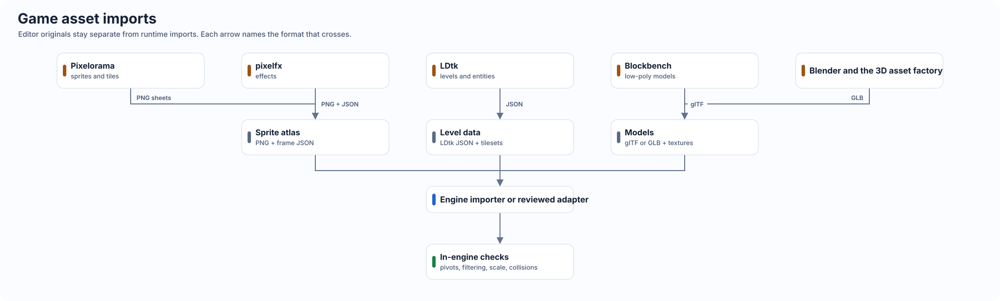

# Web 2D game

Ship a small 2D game that runs in the browser: Phaser with its bundled physics, pixel sprites and effects, optional LDtk levels, jsfxr sounds through one audio owner, optional Ink story, and automated browser tests.

## Objectives

- A vertical slice (controls, core loop, one level) playable from start to finish in desktop and mobile browsers.
- Physics, input and scoring checked by an automated browser test that steps the game at a fixed 1/60 s, as in the **tested** [fixtures/game-dev](../../fixtures/game-dev/README.md) `phaser-slice` check.
- Audio unlocks on first input; mute works; every story ending is reachable and save and resume work.

## Prerequisites and selection

Write the [game design document](../game-development/artifact-contracts.md#game-design-document) first: target browsers and devices, input, core loop, slice acceptance criteria, budgets and rights.

Use [Phaser](../repositories/phaser.md) (4.2.1 **tested**) with Arcade physics, or its bundled Matter for rotation and polygons. [Pixelorama](../repositories/pixelorama.md) for sprites and tiles (documented). [pixelfx](../repositories/pixelfx.md) for effects (sheet export **tested**; see [pixel effects](../expressive-motion/pixel-effects.md)). [LDtk](../repositories/ldtk.md) only when the game has hand-designed levels (documented; needs a reviewed loader or adapter). [jsfxr](../repositories/jsfxr.md) for effects (**tested**), played by Phaser's sound manager, or [Howler.js](../repositories/howler.md) when Phaser's audio is not enough (documented). [Ink](../repositories/ink.md) through inkjs only when the game has branching dialogue (**tested**).

Keep a single scene and code-drawn shapes when the brief tolerates it. The fixture draws its textures at runtime and needs no image assets.

Before setup, prove the existing toolchain cannot meet the acceptance criteria. Use the selected tool's pinned guide from the [index](../../REPOSITORIES.md). Review commands and record the revision in the project lockfile or tool manifest. Use [installation guidance](../../INSTALLATION.md) for isolated setup and [security review](../../SECURITY.md) before external processing.

## Rejected alternatives

| Not chosen | Why |
| --- | --- |
| A second `matter-js` package next to Phaser | Phaser bundles a modified Matter.js 0.20.0. Two copies give two engines that disagree. |
| Godot web export for a game embedded in an existing site | Godot's guide says Phaser or Babylon.js fit a small embeddable web bundle better. |
| Three.js or Babylon.js for a 2D game | A 3D renderer adds weight and has no 2D game toolkit to match Phaser's. |
| Howler.js and Phaser audio together | Two audio owners: two volume settings and two unlock paths. |
| Loading Phaser from a CDN in production | Normal web supply-chain risk. Bundle the pinned npm package. |

## Execution

1. **Scaffold and pin.** Install the pinned Phaser version and commit the lockfile. Configure the renderer, Arcade or Matter, and the scenes.
2. **Build the slice with placeholder shapes.** Player, platform, one pickup, one hazard, a win condition. Write the collision matrix and units (pixels) into the design document.
3. **Add the browser test now, not later.** Drive headless Chrome, take over the clock and step at 1000/60 ms, send keys and assert positions, overlaps and score. Expect held input to move one step late, because Phaser runs physics before `Scene.update()`. The fixture's manual stepping resets the private Arcade `_elapsed` field, which may break in a later Phaser; re-run after upgrades.
4. **Make sprites and tiles.** Draw in Pixelorama and export PNG sheets, or `.aseprite` where the loader expects Aseprite JSON. Export pixelfx effects as PNG plus Aseprite-style JSON. Keep sources in `art-src/` and exports in `assets/`, per [assets and levels](../game-development/assets-and-levels.md).
5. **Import and check.** Nearest filtering, whole-number scale, pivots, frame timing and hitboxes drawn over the art.
6. **Lay out levels (optional).** Design in LDtk; load the JSON through a reviewed loader or the Super Simple PNG and CSV export. Compare tile and entity counts with the editor.
7. **Add sound.** Generate effects with jsfxr from a seeded generator and save the parameters. Unlock audio on first input; add mute and volume. See [audio and narrative](../game-development/audio-and-narrative.md).
8. **Add story (optional).** Compile `.ink` to JSON, run it with inkjs, and test every ending plus save and resume.
9. **Playtest and measure.** Three players who match the brief, on the target devices. Record frame time, load time and bundle size.

## Asset contract

Design document → Pixelorama and pixelfx sources → PNG sheets plus frame JSON; LDtk source → level JSON; jsfxr parameters → WAV; `.ink` → compiled JSON → Phaser bundle → browser build. Each asset has a [manifest](../../templates/asset-manifest.json) entry with its source, export command and hash. See [artifact contracts](../game-development/artifact-contracts.md).

## Quality gates

Floor: the slice plays start to finish; the browser test passes on a clean install; no console errors on the primary path; keyboard reaches every menu control; audio unlocks and mutes. Reflex: same-state trace on reload; pixel sprites crisp at target scale; every story ending reached. Apply the engineering, accessibility and delivery rows of the [quality gates](../../QUALITY_GATES.md).

## Deliverables

Source project and lockfile, art sources and exports, level files, sound parameters and WAVs, story source and compiled JSON, browser test and its evidence, web build, playtest notes and the release manifest. Record tool versions, screenshots and any blocked checks using the [quality gates](../../QUALITY_GATES.md).

[Editable diagram](../diagrams/game-asset-imports.mmd)
