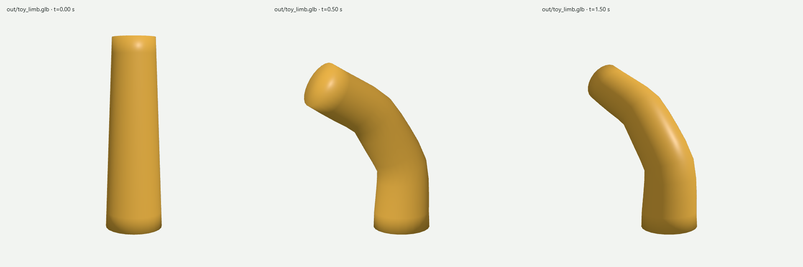

# Blender → GLB → Three.js fixture

Proves the catalogue's main 3D handoff by running it. Blender builds a small rigged, animated asset from code. The validator checks it after export, and Three.js loads it in headless Chrome and seeks its animation.



| File | Role |
| --- | --- |
| `make_asset.py` | Builds a 0.3 m tapered limb with ring topology, Smart UV Project UVs, one Principled material, a three-bone armature with automatic weights (limited to 4 influences and normalized) and a 48-frame `bend` action. Exports GLB and FBX. |
| `../../scripts/blender/validate_asset.py` | The catalogue's asset validator. Checks geometry, normals, UVs, color spaces, rig weights and animations, and writes a JSON report. |
| `viewer.html` | Loads a GLB with Three.js r187 `GLTFLoader` and exposes stats plus a seekable `AnimationMixer`. |
| `colorspace_test.py` | Negative test for the validator's color-space check: six materials, four wired wrongly on purpose. Exactly the four are flagged ([evidence](out/colorspace-test.json)). |
| `check.mjs` | Drives the viewer headlessly over DevTools (shared helper `../lib/cdp.mjs`) and checks the contract. |

## Run it

Requirements: Blender 5.x on `PATH` or by full path, Node 22+, Chrome or Chromium, FFmpeg, and network access to jsDelivr.

```sh
blender --background --factory-startup --python-exit-code 1 --python make_asset.py -- out
blender --background --factory-startup --python-exit-code 1 --python ../../scripts/blender/validate_asset.py -- out/toy_limb.glb out/report-glb.json
blender --background --factory-startup --python-exit-code 1 --python ../../scripts/blender/validate_asset.py -- out/toy_limb.fbx out/report-fbx.json
blender --background --factory-startup --python-exit-code 1 --python colorspace_test.py
node check.mjs
```

## Results on 2026-11-26

Blender 5.2.2 LTS, Chrome 158 headless with SwiftShader WebGL, three r187, Windows 11.

| Check | GLB | FBX |
| --- | --- | --- |
| Floor checks (geometry, manifold, normals, loose vertices, UVs, color spaces, weights) | Pass | Pass |
| Triangles | 624 | 624 |
| Vertices after import | 430 | 314 |
| Open boundary edges / after welding | 224 / 0 | 0 / 0 |
| Size (m) | 0.09 × 0.09 × 0.3 | 0.09 × 0.09 × 0.3 |
| Bones / unweighted / over 4 influences / not normalized | 3 / 0 / 0 / 0 | 3 / 0 / 0 / 0 |
| Action name after re-import | `bend` | `toy_rig\|toy_rig\|bend` |

Three.js side (`out/three-check.json`): it loads one skinned mesh with bones `root`, `mid` and `tip`, and the clip `bend` (2.0 s). Size is 0.3 m tall with Y up after the Z-up to Y-up conversion. The tip bone moves 5.9 cm at 0.5 s, and seeking the same time twice gives the same pose. All six checks pass.

## What the run taught

These lessons are written into the [3D pipeline guides](../../docs/3d-pipeline/asset-validation.md) and the [templates](../../templates/mesh-quality-report.md).

1. **glTF splits vertices along UV seams and hard edges.** A naive watertight check on an imported GLB fails, so the validator welds a copy before judging.
2. **FBX renamed the action** `bend` to `toy_rig|toy_rig|bend`. Record clip names in the export contract and check them after re-import.
3. **Blender's glTF importer adds an Icosphere bone-display helper.** The validator ignores bone custom shapes.
4. **Weight sums can pass while a joint still creases.** The stills show a crease at the middle joint with automatic weights. Test poses decide, not numbers alone.
5. **glTF carries four joint influences per vertex set.** Limit and normalize before export.
6. **Blender exits 0 when a `--python` script raises.** Pass `--python-exit-code 1`, or a crashed check looks like a pass.
