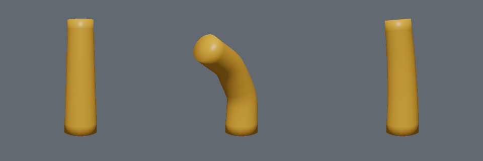

# Expressive-motion fixture

This fixture tests whether popular expressive-motion libraries can be driven by one authoritative frame clock for offline rendering, as the [time contract](../../docs/contracts/time-contract.md) requires. Every check seeks a library to story time `t`, reads back what the browser shows and compares it with values computed here. It also tests the catalogue's ownership rule: each animated property has exactly one owner.

It is a smoke test of the upstream libraries, not a reimplementation. The only upstream code that runs is the pinned library builds, plus pixelfx's own export tool in the optional fifth check.

## Run it

Requirements: Node 22 or newer, Chrome or Chromium (set `CHROME` if it is not found), FFmpeg on `PATH` for the contact sheet, and network access to esm.sh. The r3f check loads `../blender-glb/out/toy_limb.glb`, so run the [blender-glb fixture](../blender-glb/README.md) first if that file is missing.

```sh
node run.mjs                                   # all checks; re-verifies the pixelfx sample in out/pixelfx/
node run.mjs --only motion,theatre             # a subset; other entries are kept from the last run
node run.mjs --pixelfx <path to a pixelfx clone>   # also regenerate the pixelfx sheets from a clone
```

The script writes `out/result.json` and `out/r3f-sheet.png`. It exits 0 only when all four required checks pass and the optional pixelfx check did not fail. Each check uses a fresh headless Chrome, launched with `--disable-threaded-animation` through the shared helper [`../lib/cdp.mjs`](../lib/cdp.mjs). A full run takes about 40 seconds.

| File | Role |
| --- | --- |
| `run.mjs` | Runs the checks, computes expected values independently and writes the evidence |
| `pages/shared.js` | Pinned versions, the esm.sh URL builder, a cubic-bezier solver and DOM helpers |
| `pages/motion.html` | Motion `animate()` with an ease and a spring, paused and seeked |
| `pages/theatre.html` | A hand-written Theatre.js project state with one keyframed object |
| `pages/r3f.html` | React Three Fiber with `frameloop: 'never'`, the toy limb GLB and an `AnimationMixer` |
| `pages/ownership.html` | GSAP and Motion on one element: disjoint properties, then a deliberate conflict |

## Pinned versions

Every module loads from esm.sh at an exact version. The dependencies of `@react-three/fiber` are pinned too, through `?deps=`, so esm.sh does not float them within their semver ranges. `out/result.json` lists every module URL each page actually fetched.

| Package | Version | Package | Version |
| --- | --- | --- | --- |
| motion | 14.14.0 (with framer-motion 14.14.0, motion-dom 14.14.0, motion-utils 14.7.0) | react, react-dom | 19.3.1 |
| gsap | 3.15.1 | three | 0.187.0 |
| @theatre/core | 0.7.2 (with @theatre/dataverse 0.7.2) | @react-three/fiber | 9.8.2 |
| scheduler | 0.28.0 | its-fine | 2.1.1 |
| zustand | 5.1.0 | suspend-react | 0.1.3 |
| react-use-measure | 2.1.7 | use-sync-external-store | 1.7.0 |

## Results

Recorded on 2026-11-27 with Chrome 158 headless (SwiftShader WebGL), at 24 fps frame times.

| Check | Result | Key numbers |
| --- | --- | --- |
| `motion-seek` | Pass | Ease: 25 frame times over 1 s, monotonic, 0 to 200 px, max error 0.0004 px against an independent cubic-bezier(0.42, 0, 0.58, 1). Seeking the same `t` twice, in reverse order and in a fresh browser gives identical values. |
| motion springs | Seekable | Spring (stiffness 180, damping 9, mass 1): identical on repeat, reverse and fresh load. It matches the closed-form damped spring exactly until Motion's rest detection, then holds the target. Reported duration 1.5 s. The snap at rest is 0.24 px. Overshoot is 65.3 px. |
| `theatre-seek` | Pass | 49 frame times over 2 s. Max error 0 against the keyframes (a straight segment, then an ease-in-out segment). Repeat, reverse and fresh-load values are identical. The DOM follows the value. |
| `r3f-frameloop` | Pass | GLB loads with 1 skinned mesh, 3 bones (root, mid, tip) and the `bend` clip (2 s, 9 tracks). No frames render on their own in 600 ms. Each `advance()` renders exactly one frame. The same `t` gives byte-identical pixels twice, after a jump from another time and in a fresh browser. Times 0, 0.5 and 1.0 s give three different images. |
| `gsap-vs-motion-ownership` | Pass | Disjoint: GSAP x max error 0.0003 px, Motion opacity max error 0. Conflict detected and documented: see below. |
| `pixelfx-sheet` (optional) | Pass | pixelfx commit `5294518`. `ice/frost-nova`: 2592x2304 RGBA, 103 frame rectangles, all inside the PNG (847 KB, so not copied). `ice/ice-lance`: 528x512 RGBA, 24 rectangles, copied to `out/pixelfx/` (76 KB). |



## What each library needs to obey one clock

| Library | Seek call | Catch |
| --- | --- | --- |
| Motion | `controls.pause()` once, then `controls.time = t` | The DOM changes on the next animation frame, not at the assignment. A synchronous read returns the previous frame's value (85.7 px instead of 100 px at t = 0.5). Wait one frame before capture. `framecap` already waits two. |
| Motion springs | Same as above | Springs are evaluated in closed form, so they are seekable. They end at a computed duration (1.5 s here) with a small snap to the target. |
| Theatre.js (`@theatre/core`, no studio) | `sheet.sequence.position = t` | The value is ready synchronously. Project state is plain JSON, so it can be written or generated without the studio. |
| React Three Fiber | `frameloop: 'never'`, then `mixer.setTime(t)` and `advance(t)` with `t` in seconds (R3F copies it into `state.clock.elapsedTime`) | `advance` renders synchronously. Pixels were readable right after it, with `preserveDrawingBuffer` on. |
| GSAP | `tween.time(t)` on a paused tween or timeline | Writes synchronously. Its cached transform does not see writes from other libraries. |

## The ownership conflict, as evidence

Element `#c` was animated by GSAP (x from 0 to +200 px) and by Motion (x from 0 to -100 px), both seeked from the same `t`.

- Right after the seek, the DOM showed GSAP's value at every one of 24 moving frames. After two animation frames it showed Motion's value at all 24. Motion writes later, in its frame batch, so it wins whichever library is seeked first.
- At t = 0.5, GSAP still believed x was 100 px while the element showed `translateX(-50px)`. GSAP's cache disagreed with the DOM at 24 of 24 frames.
- With both libraries playing live on their own wall clocks, Motion won every frame of 40. There was no visible jitter in this order, but the outcome depends on when each library writes, not on intent.

So a conflict does not announce itself. Each library writes the whole `transform` string, the last writer wins and the loser's state goes stale. A capture taken at the wrong moment shows the other owner's value. This supports the catalogue rule: one owner per property. Split ownership by property (as `#a` does: GSAP owns x, Motion owns opacity, both correct) or by element. Never split it by time on the same property.

## pixelfx note

The optional check shallow-cloned [pixelfx](https://github.com/patch-gg/pixelfx) (MIT) at commit `5294518ce7c72e48b6100a744596e0acf57f2826` into a temporary folder outside the catalogue. `tools/render.mjs`, `tools/lib/fxlib.mjs` and `tools/lib/png.mjs` were read in full, and `src/` was searched for imports, Node APIs and network calls, before anything ran. The export needs no npm packages, makes no network calls and only writes PNG and JSON files to `--out` (FFmpeg is used only for `--gif` and `--mp4`). The export steps each effect with a fixed `1/fps` update per frame, which is a stepped clock in the time contract's terms. A sheet is a fixed set of frames, so a compositor should index it by `floor(t * fps)`. The PNG decoder in `run.mjs` is our own. Its alpha counts for `ice-lance.png` match Pillow's. Attribution for the copied sample is in [`out/pixelfx/NOTICE.md`](out/pixelfx/NOTICE.md).

## Limits

- Network is required: every library loads from esm.sh. esm.sh builds are pinned by version, but esm.sh could change its build output. Record the module list in `out/result.json` when results change.
- Byte-identical pixels are expected only on the same machine, browser build and graphics backend (SwiftShader here). Across machines, compare values, not pixels.
- `@theatre/core` 0.7.2 (Apache-2.0) is the latest release, from 2024-05-19. The Theatre.js repository's last push was 2024-08-14. It works, but treat it as unmaintained.
- GSAP uses a custom no-charge license, not an OSI license. See the catalogue's GSAP entry.
- The Motion checks use the vanilla `animate()` only, not the React `motion` components. The r3f check uses three's `GLTFLoader` through r3f's `useLoader`, not drei's `useGLTF`.
- The live (wall-clock) conflict run is informational. Its outcome depends on frame timing, so it does not gate the result.
