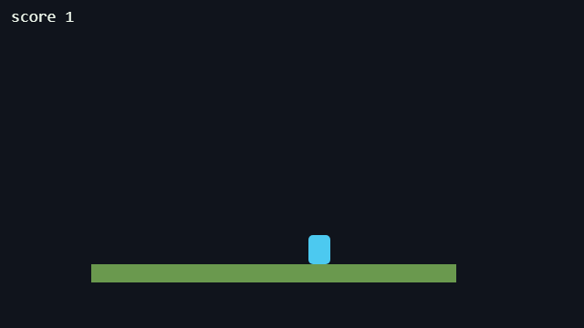
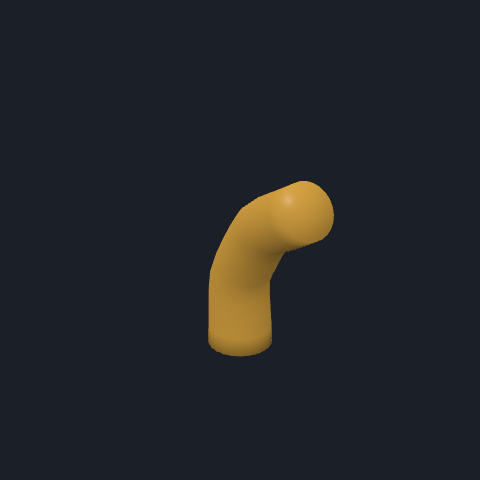

# Game-development handoff fixture

Smoke tests for the catalogue's game-development tools. Each check runs the real upstream library on a tiny scene of our own and asserts properties of the result. This fixture tests libraries. It does not re-implement them.

 

| Check | Library (pinned) | Where it runs | What it proves |
| --- | --- | --- | --- |
| `phaser-slice` | `phaser` 4.2.1 | Headless Chrome | Arcade physics with a fixed step, keyboard input sent over DevTools, overlap scoring, stepped without wall time |
| `matter-determinism` | `matter-js` 0.20.0 | Node | Same stack, same 300 steps, bitwise-equal end state, bodies at rest |
| `rapier-determinism` | `@dimforge/rapier2d-compat` 0.21.0 | Node | Same, plus equal world snapshots |
| `ink-branches` | `inkjs` 2.4.0 (compiler included) | Node | Compile `.ink`, walk every choice path, endings, variables, save and restore |
| `jsfxr-sfx` | `jsfxr` 1.4.1 | Node + FFmpeg | Jump and coin WAVs, checked by `ffprobe` and decoded RMS |
| `colyseus-room` | `@colyseus/core` 0.18.30, `@colyseus/ws-transport` 0.18.5, `@colyseus/schema` 5.0.52, `@colyseus/sdk` 0.18.10 | Node, 127.0.0.1 only | Server-authoritative room, two clients, rejected teleport, reconnect, clean shutdown |
| `babylon-glb` | Babylon.js 9.38.0 (`babylonjs` and `babylonjs-loaders` from jsDelivr) | Headless Chrome | Loads `../blender-glb/out/toy_limb.glb`: skinned mesh, bones, `bend` clip, 0.3 m height |

## Files

| File | Role |
| --- | --- |
| `run.mjs` | Runs the checks in order, each with a 180 s limit, and writes `out/result.json`. |
| `checks/*.mjs` | One module per check. Each returns `{ pass, details }`. |
| `web/phaser.html` | The Phaser scene. Textures are drawn at runtime, so there are no image assets. |
| `web/babylon.html` | The Babylon.js loader page. |
| `story/lantern.ink` | A short original ink story with three endings, two variables and a conditional choice. |
| `package.json`, `package-lock.json` | Pinned dependencies. `node_modules/` is ignored by `.gitignore`. |

The browser checks use the shared DevTools helper `../lib/cdp.mjs` and its loopback static server.

## Run it

Requirements: Node 22+, Chrome or Chromium (set `CHROME` if it is not in a standard place), FFmpeg with `ffprobe` on `PATH`, network access to jsDelivr for Babylon.js, and the Blender fixture's `../blender-glb/out/toy_limb.glb`.

```sh
npm ci --ignore-scripts --legacy-peer-deps
node run.mjs                 # all checks
node run.mjs ink-branches    # one or more by name
```

Exit code 0 means every selected check passed. `out/result.json` holds the numbers.

### Install notes

- The only package with an install script is `msgpackr-extract` (pulled in by `@colyseus/core` through `msgpackr`). Its script only looks for a prebuilt native binary. We install with `--ignore-scripts`; `msgpackr` falls back to plain JavaScript if no binary loads. No package needed its scripts.
- `--legacy-peer-deps` stops npm from pulling Colyseus's optional peers (auth, PM2, zod). `express` is listed directly because `@colyseus/ws-transport` imports it.
- We use `@colyseus/sdk` 0.18, not `colyseus.js`. The newest `colyseus.js` is 0.16, while `@colyseus/sdk` declares `@colyseus/core` 0.18.x as its peer. We did not test `colyseus.js` against the 0.18 server.
- Babylon.js comes from jsDelivr (pinned 9.38.0) instead of npm. The npm packages unpack to about 190 MB.

## Results on 2026-11-27

Node v24.14.0, Chrome 158 headless with SwiftShader WebGL 2, Windows 11. `node run.mjs` passed all seven checks on four runs, the last one after a clean `npm ci`.

| Check | Result | Key numbers |
| --- | --- | --- |
| `phaser-slice` | Pass | Lands at y = 274.0 (platform top 290 minus half of 32 px), `blocked.down` true, vy 0. Holding Right for 75 steps moves 197.33 px (74 steps × 160/60). Score 0 → 1 and the coin is disabled. After release, vx = 0. A reload gives an identical state trace. WebGL renderer. |
| `matter-determinism` | Pass | 10 boxes in a 4-3-2-1 pyramid, 300 steps of 16.67 ms. Both runs bitwise equal. Max speed 5.9e-7, max angular speed 8.3e-9. The pyramid still stands (top box y = 450.65). |
| `rapier-determinism` | Pass | 8 boxes, 300 steps of 1/60 s. Both runs bitwise equal and their world snapshots hash the same. All 8 bodies asleep. Top of the 5-box column at y = 2.2417 m (2.25 nominal; contact skin). |
| `ink-branches` | Pass | 0 compile errors. 4 paths reach all 3 endings (`beacon`, `home`, `map`). `courage` reaches 2 on the beacon path; `coins` ends at 2 after the trade. The coin-gated choice is hidden when coins < 3. A state saved at the crab and loaded into a new `Story` gives the same choices and the same text to the end. |
| `jsfxr-sfx` | Pass | `jump.wav`: 0.312 s, 44100 Hz mono `pcm_s16le`, RMS −12.2 dBFS. `coin.wav`: 0.274 s, same format, RMS −13.9 dBFS. Both rebuild byte-identical with the same seed. |
| `colyseus-room` | Pass | Server bound to 127.0.0.1. Both clients join one room and see the same state: tick 6, A at x = 6, B at (12, 4). A message carrying `x: 9999` is rejected and counted. `dx: 500` is clamped to one step. B drops, reconnects with its token, keeps its session and position, and its next move reaches both clients. The server shuts down cleanly. |
| `babylon-glb` | Pass | 1 skinned mesh, 1 skeleton, bones `root`, `mid`, `tip`. `bend` animation group with 9 targeted animations. Skinned height 0.3000 m. The tip bone moves 5.9 cm at a quarter of the clip, which matches the Three.js result in `../blender-glb`. |

## Limits and simplifications

- **Phaser input lag is one step.** Phaser runs the physics step before `Scene.update()`. A velocity set in `update()` takes effect on the next step. The check expects this one-step delay.
- **Phaser stepping uses a private field.** To take over the clock, the page sleeps `game.loop`, empties the Arcade world's `_elapsed` accumulator and calls `game.step(t, 1000/60)` by hand. `_elapsed` is not public API and may change.
- **Determinism is same-machine only.** Both physics checks compare two runs in one process. They do not prove cross-platform determinism. For that, Rapier publishes separate `-deterministic` builds.
- **jsfxr presets use `Math.random`.** The check swaps in a seeded generator while rendering so the WAVs repeat. The coin preset hits full scale on 3 samples (peak 1.0). That is the preset's own level, not a test failure.
- **The ink walk is exhaustive only because the story is small.** It tries every choice at every point.
- **Colyseus reconnect is the manual path.** The SDK's automatic reconnection is turned off so the test exercises `client.reconnect(token)` and the server's `allowReconnection` in `onDrop`.
- **Babylon.js needs the network** to load from jsDelivr. Everything else runs offline once `npm ci` is done.
