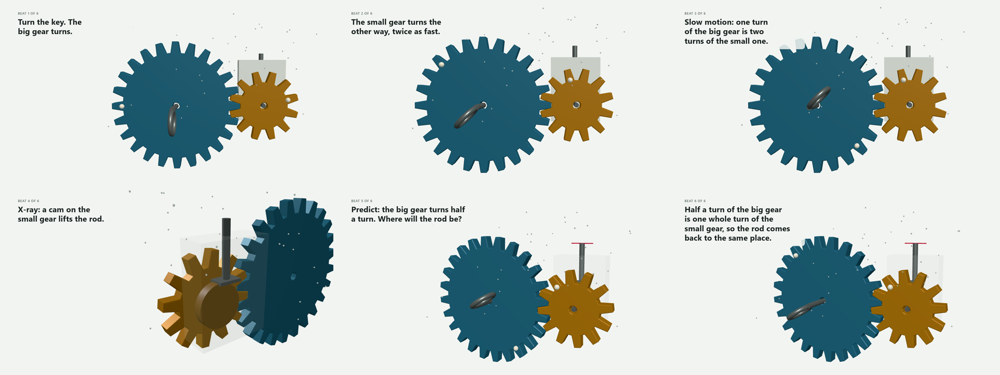

# Seekable scene fixture

One Three.js scene that is both a live explorable and a rendered film, from the same code and the same clock. It is the executable proof of the [time contract](../../docs/contracts/time-contract.md).

The scene teaches one idea in six beats: a large gear drives a small gear twice as fast the other way, and a cam on the small gear lifts a rod. Beat 5 asks the learner to predict where the rod will be after half a turn of the large gear. Beat 6 shows the answer: the rod is back where it started.



| File | Role |
| --- | --- |
| `scene.js` | The scene. Every visible value is a pure function of story time `t` and a seed. Exposes `setTime`, `setBeat`, `setSize` and `digest`. |
| `index.html` | Live mode: wall clock, play and pause, scrubber, beat buttons, keyboard, reduced motion and the prediction question. `?render` hides the controls for the film. `#t=12.5` or `#beat=5` opens paused at that exact state. |
| `contact-sheet.png` | The six beat stills from the latest render. |
| `render.mjs` | Frame renderer with no npm dependencies. Drives headless Chrome over the DevTools protocol, seeks frame by frame, encodes with FFmpeg and writes `out/evidence.json`. |

## Run it

Requirements: Node 22 or newer, Chrome or Chromium, FFmpeg on `PATH`, network access to jsDelivr for `three@0.187.0`.

```sh
node render.mjs            # 30 fps, writes out/seekable-scene.mp4, out/beat-*.png, out/live-beat5.png and out/evidence.json
node render.mjs --fps 60   # any rate: the scene has no notion of frames
```

To explore it live, serve this folder over HTTP (ES modules do not load from `file://`) and open `index.html`:

```sh
python -m http.server 8000
```

## What the renderer proves

| Check | Method | Fails when |
| --- | --- | --- |
| `seekable` | Render all frames in order, then jump to frames out of order in the same page and compare PNG bytes | State depends on what was rendered before, e.g. `phase += dt` |
| `repeatable` | Render the probe frames again in a fresh browser and page load | Unseeded randomness, wall-clock reads, load-order effects |
| `pauseToPlay` | Open the live page at each beat's `#t=` link and compare its state digest with the film frame | The live page and the film disagree about the same moment |
| `stream` | ffprobe the MP4 for size, frame rate, decoded frame count and duration | The encode drops, duplicates or retimes frames |

Recorded on 2026-11-26: Chrome 158 headless with SwiftShader WebGL, three r187, FFmpeg 7.1. 600 frames at 1280×720 rendered in about 60 seconds, and all four checks passed. Byte-identical frames are expected only on the same machine, browser build and renderer. Across machines, compare `digest()` values, which are rounded scene state, not pixels.

## Carry it into a real compositor

`window.__scene.seek(t)` is the whole integration surface:

- **HyperFrames** renders seekable animations to deterministic MP4. Register the scene's seek as the composition's time source and keep `setTime` free of side effects.
- **Remotion** drives time with `useCurrentFrame()`. Call `setTime(frame / fps)` inside `@remotion/three`'s `ThreeCanvas`, or render the canvas yourself.
- **Motion Canvas** advances generators in time. Call `setTime` from a time signal and draw the canvas as an image node.
- **Plain FFmpeg**, as here: numbered frames at an explicit `-framerate`.

HyperFrames documents seekable-animation rendering and Remotion publishes `@remotion/three` (npm 4.0.547 on 2026-11-26). The Motion Canvas route is a proposal. None of the three is tested here: the DevTools route in `render.mjs` is the one this fixture proves.
