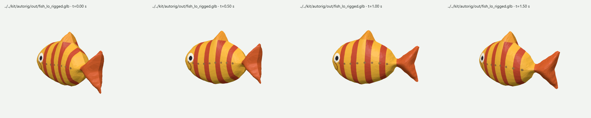

# autorig

Predicts a bone chain and skin weights for a mesh, adds a looping test clip, and exports GLB and FBX. Runs inside Blender.

**Stands in for:** [UniRig](../../docs/repositories/unirig.md)'s skeleton and skinning prediction, for chain-shaped bodies: fish, tails, tentacles, snakes, limbs, toy segments.



## How it works

1. **Main axis.** PCA of the vertices gives the body's principal axis.
2. **Joints.** The axis is cut into equal spans, and each joint sits at the centroid of the vertices in its slice. The skeleton follows the body's centreline, not a straight line.
3. **Root.** The root goes at the thicker end, measured along the thinnest principal axis. Counting vertices is the wrong rule: a wide, thin fin holds more vertices than a head. `--root first|last` overrides it.
4. **Weights (our own `segment` mode).** Each vertex is weighted by the inverse fourth power of its distance to each bone segment, keeping the three nearest. `--weights heat` uses Blender's automatic weights instead.
5. **Clean-up.** Weights are limited to 4 influences and normalized, as glTF requires.
6. **Clip.** `swim` sends a travelling wave down the chain, growing toward the free end. `bend` curls it in one plane.

## Use

```sh
blender --background --factory-startup --python-exit-code 1 --python autorig.py -- in.glb out/ --bones 4 --anim swim
blender --background --factory-startup --python-exit-code 1 --python autorig.py -- arm.obj out/ --bones 3 --anim bend --root first
```

Writes `<name>_rigged.glb`, `<name>_rigged.fbx` and `<name>_rigged.rig.json` (axis, joints, bone lengths, end thicknesses).

## Test

```sh
python test.py
```

The test inflates the toy fish, remeshes it to 2,400 faces, rigs it with 4 bones and a swim clip, validates the result in Blender, then loads it in Three.js r187 in headless Chrome and seeks the clip. Result on 2026-11-26: **pass, 12 of 12 checks**.

- The chain runs along the fish's length with even bones (0.080–0.082 m) and its root at the head.
- The [Blender validator](../../scripts/blender/validate_asset.py) passes every Floor check. Weights are normalized with at most 4 influences, and no vertex is unweighted.
- Three.js loads one skinned mesh with 4 bones and the `swim` clip. The tail bone sweeps 0.10 m, and seeking the same time twice gives the same pose.

The first version rooted the chain at the tail: the fin's many vertices won the old "heavier end" rule, and the head swam instead of the tail. The stills caught it, not the numbers. The thickness rule replaced it.

## What it does not do

One chain per mesh. No branching skeletons (bipeds, quadrupeds, hands), no bone roll design, no IK or controls. For characters, use UniRig or a hand rig, then check it with the [rig validation report](../../templates/rig-validation-report.md).
