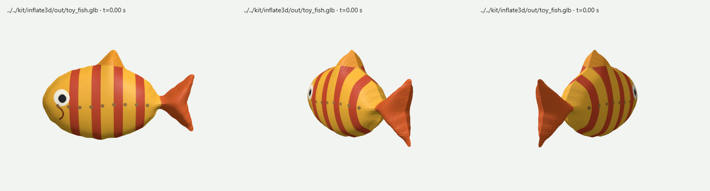

# inflate3d

One image of an object in, a closed, textured GLB out. It inflates the object's silhouette like a balloon, so no neural network is involved.

**Stands in for:** [Stable Fast 3D](../../docs/repositories/stable-fast-3d.md), [SAM 3D Objects](../../docs/repositories/sam-3d-objects.md) and [TRELLIS.2](../../docs/repositories/trellis-2.md) as the first step of the 3D asset factory.



## How it works

1. **Mask.** Uses the image's alpha, or keys out the corner background color when there is none. Keeps the largest object and fills holes.
2. **Grid.** Samples the mask on a grid (`--res` cells along the longer side) and makes two triangles per inside cell, with the front facing +Z.
3. **Chords.** Splits interior edges whose two ends both sit on the rim, the one-cell-wide strips at fin tips. Without this, the front and back would share them and the mesh would not be closed.
4. **Silhouette.** Smooths the rim along each boundary loop to remove the pixel staircase.
5. **Height.** Gives each vertex `sqrt(2·D·d − d²)`, a round cross-section, where `d` is its distance to the edge and `D` the object's half-width. That height is scaled by `--thickness` and smoothed over the mesh. An optional `--depth` map adds relief from any depth estimator.
6. **Back.** Mirrors the front, sharing the rim vertices, so the mesh is watertight. Front and back use one planar UV projection: no UV seam.
7. **Output.** Scales to `--height` meters with its base on y = 0. Exports a GLB whose base-color texture is the source image, with edge colors bled outward so filtering never picks up the background.

## Use

```sh
python inflate3d.py toy.png out/toy.glb --height 0.2
python inflate3d.py photo.jpg out/thing.glb --res 128 --thickness 0.8 --depth photo_depth.png --depth-scale 0.4
python make_toy.py out/toy_fish.png   # draws the original test toy
```

A JSON report is written beside the GLB: input hash, parameters, counts, watertightness and size.

## Test

```sh
python test.py
```

Result on 2026-11-26: **pass, 9 of 9 checks**.

| Check | Result |
| --- | --- |
| Watertight, positive volume | Yes |
| Height | 0.200 m as requested; 0.335 × 0.2 × 0.103 m overall |
| Texture and UVs present, UVs in 0–1 | Yes |
| Silhouette against the drawing (IoU) | 0.913 |
| White-background JPEG keyed without alpha | Yes |
| [Blender validator](../../scripts/blender/validate_asset.py) Floor and Reflex checks | All pass, including watertight and no n-gons |

## What it does not do

It cannot see the back or the side of an object: the back is a mirrored inflation, and both faces show the same image. Concave and overhanging shapes come out as puffy versions of the silhouette. That suits toys, badges, characters drawn in profile and stylized props, not accurate scans. For real reconstruction, use a learned model from the catalogue and record which one in the [asset manifest](../../templates/asset-manifest.json).
