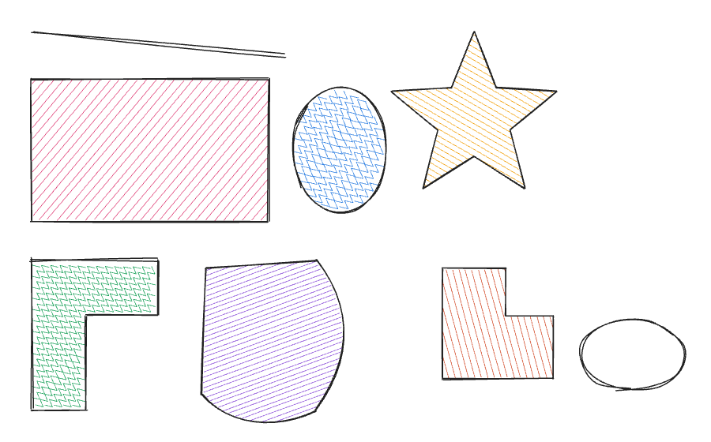

# sketchy

Hand-drawn looking SVG shapes from a seeded generator. Lines, rectangles, ellipses, polygons and SVG paths are drawn as two slightly different pen strokes, with optional hachure or zigzag fill. The same seed always gives the same drawing.

It stands in for **Rough.js** (its SVG output path). It is our own code, written from general geometry: jittered cubic Bézier strokes, Catmull-Rom curves for ellipses, and even-odd scanline fill.



## Usage

```js
import { createGenerator, toSvg } from './sketchy.mjs';

const g = createGenerator(42);                       // seed
const shapes = [
  g.line(40, 40, 360, 70, { roughness: 1.5 }),
  g.rectangle(40, 100, 300, 180, { fill: '#e0457b', hachureGap: 9 }),
  g.ellipse(430, 190, 120, 160, { fill: '#2a7de1', fillStyle: 'zigzag' }),
  g.polygon([[0, 0], [80, 10], [40, 70]], { fill: '#f2a516', hachureAngle: 30 }),
  g.path('M260 340 L400 330 Q470 420 400 520 C350 545 290 540 255 500 Z', { fill: '#8a4fd8' }),
];
const svg = toSvg(shapes, { width: 900, height: 560, background: '#fff' });
```

Each call returns `{ shape, options, sets }`, where `sets` is a list of `{ type: 'stroke' | 'fill', d }` with SVG path data. Use `toSvgElement(drawable)` for the `<path>` elements alone, or read `d` directly for canvas or another renderer.

| Option | Default | Meaning |
| --- | --- | --- |
| `roughness` | 1 | Hand jitter. 0 draws the exact geometry. |
| `bowing` | 1 | How much straight lines bend in the middle. |
| `stroke`, `strokeWidth` | `#222`, 1.5 | Outline pen. |
| `passes` | 2 | Pen strokes per outline. |
| `fill` | null | Fill line color. null means no fill. |
| `fillStyle` | `hachure` | `hachure` (parallel lines), `zigzag` or `none`. |
| `hachureAngle`, `hachureGap` | -50, 8 | Fill line angle in degrees and spacing in px. |
| `fillWeight` | strokeWidth / 2 | Fill line width. |
| `seed` | null | Per-shape seed. Without it a shape takes the next values from the generator's stream, so output depends on call order. |

Paths support `M L H V C Q Z` in absolute and relative form. Quadratic segments are converted exactly to cubics. Fill uses the even-odd rule, so holes in multi-ring paths work.

Other exports: `parsePath(d)`, `strayBounds(len, roughness, bowing)` (how far a stroke may stray from the true line), `insidePolygons(p, rings)`, `cubicAt(...)` and `randomStream(seed)`.

### How it draws

- A straight segment becomes one cubic Bézier per pen pass. Both ends move by up to `roughness × clamp(len / 100, 0.5, 2)` px in x and y. The control points sit at about 25% and 75% along the line, pushed sideways by a shared bow (`bowing × roughness × len / 200`) plus a little jitter. The second pass uses smaller offsets so the two strokes stay close.
- An ellipse is a closed Catmull-Rom curve through jittered points. Each pass starts at a random angle and runs a little past its start, like a pen closing a loop.
- Fill lines come from scanlines in a rotated frame. Each line is shortened slightly, drawn with half the roughness, and sampled; if any sample leaves the shape, it is redrawn calmer, and as a last resort straight. Zigzag fill joins neighbouring scan rows with diagonal teeth where their spans overlap.

## What it does not do, compared with Rough.js

- SVG path data only. No canvas renderer and no DOM helpers.
- Paths have no arcs (`A`) and no smooth-curve shorthands (`S`, `T`). There are no separate arc, curve or open-polyline shape types.
- Fill styles: hachure and zigzag only. No solid, cross-hatch, dots, dashed or sunburst fills.
- Path fill flattens curves into 16 straight steps, so fill lines can stop up to that chord error short of a curved edge.
- The random stream is our own (xorshift32), so drawings do not match Rough.js output for the same seed.

## Test

```sh
node test.mjs
```

The test draws a demo sheet with every shape and both fill styles, including a concave star, a concave L-shape, a curved path and a relative-command path. Results (26 Nov 2026, Chrome 158):

| Check | Result |
| --- | --- |
| `determinism`: seed 42 twice gives identical SVG; seed 43 differs | pass |
| `fillInside`: every fill curve sampled 33 times against an independent fine model of the true shape | pass: 26,000 samples over 6 shapes, 0 outside |
| `strokeBounds`: 32 line strokes at roughness 0.5 to 3, plus a rectangle; ends within the jitter bound, every point within the curve bound; two different strokes per segment; roughness 0 is exact | pass: worst endpoint at 0.91 of its bound, worst curve point at 0.28 |
| `pathParser`: relative `m l h v q z` resolve to the right absolute points | pass |
| `rasterize`: the SVG loads in headless Chrome, `out/sheet.png` is written, and ink and fill colors are present | pass: 9.3% of pixels inked |

Outputs: `out/sheet.svg`, `out/sheet.png`, `out/raster.html` and `out/result.json`. The SVG is passed to Chrome as a data URL because the shared static server does not label `.svg` files as images.
